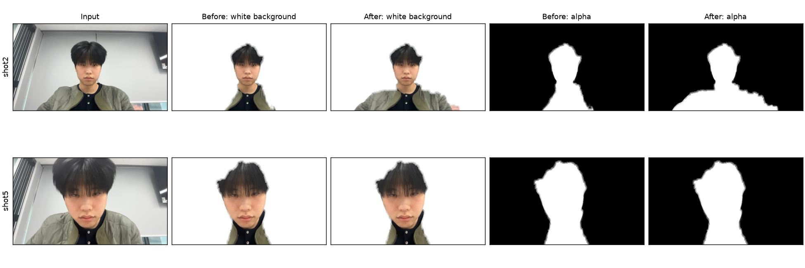
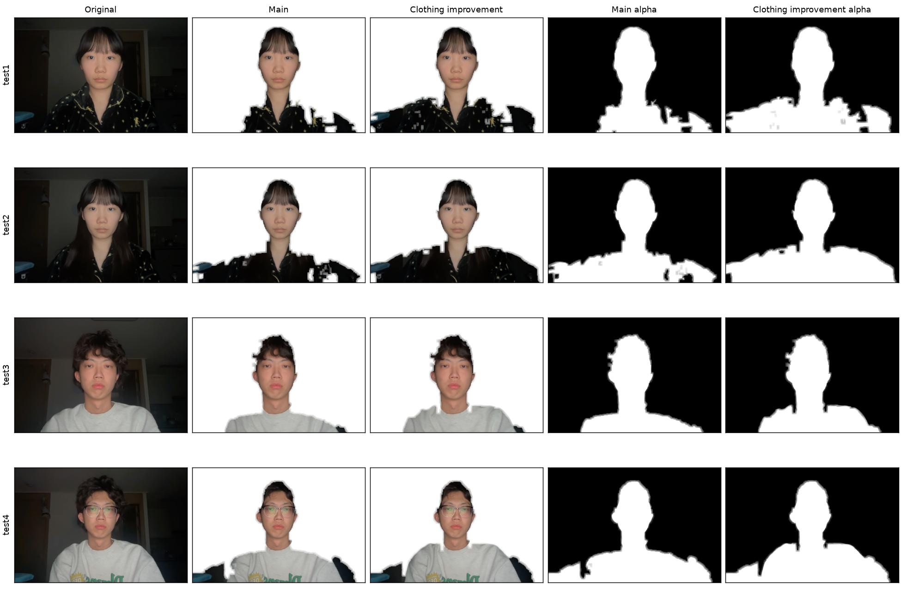
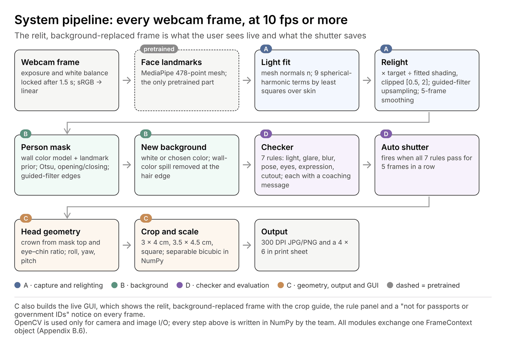

[English](README.md) | [한국어](README_kr.md)

# Module B experiment: recovering clothing

## All twelve photos: results first

**The extra clothing model recovers missing fabric, but does not solve general portrait segmentation.**
These photographs have **no ground-truth masks**. Added mask pixels below are change counts at
alpha > 0.5, **not accuracy, recall, or confirmed clothing pixels**. Some additions are background.
All observations refer to image-left/image-right, not the sitter's left/right.

| Photo | Added pixels, live | Observation and remaining failure |
|---|---:|---|
| shot2 | 15,927 | Much more khaki jacket; outer sleeves and a small bright hole still missing. |
| shot3 | 7,916 | More jacket on both sides; substantial left sleeve still missing. |
| shot4 | 6,699 | More outer jacket; right-side room clutter is still retained. |
| shot5 | 0 | Unchanged failure: the close-up leaves no chest samples in frame, so recovery is skipped. |
| test1 | 26,880 | More black patterned top; large shoulder gaps and dark-room leakage remain. |
| test2 | 15,067 | More patterned top; dark objects remain joined at the sides. |
| test3 | 7,138 | More gray shirt near the neck/shoulder; a notch near the neck remains. |
| test4 | 7,185 | More gray shirt near the shoulder; blue object and dark side clutter remain. |
| test5 | 12,618 | Right white shoulder is recovered; left-side wall strip remains foreground. |
| test6 | 11,753 | More outer white shirt; wall behind the shoulders is also added, a regression. |
| test8 | 15,664 | Outer black sleeves recovered; collar notches and blocky edges remain. |
| test9 | 34,428 | More dark hoodie; shadow-side gaps and dark background attachment remain. |

Baseline: main commit `e96bb08cb678634207ea3aa45f086152c4c96f11`.
Input width is 640 px, relighting strength is zero to isolate Module B, background is white,
models start cold, and landmarks are identical within each before/after pair.
The columns are **input / before composite / after composite / before alpha / after alpha**.
Labels are outside the photographs; no text is painted over them.

### Jackets: shot2, shot3, shot4, shot5



### Dark room: test1, test2, test3, test4



### Other backgrounds: test5, test6, test8, test9


The [live measurements](docs/evaluation/clothing/measurements.csv) record all 12 photos,
including skip status, available seed counts, thresholds, and single-run matting times.
Across the set, 161,275 pixels cross upward through alpha 0.5 and 9 cross downward.
Recovery only adds to the binary mask **before** cleanup; guided-filter recomputation can still
move a few existing edge pixels below 0.5. More mask area is not evidence of better segmentation.

The shutter algorithm was also run with `s=1` on the **same 640-px inputs**, rather than the
live algorithm's `s=2`: [measurements](docs/evaluation/clothing/full-grid/measurements.csv),
[jackets](docs/evaluation/clothing/full-grid/comparison-1.jpg),
[dark room](docs/evaluation/clothing/full-grid/comparison-2.jpg),
[other backgrounds](docs/evaluation/clothing/full-grid/comparison-3.jpg).
It adds 122,211 pixels and removes 6 at alpha 0.5. Differences are substantial:
shot2/shot4 retain fragmented shoulders, while shot3 improves more than in live mode.
**These are not original-resolution export results**, and not a claim that live and saved
edges match. The application's rule-7 fallback can keep the original wall on export;
the comparison deliberately displays the requested white composite even on a failed cutout.

## Motivation and diagnosis

If the existing matting method is unfamiliar, first read the
[Module B matting README](https://github.com/hanbin5/relight/blob/module-b/matting/README.md)
([Korean](https://github.com/hanbin5/relight/blob/module-b/matting/README_kr.md)).
This report covers only the clothing experiment, not that entire pipeline.

The old gate serves two incompatible purposes: the person cannot exist beyond it, and every
pixel beyond it is eligible to train the wall model. A sleeve that slightly exceeds the
assumed shoulder shape can therefore both be excluded and teach the model that its fabric
is background. A color already assigned to a dark object elsewhere in the room can also
outvote dark clothing. Finally, the old foreground samples mix face, hair, neck, and a narrow
chest. A black inner top can dominate that chest, leaving the khaki outer jacket unrepresented.
Color evidence and the Otsu threshold can then defeat the torso's 0.7 prior.

These are mechanisms confirmed with the code and controlled synthetic scenes below.
Earlier reports about particular photo pixels were diagnostic observations, not annotations;
they were not reused as ground truth or reported as measured accuracy here.

## Experiments and selected method

| Experiment | Motivation | Observed result / decision |
|---|---|---|
| Widen global chest samples and move the global shoulder gate upward | Represent jackets and protect shoulders from wall sampling | More fabric, but retrained background/foreground models and changed Otsu also altered hair in shot3/test9. Rejected. |
| Separate clothing models with guarded background samples | Improve the body without retraining the head model | Restores the jacket in shot2 and white shoulder in test5; selected. |
| Tighten clothing shade scaling and require a supported clothing color | Avoid explaining a darker wall as shaded white fabric, or accepting colors unseen by either model | Limits additions, but cannot eliminate test6 wall leakage. Selected with this limitation. |
| Add supported clothing instead of replacing existing body labels | Avoid new holes in collars and patterned fabric | Preserves existing foreground before morphology, but also preserves existing false foreground. Selected. |

Only NumPy processing is added. There is no segmentation model, depth model, calibration frame,
manual per-photo ROI, OpenCV processing, or photo-specific name/threshold in the app.

The separate models are warmed across frames and cleared by `Matter.reset()`. If fewer than
50 foreground or protected-background pixels are available on the processing grid, this
additional pass is skipped and its cached models are cleared on an updating frame.
The skip and both counts are exposed in `ctx.stats["matting"]`; a frame-border sampling
fallback is **not** used to train the extra clothing model.

### Settings

Distances below use the existing landmark-derived face width (`fw`), eye-to-chin length
(`ec`), and midline. They scale with the frame, not with a particular photograph.

| Setting | Value |
|---|---|
| Clothing search start | Chin + 0.2 ec |
| Shoulder widening | Square-root progression over 0.8 ec; half-width 0.6 fw to 2.8 fw |
| Gate fade | 0.25 fw outside that half-width |
| Background guard | Below chin, exclude the half-width plus 0.6 fw from old background seeds |
| Clothing samples | Chin + 0.65 ec through chin + 2.5 ec; tapered half-width 0.35 fw to 1.0 fw |
| Sampling taper | Square-root progression over 1 ec after chin + 0.65 ec |
| Clothing prior | 0.5 at the margin to existing `PRIOR_TORSO=0.7` in the inner torso |
| Neck protection | Recover below chin + 0.65 ec, or farther than 0.45 fw from the midline |
| Color models | Existing 8 background / 5 foreground clusters, at most 2,000 samples each |
| Sampling RNG seeds | 3 for clothing background, 4 for clothing foreground |
| Cold / warm k-means | 8 / 3 iterations, as in the original models |
| Clothing shade scale | 0.8 to 1.2 in linear intensity; square root for the color-distance calculation |
| Supported color | Foreground distance strictly below existing `OUTLIER_DISTANCE=2.5` |
| Score cutoff | Original frame's Otsu threshold, still clipped to 0.35 through 0.65 |
| Cleanup, refinement | Existing opening, closing, face connectivity, holes and guided filter unchanged |

The guarded background model is for **clothing scoring only**. Head models, wall statistics,
plain-wall check, and local-spill estimation retain their original definitions. In particular,
this does not claim to purify all background estimates throughout the old pipeline.

## Controlled regressions

The tests render a known face and construct wider, earlier shoulders. These synthetic masks
are known exactly, unlike the real photographs. Both live and shutter-grid paths are tested.

| Synthetic target | Target pixels | Baseline retention, live / full grid | After retention, both |
|---|---:|---:|---:|
| Khaki jacket outside a black inner top | 13,932 | 0% / 0% | 100% |
| White sleeve pixels outside the old gate | 658 | 0% / 0% | 100% |
| Dark top with separate dark room clutter | 26,304 | 95.38% / 95.15% | 100% |

After recovery, false foreground in these controlled scenes occupies about 0.013% to 0.016%
of the **whole image**, not of the background. Assertions require target retention above 98%
and false foreground below 0.5% of the image. Additional tests cover the sampling guard and
warm-state clearing when the chest is cropped. These simple scenes establish the repaired
mechanisms; they do not establish real-world accuracy or solve identical fabric/wall colors.

## Reproduce

```bash
uv sync --group dev
uv run python tools/fetch_model.py
uv run python tools/eval_clothing.py
uv run python tools/eval_clothing.py --full-grid --out docs/evaluation/clothing/full-grid
uv run pytest tests/test_matting_checker.py -q
uv run pytest -q
```

The first evaluation writes the three live comparison sheets and `measurements.csv`.
The second writes the same twelve comparisons for the full-grid algorithm.
The default baseline is the fixed main SHA above; `--baseline SHA` overrides it.
The tool loads that revision's matting implementation and uses unchanged common settings.
Cached image-mode landmarks live in `out/clothing-landmarks/`; choose a fresh `--cache`
directory to detect them again. A missing image or missing face is an error, never silently skipped.
`test9.jpg` was restored unchanged from commit `e8e798c8eee3118bebba4ba8f34c37808f84c250`
on `module-b/person-prior`; no other code from that branch is included.

Validation on this branch: **198 tests passed**, including **28 matting/checker tests**.
The CSV timings are single cold-run diagnostics on mixed image heights, not a latency or
10-fps claim. Original-resolution rendering, sustained webcam performance, landmark jitter,
and warm-start real-photo sequences were not evaluated in this experiment.

## Limits and consequence

This is a bounded clothing-recovery improvement, **not a generally clean cutout**.
It cannot infer an unseen jacket from a close-up with no chest samples (shot5), reliably
separate equal-colored room objects from fabric (test1/test2/test9), remove the old left-wall
strip (test5), or avoid every newly attached background region (test6).
Assumed anatomy can fail on crossed arms, unusual posture, or an occluded chest.
The existing checker and original-wall export fallback remain necessary.
Hand-drawn masks and temporal/original-resolution evaluation are still required before
making accuracy or production-readiness claims.

---

# ID Photo: webcam ID photos with live relighting

A Python desktop app that turns a webcam session into résumé (3 × 4 cm), student or employee ID (3.5 × 4.5 cm) and square profile photos, plus 6 × 4 in print sheets. Every frame is relit to an even light from the face mesh, the background is replaced, and seven checks run before the shutter. The plan, formulas and thresholds are in [docs/id-photo-survey-plan-v2.md](docs/id-photo-survey-plan-v2.md).

The photos are edited (relit, background replaced), so the app is **not for passports or other government IDs**. It says so on screen and in every saved file.

## Quick start

Requires [uv](https://docs.astral.sh/uv/). Python 3.12 is pinned in `.python-version`.

```bash
uv sync
```

```bash
uv run python tools/fetch_model.py
```

The second command downloads MediaPipe's face landmark model (3.6 MB) to `models/` if it isn't there yet. Then start the app:

```bash
uv run idphoto
```

Other ways to run it:

```bash
uv run idphoto --source demo
```

```bash
uv run idphoto --source photo.jpg --lang en
```

- `--source`: camera index (default `0`), `demo` (a synthetic sitter, no camera needed), or an image or video file.
- `--lang ko|en`: interface language (default: the system language). The panel's language button switches it live.
- `--camera-size 1920x1080`: request a larger camera frame for sharper saved photos.

In the app, hold **B** to see the frame before processing, and press **Space** to take a photo without waiting for the auto shutter.

On macOS, the first start asks for camera access on behalf of the app you launched it from (Terminal, iTerm and so on): click Allow and the live view starts. If no dialog appears, which can happen in an editor's built-in terminal, run it from Terminal, or turn that app on in System Settings → Privacy & Security → Camera and restart it.

## What happens to each frame



| Step | Module (owner) | File | Plan |
|---|---|---|---|
| Camera, exposure and white-balance lock, lock check | A | [capture.py](idphoto/capture.py) | B.2 |
| sRGB → linear, luminance | A | [color.py](idphoto/color.py) | B.2 |
| 478 face landmarks (the only pretrained part) | C | [landmarks.py](idphoto/landmarks.py) | A.3 |
| Mesh normals, 9-term SH light fit, ratio relighting, 5-frame average | A | [relight.py](idphoto/relight.py), [mesh.py](idphoto/mesh.py) | B.2 |
| Background and person color models, score, Otsu, opening/closing, guided filter, spill removal, compositing | B | [matting.py](idphoto/matting.py) | B.3 |
| Crown, pose, crop and scale, print sheet, 300 DPI files | C | [geometry.py](idphoto/geometry.py) | B.5 |
| Seven checks with coaching messages, auto shutter | D | [checker.py](idphoto/checker.py) | B.4 |
| Glue, settings, shutter render | all | [pipeline.py](idphoto/pipeline.py) | 2.2 |
| GUI (Korean/English) | C | [gui.py](idphoto/gui.py), [i18n.py](idphoto/i18n.py) | Fig. 4 |

All modules exchange one [`FrameContext`](idphoto/context.py) (B.6). Image processing is NumPy only ([npimg.py](idphoto/npimg.py): box filters from cumulative sums, guided filter, Laplacian, Otsu, morphology, separable bicubic resampling, polygon fill, triangle rasterizer). OpenCV is used only to open the camera and to read and write image files.

Every starting value from B.2–B.5 is in [config.py](idphoto/config.py), so tuning in weeks 2–5 happens in one file.

The live view runs on frames downscaled to 640 px wide. When the shutter fires, the same camera frame is processed again at full resolution with the live light average, and that is what gets saved.

## Saved files

**Save…** in the result window writes a folder `idphoto_YYYYmmdd_HHMMSS/` with:

- `resume_3x4cm.jpg` (354 × 472), `id_3.5x4.5cm.jpg` (413 × 531), `profile_800px.jpg` (800 × 800), all marked 300 DPI;
- `print_sheet_resume_3x4cm_6x4in.jpg` (10 photos) and `print_sheet_id_3.5x4.5cm_6x4in.jpg` (8 photos), 1800 × 1200 at 300 DPI;
- `report.json`: the seven check values, R_LR before and after, the fitted light, crown and crop boxes. This is data for the evaluation in C.1.

Everything stays on the computer. Nothing is uploaded.

## Tools

| Command | What it does |
|---|---|
| `uv run python tools/relight_demo.py` | Reproduces Figure 3 with the real code: prints R_LR and shadow share before and after, saves `out/relight_demo.png` |
| `uv run python tools/eval_synthetic.py` | Synthetic version of C.1: R_LR over a sweep of side lights, mask IoU against the true mask, staged faults and per-rule recall |
| `uv run python tools/eval_checker.py testset/` | Precision and recall of each checker rule on real photos sorted into one folder per staged fault (C.1); saves every measured value to `out/checker_eval.csv` |
| `uv run python tools/bench_fps.py` | Frames per second of the full live pipeline on this machine (target ≥ 10) |
| `uv run python tools/process_image.py photo.jpg` | Runs the pipeline on still photos and saves the same files as the app |
| `uv run python tools/crown_inspector.py photo.jpg` | Crown and crop checking window: both crown cues, the crop box and the saved photo, with sliders for k, the mask band and the head share. Click the top of the hair to mark the true crown (Shift+click marks the skull top on a photo with the hair flattened); it shows the head-length error in mm and the best-fit k, and compares head mode with the experimental face mode. `--demo` uses synthetic faces |
| `uv run python tools/check_lock.py` | Tests the webcam's exposure / white-balance lock on this machine: lock state, then brightness drift while you hold still. On macOS run it from a terminal that has camera access |
| `uv run python tools/capture_frames.py` | Saves webcam frames, their landmarks and each matting step to `out/debug/` (debugging, test sets). On macOS run it from a terminal that has camera access |
| `uv run python tools/replay_frames.py out/debug/<folder>` | Re-runs the pipeline on saved frames, to compare a code change on real rooms |
| `uv run python tools/extract_canonical_mesh.py` | Rebuilds `idphoto/data/canonical_face_mesh.npz` from the model bundle |

Tests: `uv run pytest` (198 tests, about 15 s).

## Results so far

Measured on an Apple M4 Pro, mostly with the synthetic sitter (`idphoto/synthetic.py`), which renders MediaPipe's canonical face with a chosen light, so each module can be checked against known truth. These are not the plan's results; those need real people (C.1).

- **Relighting:** a side window that leaves R_LR = 0.41 is relit to 0.94, and the shadowed share of the face drops from 15% to 0%. R_LR lands in 0.90–1.10 for side lights down to R_LR ≈ 0.4; harsher lights stop at about 0.84–0.89 because of the [0.5, 2] clip, and rule 1 then asks the user to turn toward the light, as C.4 plans.
- **Matting:** IoU 1.000 against the true mask on four wall and top combinations. A top the color of the wall drops to 0.82, and rule 7 catches it (contrast below 0.12).
- **A real, busy room** (clothes rack, white doors, ceiling light, black T-shirt; six webcam frames): hair, face and the black top are kept and the room is replaced. The edge on the clothes-rack side is not exact, and rule 7 asks for a plain wall there, since only 65% of that background is one color.
- **Relighting on real frames** (nine webcam frames, overhead light, head turned up to about 6°): R_LR after relighting is 0.97–1.05 on all nine. With a camera-fixed target it was 0.89–1.12, four of nine outside 0.90–1.10.
- **Checker:** each staged fault (side shadow, glare, blur, tilt, turn, closed eyes, open mouth, top like the wall) fails its rule; the good frame passes all seven.
- **Speed:** 16–22 fps for the whole live pipeline including MediaPipe (45–62 ms per frame from a 1280 × 720 camera frame, varying between runs).
- **Landmarks:** MediaPipe finds the synthetic face with a mean landmark error of 1.6% of the face width, which confirms that the renderer and the landmark numbering agree.

## Where the code goes beyond or departs from the plan

These are choices made while implementing the drafts in Appendix B. Each is commented in the code.

1. **Mesh normals** are stored on the 128 × 128 face crop the light is fitted on (`FrameContext.normals` plus `face_box`), not as a full (H, W, 3) array.
2. **Guided filter (B.3 step 3):** the guide is the frame's color instead of its luminance (He et al.'s color-guide variant), since a lit neck and a wall of the same brightness differ only in color. The radius is 6 px at 640 px wide instead of the starting 15 px: in a real room, a 15-px window spread a gray halo wherever the mask edge was a few pixels off.
3. **Background and person color models (B.3 step 1):** the single wall color from the upper corners failed in a real room (corners holding a window, a patterned ceiling and a door frame), and dark hair was classified as a shadowed wall. The background is now k-means clusters (8) of the pixels the landmarks place well outside the person, and the person gets clusters (5) of the face, the head under the crown and a column straight below the chin. Each pixel weighs its distance to the nearest background color (allowing it 0.5–1.25 times as bright, so a wall shadow stays background) against its distance to the nearest person color; distances past 2.5 spreads count the same. In front of a plain wall this reduces to the plan's wall model.
4. **Head-and-shoulders prior:** besides the region where the person can be, a prior probability that is high in the skull and neck (0.88) and inside the shoulder line (0.7), so a black top in front of dark clutter is kept; after Otsu and morphology, only the region connected to the face is kept and holes are filled.
5. **Live speed:** in the live view, steps 1–3 and the guided-filter coefficients run at half resolution and the coefficients are upsampled (fast guided filter); connectivity runs on a grid 4 times coarser. The saved photo uses the exact full-resolution filter.
6. **Spill removal:** μ_B in F = (I − (1 − α) μ_B) / max(α, 0.1) is the background color around each edge pixel (the mean of nearby background pixels), not one wall color.
7. **Target light follows the head's yaw (B.2):** "frontal" means in front of the face, not the camera. The yaw comes from the mesh's mean normal, averaged over the same 5 frames as the light. With a camera-fixed target, a head turned a few degrees left one cheek brighter after relighting.
8. **Ratio outside the face** fades to the face mean weighted by brightness, so hair, neck and shoulders keep the exposure the face keeps.
9. **Cheek polygons** sit below the lower orbital rim so glasses frames stay outside them.
10. **Pitch ratio:** d(10, 1) / d(1, 152) is divided by its value on MediaPipe's canonical face (1.134), so 1.0 means a level head and the 0.85–1.15 band applies.
11. **Sharpness (rule 3)** is measured on the camera's full-resolution frame, so the 256 × 256 face crop is not an upsampled copy of the 640-px live frame. The bound of 120 is calibrated per camera as B.4 asks: after 15 frames it becomes 70% of the camera's sharp frames (the 80th percentile of the last 90), never above 120 and never below 15. A MacBook webcam scores 40–50 and could never pass 120.
12. **Rule 7:** the hair band is everything above the mouth within 1.1 face widths of the midline. Contrast compares the top with the background in the same rows, on each side of the neck, and the weaker side counts. When the cutout fails, the message asks for a top unlike the wall (low contrast), for a plain wall (less than 70% of the background is one color), or to move away from the wall.
13. **Crown:** measured, not averaged. The crown is where the person mask ends on the face midline; the eyes-halfway proportion (k = 2) only checks it, and stands in when the mask top lies outside 0.85–1.25 of the proportion's head length (hair cut off, wall or hat included, or the mask leaves the frame). On hand-marked photos the hair top fitted k = 1.99–2.25 depending on the hairstyle, which is why k alone is not used. An experimental face mode (`CROP_MODE = "face"`, off by default) sizes the photo by chin to skull instead; it is not validated yet.
14. **Exposure lock:** on macOS the camera is read through AVFoundation (pyobjc), because OpenCV's macOS backend has no exposure control. `AVCaptureDevice` offers what the hardware supports: the built-in MacBook camera supports neither lock, and an external Brio 300 supports the exposure lock only (state `partial`). Where nothing can be locked (`unsupported`), the lock did not hold (`failed`) or face brightness drifts more than 3% while the head holds still (`drifting`), the light is averaged over 10 frames instead of 5 (the C.4 fallback). The lock is set after at least 1.5 s and once the mean brightness is steady (at most 5 s); `tools/check_lock.py` tests it on a machine.
15. **Rule 7 fallback (C.4):** if the cutout check fails when a photo is taken, the saved photo keeps the original wall and the result window says so.
16. **Print sheets** are made for the résumé and ID formats; the profile photo is for screens.
17. **Rule 1 shadow share** is measured below the eyes and 4 px inside the face edge (on the 128 × 128 grid), not over the whole face. On real photos, bangs and hair at the temples fall inside the face outline and counted as shadow (9–33% on our 11 test photos, limit 5%); now they measure 0–2%. A side shadow still shows: an unrelit side-lit face gives 13–38%.

## Not done yet

- Part D (checker and evaluation) steps, how to take test photos, and what D needs from the team: [docs/part-d-steps.md](docs/part-d-steps.md).
- Not yet tested on the team's webcams and rooms. The Nov 8 gate (10 real frames, side and overhead light) is the next check.
- The C.1 baselines (ArcFace identity, rembg masks, blind rating, usability test) are separate studies and are not in this repository.
- Thresholds are the drafts from B.4 and are calibrated in week 5. EAR ≥ 0.23 is close to the canonical face's 0.234, so it may need a lower or per-user value.
- Stretch goals (lighting presets, more background colors, job-portal pixel sizes) are not started.

## Credits

Face landmarks: [MediaPipe Face Landmarker](https://developers.google.com/edge/mediapipe/solutions/vision/face_landmarker) (Apache 2.0). `idphoto/data/canonical_face_mesh.npz` is MediaPipe's canonical face mesh, extracted from the model bundle.
