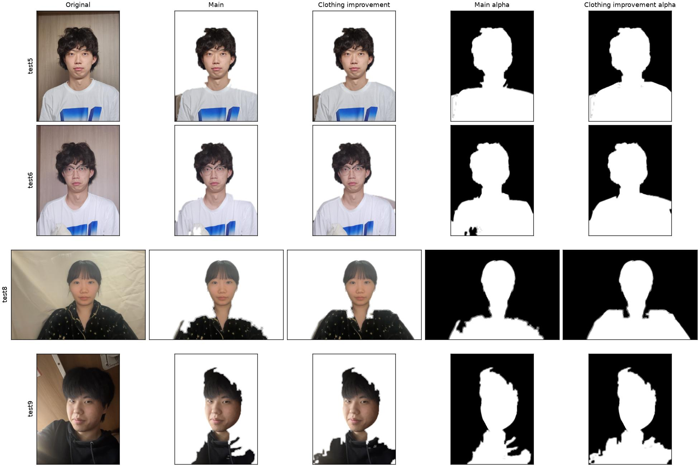

[English](README.md) | [한국어](README_kr.md)

# Module B Clothing-Recovery Experiments

If the existing background-separation pipeline is unfamiliar, first read the [Module B matting overview](https://github.com/hanbin5/relight/blob/module-b/matting/README.md). This report does not repeat that pipeline; it describes the attempts to recover missing clothing and their results. The selected change is in the app's `idphoto/matting.py`, not just an offline experiment.

The **person prior** uses facial landmarks to assume where a person might be, and the **gate** limits that region. **Color-sample candidates** are pixels eligible to be sampled for a color model. **Alpha** is 0 for background, 1 for foreground, and intermediate where the two colors are mixed. There is no semantic clothing-segmentation model.

## Full-Dataset Evaluation: 12 Unique Photos

We compared `shot2`–`shot5`, `test1`–`test6`, `test8`, and `test9` in `docs/evaluation/test`. The four photos in `docs/evaluation/crown-crop/originals/` are byte-identical copies of `shot2`–`shot5`, so they are not counted again.

The baseline is main commit `e96bb08cb678634207ea3aa45f086152c4c96f11`; the improved implementation is `06ec619158d68d7c3417fd47ce8fd3703ae269ca`. Each input is 640 px wide, and each before/after pair uses the same landmarks. Relighting strength is 0 and the replacement background is white. Each run uses a new `Matter` with `update=False`, so color models do not carry over from another photograph.

**There are no ground-truth masks for the real photos.** The numbers count pixels whose alpha was at most 0.5 before and above 0.5 after. They are not counts of actual clothing pixels, accuracy, or recall; added background is included. Images have different sizes, so counts across photos are not comparable as quality scores. Observations refer to the live result; left and right are as viewed in the image.

| Photo | Added pixels: live | Added pixels: full grid | Live result and remaining problem |
|---|---:|---:|---|
| shot2 | 15,927 | 5,355 | Much more khaki jacket remains, but outer sleeves and a small bright hole are still missing. |
| shot3 | 7,916 | 14,472 | More jacket remains on both sides, but much of the left sleeve is missing. |
| shot4 | 6,699 | 6,157 | More outer jacket remains, but so does room clutter on the right. |
| shot5 | 0 | 0 | The close-up has no clothing samples, so the extra recovery is skipped. |
| test1 | 26,880 | 10,719 | More black patterned clothing remains, with shoulder holes and dark-room leakage. |
| test2 | 15,067 | 16,128 | More patterned clothing remains, but dark objects at the sides stay connected. |
| test3 | 7,138 | 7,011 | More gray clothing remains near the neck and shoulders; a neck notch remains. |
| test4 | 7,185 | 7,109 | More clothing remains near the shoulder, along with a blue object and dark side clutter. |
| test5 | 12,618 | 12,714 | The right white shoulder returns, but a left wall strip remains. |
| test6 | 11,753 | 12,569 | More outer white clothing remains, but wall behind the shoulders is also newly included. |
| test8 | 15,664 | 14,794 | Outer black sleeves return, with collar notches and blocky edges remaining. |
| test9 | 34,428 | 15,183 | More dark hoodie remains, but shadow-side gaps, attached background, and a clipped hair edge remain. |

### Jackets: shot2–shot5


*Each row: input / baseline composite on white / improved composite / baseline alpha / improved alpha. In alpha, white is foreground and black is background. Column and photo names are outside the photographs.*

Much of shot2's previously missing khaki jacket returns, but not every sleeve or background error is fixed. In shot5 the face fills the frame and there are zero clothing-sample candidates, so the baseline result is left unchanged.

### Dark room: test1–test4


*Columns and alpha colors are the same as above.*

In test1 and test2, a wider area of black clothing remains, but dark objects in the room remain with it. A larger mask alone does not establish that the clothing has been separated correctly.

### Light walls and other poses: test5, test6, test8, test9



*Columns and alpha colors are the same as above.*

The right white shoulder in test5 is wider than before, but in test6 the bright wall behind the shoulders is newly included as well. Separating similarly colored clothing and wall remains unsolved.

The live path calculates color decisions and filter coefficients on a **half-size grid, `s=2`**, from the 640 px input. The full-grid comparison applies the shutter algorithm's **`s=1` to the same 640 px input**: [jackets](docs/evaluation/clothing/full-grid/comparison-1.jpg), [dark room](docs/evaluation/clothing/full-grid/comparison-2.jpg), and [other photos](docs/evaluation/clothing/full-grid/comparison-3.jpg). On this path the shoulders in shot2 and shot4 remain fragmented, while shot3 gains more than in live mode. **This is not an original-resolution export evaluation**, nor evidence that the two paths produce identical boundaries.

The [live CSV](docs/evaluation/clothing/measurements.csv) and [full-grid CSV](docs/evaluation/clothing/full-grid/measurements.csv) record thresholds, sample-candidate counts, application status, and single-run times for all 12 photos. Across the set, live mode adds 161,275 pixels and removes 9; full grid adds 122,211 and removes 6. Removed pixels had alpha above 0.5 before and at most 0.5 after. Recovery only adds to the binary mask **before** cleanup; subsequent cleanup and guided-filter recomputation can also change existing edges.

The figures show white-background composites regardless of rule 7. The app can retain the original wall when rule 7 fails at the shutter, so the figures do not necessarily represent what would be saved.

## 1. Why Clothing Was Missing

The old gate serves two roles: in the scoring stage it excludes the person outside the assumed shape, and pixels outside it are candidates for the background color model. A shoulder wider than assumed can therefore be cut off and also teach the model that its fabric is background.

In the earlier [matting failure analysis](https://github.com/hanbin5/relight/blob/module-b/matting/README.md), about 20 background samples came from the end of test5's right white shoulder and formed a white cluster. In shot2, the khaki jacket resembled a dark shade of the gray blind cluster, and 59% of a landmark-defined outer-shoulder region was included in the mask. These are **observations from the earlier original-resolution analysis**, not recall against labeled clothing. They are not a before/after measurement paired with the 640 px comparison above.

The old person-color samples represent the face, hair, neck, and a narrow chest together. If a black inner top occupies the middle of the chest, an outer jacket's color may be poorly represented. In a dark room, black clothing and room objects can have similar colors. The torso prior of 0.7 is not certain foreground, so background color evidence and the threshold can still exclude clothing.

## 2. Separate Clothing Models and Guarded Background Samples

### Why and What Was Selected

The first attempt widened the global shoulder gate higher up and expanded chest samples. More clothing remained, but the global background/person models and Otsu threshold also changed, with visible changes to the hair boundary in shot3 and test9. Rather than redefine the head color model, we selected a separate clothing score. The intermediate code and figures for that first attempt were not retained, so this is not an independently reproducible quantitative ablation.

We also narrowed the allowed shading of clothing colors and required a close match to the clothing samples. This still did not prevent wall leakage in test6. Instead of replacing existing body labels, the selected method **adds only supported pixels to the existing mask** to reduce new holes; it can also retain background that was already incorrectly included.

### Process

1. Face width `fw`, eye-to-chin distance `ec`, and the midline from the landmarks define a clothing search region that widens higher up than the old shoulder gate. Pixels in a wide guard below the chin are excluded **only from clothing-background candidates**; the whole guard is not forced to foreground.
2. Clothing-color candidates come from the chest below the chin; clothing-background candidates are old background candidates outside the guard. For example, test5 has 20,243 clothing and 44,745 background candidates on the live processing grid; at most 2,000 from each are used by the models. Candidate regions can contain pixels that are not actually clothing or background.
3. Separate clothing foreground/background color models score the search region using color distances and a torso prior. A pixel is added only if its clothing score exceeds the original Otsu threshold and its distance to the clothing model is below 2.5.
4. The added decisions are combined with the old binary mask before the existing opening/closing, face connectivity, hole filling, and guided filter. The original head color models and scoring definitions are unchanged, but later connectivity and edge processing are not guaranteed to be pixel-identical.


*Top: shot2; bottom: test5. Left to right: input, old background candidates (orange), guarded background candidates (orange) and excluded old candidates (blue), clothing candidates (green). All candidates on the live processing grid are enlarged for display; these are not the actual sampled pixels or the final mask.*

For test5, the guard excludes 4,607 of the 49,352 old background candidates, leaving 44,745 for the clothing-background model. The blue region includes wall as well: it is not all contaminated samples or all clothing. The green region is not guaranteed to be clothing either.

The app's image processing uses NumPy. There is no additional segmentation or depth model, calibration frame, manual per-photo region, or photo-name-specific threshold. Facial landmarks still use the existing MediaPipe model.

### Settings and Insufficient Samples

| Item | Setting |
|---|---|
| Clothing search region | Starts at chin + 0.2 `ec`; half-width increases from 0.6 `fw` to 2.8 `fw` with a square-root progression over 0.8 `ec`, then fades across 0.25 `fw` |
| Background guard | Below the chin, excludes old background candidates inside that half-width plus 0.6 `fw` from clothing-background candidates |
| Clothing candidates | Chin + 0.65 `ec` through + 2.5 `ec`; half-width grows from 0.35 `fw` to 1.0 `fw` with a square-root progression over 1 `ec` |
| Neck protection | Additional decisions only below chin + 0.65 `ec` or at least 0.45 `fw` from the midline |
| Clothing prior | 0.5 at the margin, up to the existing `PRIOR_TORSO=0.7` inside the torso |
| Color models | 8 background and 5 clothing clusters, at most 2,000 samples each; sampling RNG seeds 3 and 4 respectively |
| k-means | 8 iterations cold, 3 on an updating frame with previous models |
| Shading and color support | Clothing linear-intensity scale 0.8–1.2; its square root is used for color distance. Distance to the clothing model must be below the existing cap of 2.5 |
| Threshold | Original score's Otsu value, clipped to 0.35–0.65 |

If either the clothing candidates or guarded background candidates number fewer than 50 on the processing grid, the additional pass is skipped. On an updating frame, the old clothing models are also cleared; `Matter.reset()` clears both original and clothing models. Application status and candidate counts are recorded in `ctx.stats["matting"]`.

**The frame-border fallback still matters.** If the old background or old foreground candidates number fewer than 50, the original code replaces background candidates with the frame border. The clothing-background candidates then also come from that border minus the guard; if at least 50 remain, they can train the clothing-background model. They are not guaranteed to be clean wall pixels.

The guarded background model is used only for clothing scoring. The original head/background models, wall statistics, plain-wall check, and local-spill estimation keep their original definitions. This does not purify every background estimate in the pipeline.

## 3. Synthetic Regression Scenes With Known Masks

Unlike the real photos, the person region in each 320 × 280 synthetic scene is known when it is rendered. We constructed wider, higher shoulders and compared the same baseline and improved code. Retention below is the fraction of the **specified synthetic target region** whose alpha exceeds 0.5, not full-image IoU.

| Synthetic target | Target pixels | Baseline retention: live / full grid | Improved: live / full grid |
|---|---:|---:|---:|
| Khaki jacket outside a black inner top | 13,932 | 0% / 0% | 100% / 100% |
| White sleeve where the old gate is below 0.05 | 658 | 0% / 0% | 100% / 100% |
| Dark top with separate dark room clutter | 26,304 | 95.38% / 95.15% | 100% / 100% |

After recovery, false foreground in these scenes occupied about 0.013–0.016% of the **whole image**, not of the background alone. The tests require target retention above 98% and false foreground below 0.5% of the whole image. They also check the sampling guard and clearing warm state when the chest is cropped.

These simple scenes check the intended regressions; they do not establish accuracy on real photos, separation of identical clothing and wall colors, coverage of varied poses, or hair-boundary quality.

## 4. Reproduction and Limitations

Python 3.12 and [uv](https://docs.astral.sh/uv/) are required. These commands write under `out/` rather than overwriting the tracked figures and CSVs.

```bash
uv sync --group dev
uv run python tools/fetch_model.py

uv run python tools/eval_clothing.py --sample-figure --out out/clothing-report/live
uv run python tools/eval_clothing.py --full-grid --out out/clothing-report/full-grid

uv run pytest tests/test_matting_checker.py -q
uv run pytest -q
```

Each evaluation writes three comparison sheets and `measurements.csv`. `--sample-figure` also produces the `sample-regions.jpg` shown above. The default baseline is the fixed main commit above; `--baseline SHA` overrides it. The tool loads that revision's `matting.py` from Git using the current shared configuration, so the baseline commit must be present locally. The only shared-configuration difference from the fixed baseline is the new clothing-shade constant, which the baseline code does not use.

Landmarks are detected in image mode and cached by default in `out/clothing-landmarks/`; the same values are used within each before/after pair. The cache is not tracked by Git. Redetection in a fresh environment or with a fresh `--cache` directory can change landmarks and measurements. Missing photos or faces raise errors instead of being silently omitted. `test9.jpg` was restored unchanged from `e8e798c8eee3118bebba4ba8f34c37808f84c250` on `module-b/person-prior`.

Validation passed 201 tests overall, including 31 matting/checker tests. CSV times are single cold-run measurements of the matting stage only; they exclude loading, landmark detection, and relighting. They are diagnostics, not a latency guarantee or a 10 fps claim.

This is a **bounded clothing-recovery improvement, not a general portrait-segmentation solution**. It cannot recover clothing without samples, as in shot5; similar-colored objects in test1/test2/test9 and the wall in test6 can remain. Crossed arms or an occluded chest can invalidate the assumed sample and shoulder locations. Original-resolution export, warm starts on real sequences, landmark jitter, and sustained webcam performance were not evaluated. Accuracy or production-readiness claims need hand-drawn masks and temporal evaluation.

For general app usage, see the [main README](https://github.com/hanbin5/relight/blob/main/README.md). The app produces edited photos and is not for passports or other government IDs.
