[한국어](README_kr.md)

# Background Separation (Matting) Algorithm Visualization

relight `main` e96bb08 · `idphoto/matting.py` (Module B) · Based on the capture (shutter) path, `Matter.process(fast=False)`

- Runs **without a deep learning model**. Face landmarks define where the person could be. Background colors outside that region and foreground colors around the face and neck are modeled with k-means to score each pixel. Thresholding, morphological cleanup, and a guided filter then refine the boundary into an alpha (opacity) matte, which is composited onto a new background.
- Every figure shows intermediate values obtained by running the main-branch code step by step, without changing it. The final alpha is **pixel-for-pixel identical** to the actual pipeline output (maximum difference: 0 for all 4 images).
- No text is drawn over the figures; explanations appear below each image. Click an image to view it at a larger size.

## Overall Flow

<table>
<tr><td valign="top" width="14%"><a href="docs/module-b/matting/test3_0_landmarks.jpg">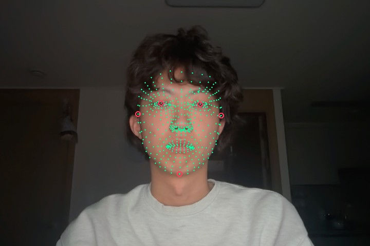</a> <b>① Input</b> Landmarks</td><td valign="top" width="14%"><a href="docs/module-b/matting/test3_1_gate.jpg">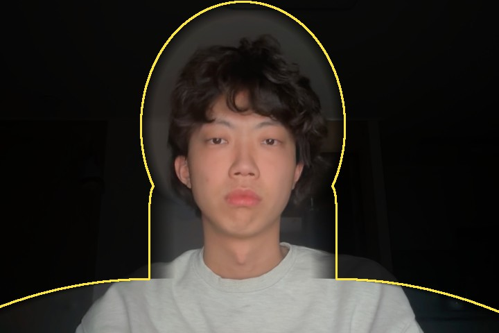</a> <b>② Prior region</b> gate</td><td valign="top" width="14%"> <b>③ Color samples</b> k-means</td><td valign="top" width="14%"> <b>④ Score</b> Color + prior</td><td valign="top" width="14%"> <b>⑤ Binary mask</b> Otsu · cleanup</td><td valign="top" width="14%"> <b>⑥ Boundary</b> Guided filter</td><td valign="top" width="14%"> <b>⑦ Composite</b> Spill removal</td></tr>
</table>

Four example photos are used.

<table>
<tr><td valign="top" width="25%"> test3</td><td valign="top" width="25%"><a href="docs/module-b/matting/test5_0_input.jpg">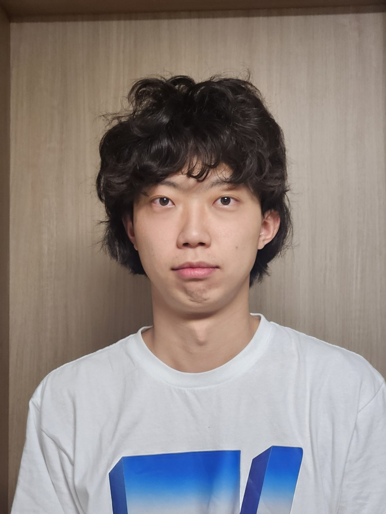</a> test5</td><td valign="top" width="25%"> shot2</td><td valign="top" width="25%"> test1</td></tr>
</table>

| Photo | Original size | Scene | Use in this document |
|----|----|----|----|
| test3 | 1440×960 | Dark room, black curly hair, gray sweatshirt | Main example for the step-by-step explanation |
| test5 | 3000×4000 | Beige wooden wall, white T-shirt | High-resolution boundary close-ups (Sections 5 and 6), failure analysis |
| shot2 | 1280×720 | Bright roller blind, window at the lower right, khaki jacket | Failure analysis |
| test1 | 1440×960 | Very dark room, black hair, dark patterned jacket | Failure analysis |

## 0. Input — Landmarks and Face Mask

From the 478 MediaPipe Face Landmarker points, we obtain the face width *fw* (between the two sides of the face), the eye-to-chin distance *ec* (from the midpoint of the two iris centers to the chin), and the centerline *cx*. All subsequent regions are defined as multiples of these three values. Colors are represented as the square root of linear RGB (sqrt-linear), which approximates perceptual spacing.

<table>
<tr><td valign="top" width="33%"> Original input</td><td valign="top" width="33%"> Green dots: landmarks. Red circles: iris centers, chin, and face sides (reference points for <i>fw</i>, <i>ec</i>, and <i>cx</i>)</td><td valign="top" width="33%"><a href="docs/module-b/matting/test3_0_facemask.jpg">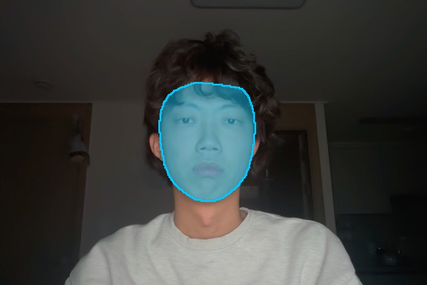</a> Light blue: Module A's face mask. This region is always fixed as foreground (score 1, alpha 1)</td></tr>
</table>

## 1. Person Prior — `person_prior`, `foreground_seeds`

- **gate** (where the person could be): a **prior assumption** that the head, neck, and shoulders lie within a region inferred from the face position and size. **Everything outside this region is treated as background** and used for background color samples. Foreground/background classification is performed only inside the region.
- **likely** (prior foreground probability inside gate): 0.88 for the skull and neck, 0.7 for the torso (up to 2.2 *fw* from the centerline), and **0.5 = neutral** elsewhere (side hair, outermost shoulders, and the margin above the crown), where color alone determines the result.
- **Foreground sample candidates**: the face mask (eroded by 1 px), the forehead-to-crown ellipse, a narrow column below the chin (width ±0.25 *fw*), and the chest (±0.65 *fw*).

<table>
<tr><td valign="top" width="33%"> <b>gate</b>: the allowed region is inside the yellow outline; the outside is darkened</td><td valign="top" width="33%"> <b>likely</b>: prior probability inside gate (gray outside gate)</td><td valign="top" width="33%"> Sample candidate regions for the color models</td></tr>
</table>

Orange: background sample candidates (outside gate) · Green: foreground sample candidates

## 2. Color Models — k-means

### How the 2000 px Samples Are Selected

We select **up to 2000 px uniformly at random, without replacement**. Every candidate pixel has the same chance of selection; if there are fewer than 2000 candidate pixels, all are used. The sample count is 2000 regardless of image size, so only 0.26% of the background candidates are selected for test3 (1.4 million pixels), and 0.05% for test5 (12 million pixels).

<table>
<tr><td valign="top" width="50%"><a href="docs/module-b/matting/test3_2_samples.jpg">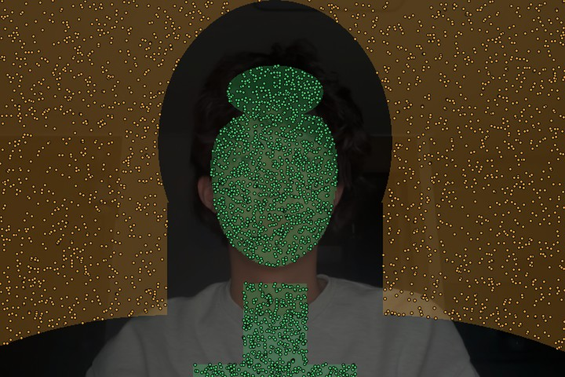</a> test3 · Actual selected samples. Orange dots = 2000 background samples; green dots = 2000 foreground samples; tinted areas = candidate regions</td><td valign="top" width="50%"><a href="docs/module-b/matting/test5_2_samples.jpg">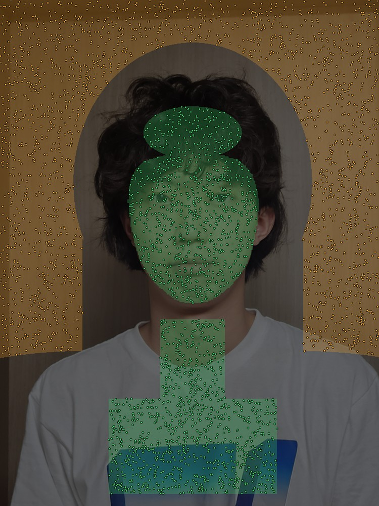</a> test5 · The white T-shirt at the right shoulder tip lies outside gate, so about 20 background samples come from the T-shirt (see Section 7)</td></tr>
</table>

### Building the Clusters

k-means++ (8 iterations) is applied to the selected background and foreground samples to create **8 background clusters and 5 foreground clusters**. Each cluster stores its center color, spread (RMS, with a minimum of 0.03), and proportion. Distance is measured in units of the nearest cluster's spread, with **shadow tolerance**: colors scaled in brightness by 0.5–1.25 for background clusters or 0.6–1.5 for foreground clusters are treated as belonging to the same cluster. This is intended to absorb wall shadows and facial shading, but it can also confuse white clothing with a bright wall, or black hair with a dark background.

The first maps below color every pixel in the sample candidate regions by its nearest cluster, not just the 2000 selected samples. The full-image maps assign every pixel to its nearest background or foreground cluster using the distance metric employed for scoring. **These figures show clusters, not the final mask.** The bars below the maps identify each cluster's center color. Clusters are built separately for each photo, so each photo has its own bars. The upper part shows the actual center colors (width indicates sample proportion); the lower part shows the colors used to display the clusters in the maps.

<table>
<tr><td valign="top" width="25%"> test3 · Clusters of candidate-region pixels</td><td valign="top" width="25%"> test3 · Nearest cluster for every pixel</td><td valign="top" width="25%"><a href="docs/module-b/matting/test5_2_clusters_seed.jpg">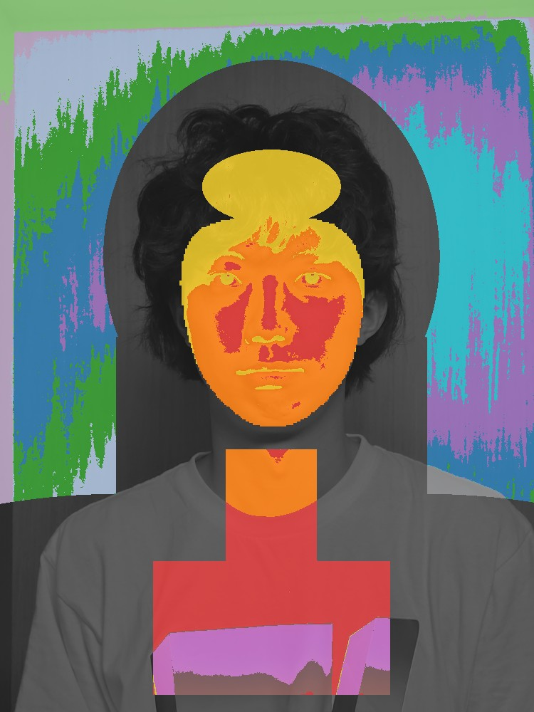</a> test5 · Clusters of candidate-region pixels</td><td valign="top" width="25%"><a href="docs/module-b/matting/test5_2_clusters_all.jpg">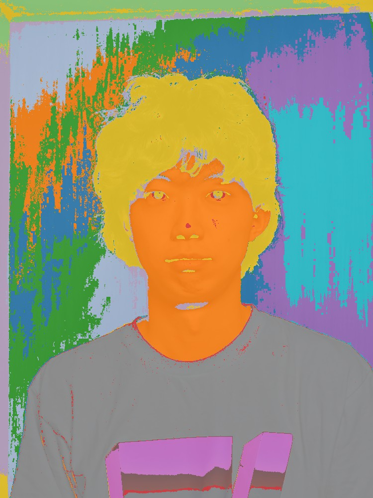</a> test5 · Nearest cluster for every pixel</td></tr>
</table>

<table>
<tr><td valign="top" width="50%"> test3 background clusters: center colors and map display colors</td><td valign="top" width="50%"> test3 foreground clusters: center colors and map display colors</td></tr>
<tr><td valign="top" width="50%"> test5 background clusters: center colors and map display colors</td><td valign="top" width="50%"> test5 foreground clusters: center colors and map display colors</td></tr>
</table>

<table>
<tr><td valign="top" width="100%"> Sample distribution: warmth (R−B) horizontally, brightness vertically. Small markers are samples (circles = background, triangles = foreground); large markers are cluster centers. The dark-hair cluster (triangle) overlaps the dark-background cluster (circle) at the lower left.</td></tr>
</table>

## 3. Score — Color Evidence + Prior Probability

<blockquote>
evidence = ( min(<i>d</i>bg, 2.5) − min(<i>d</i>fg, 2.5) ) / τ &nbsp;&nbsp;(τ = 1) pcolor = σ(evidence) score = gate · σ( evidence + logit(likely) ), with 1 on the face mask
</blockquote>

*d*bg and *d*fg are the distances to the background and foreground clusters. They are capped at 2.5 so that a color absent from both models (for example, scenery outside a window) does not strongly favor either side. Where likely = 0.5, logit(likely) = 0, so **score = pcolor**: the decision depends entirely on color.

<table>
<tr><td valign="top" width="50%"> <i>d</i>bg: distance to background clusters (larger means less like the background)</td><td valign="top" width="50%"> <i>d</i>fg: distance to foreground clusters</td></tr>
</table>

<a href="docs/module-b/matting/cbar_dist.png">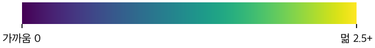</a>

<table>
<tr><td valign="top" width="50%"><a href="docs/module-b/matting/test3_3_pcolor.jpg">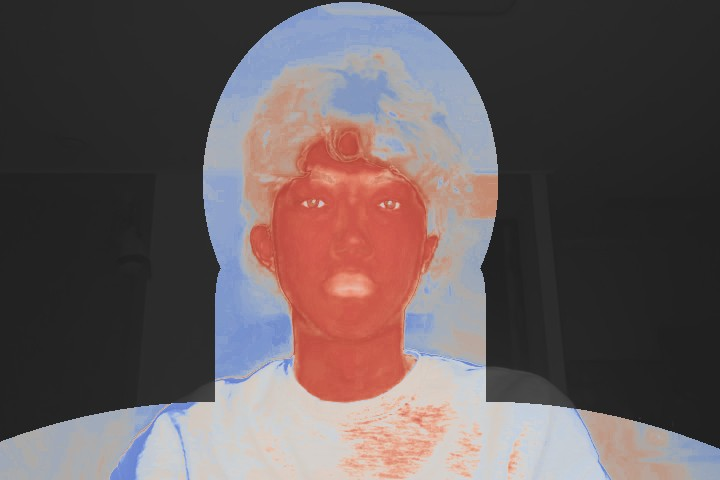</a> pcolor: foreground probability from color alone</td><td valign="top" width="50%"> score: final score after adding the prior probability and multiplying by gate (face = 1)</td></tr>
</table>

## 4. Thresholding and Cleanup

1. **Otsu threshold**: selected automatically from the score histogram where gate > 0.05, then clamped to [0.35, 0.65]. For test3, *t* = 0.598.
2. **Opening** (radius 2*k* = 4 px, where *k* = image width/640): removes small specks and thin protrusions.
3. **Closing** (radius 5*k* = 11 px): fills narrow gaps and small holes.
4. **Keep only regions connected to the face**: retain components 4-connected to the face on a 1/4-resolution grid, and fill holes that do not touch the image border.

<table>
<tr><td valign="top" width="50%"> Score histogram (log scale) and Otsu threshold (red line)</td><td valign="top" width="50%"><a href="docs/module-b/matting/test3_4_m_raw.jpg">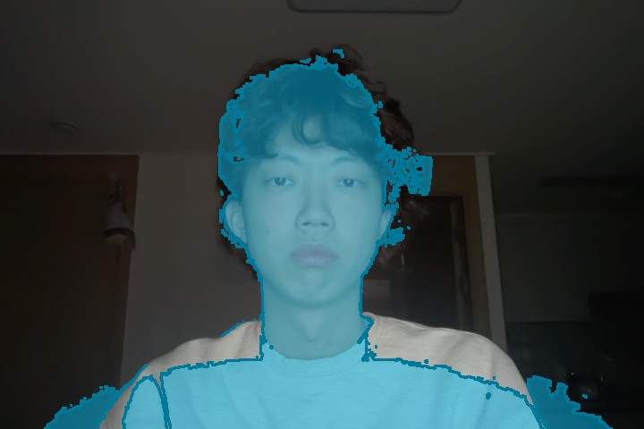</a> Raw binary mask: score &gt; <i>t</i></td></tr>
</table>

<table>
<tr><td valign="top" width="33%"> After opening</td><td valign="top" width="33%"> After closing</td><td valign="top" width="33%"> Face-connected components + hole filling</td></tr>
</table>

Light blue: mask (person) · Red: removed since the previous step · Yellow: added since the previous step

In test3, closing also fills dark background beside the right side of the hair, creating a bump. The connectivity step removes the detached fragment at the lower left.

## 5. Boundary Refinement — Color Guided Filter

After slightly blurring the binary mask with a 3×3 mean filter, we apply a **color guided filter** (He et al.) using the relit frame's colors as the guide. It fits the local linear model alpha ≈ *a*·color + *b* in each window, allowing the mask boundary to follow actual image edges, including hair strands. The radius is *r* = 6*k* (28 px for test5), with ε = 2·10−3. Pixels farther than *r*/2 (14 px for test5) from the coarse boundary are then fixed to 0 or 1, limiting the soft transition to a band within ±*r*/2 of the boundary. The figures below are native-resolution crops of the hair at the upper left of test5.

<table>
<tr><td valign="top" width="25%"> Close-up location (yellow rectangle)</td><td valign="top" width="25%"><a href="docs/module-b/matting/test5_5_crop_img.jpg">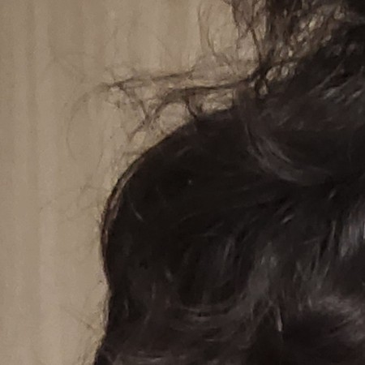</a> Original</td><td valign="top" width="25%"> Binary mask from Section 4 (white = foreground)</td><td valign="top" width="25%"> Yellow band: region where alpha can remain between 0 and 1 (within ±<i>r</i>/2 of the boundary)</td></tr>
</table>

<table>
<tr><td valign="top" width="33%"><a href="docs/module-b/matting/test5_5_crop_gf.jpg">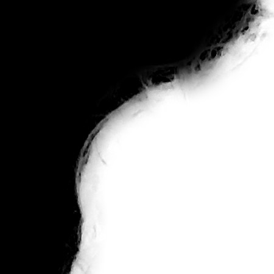</a> Raw guided-filter output: responds even to flyaway hair strands</td><td valign="top" width="33%"> Final alpha: fixed to 0/1 outside the band, removing flyaway hair beyond it</td><td valign="top" width="33%"><a href="docs/module-b/matting/test5_5_alpha_overlay.jpg">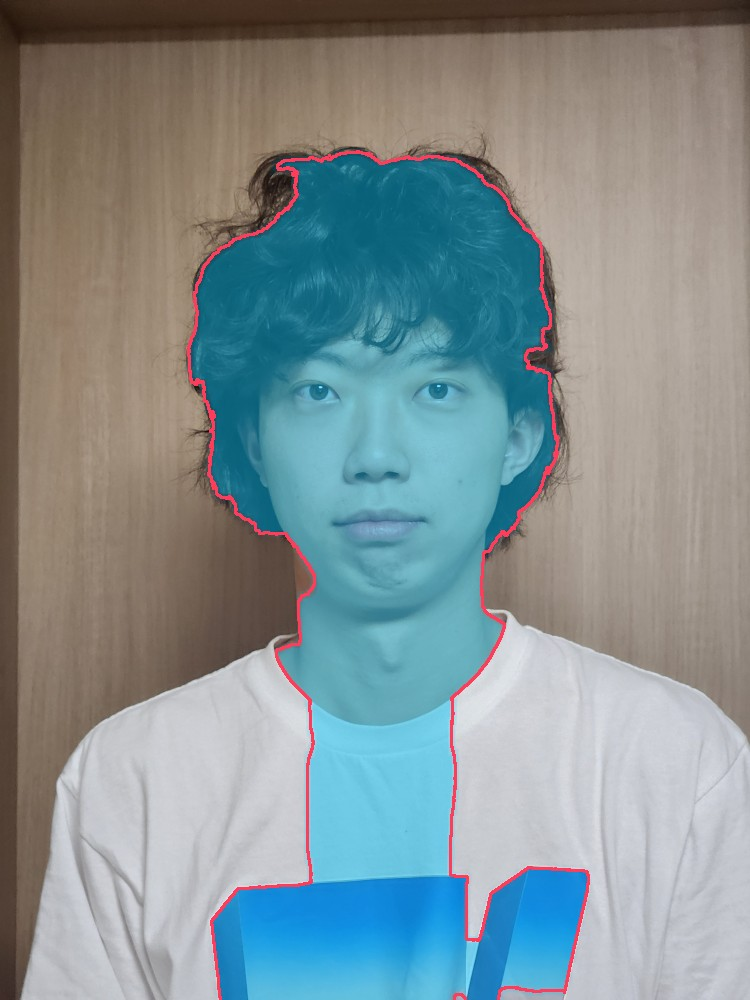</a> Full alpha (translucent light blue) and the alpha = 0.5 contour (red)</td></tr>
</table>

## 6. Spill Removal and Compositing

<blockquote>
α = 0 → new background color, &nbsp; α = 1 → original 0 &lt; α &lt; 1 : &nbsp; <i>F</i> = ( <i>I</i> − (1 − α) · ratio · <i>B</i>local ) / max(α, 0.1), &nbsp; output = α·<i>F</i> + (1 − α)·new background
</blockquote>

Pixels in the boundary band contain a mixture of foreground and the original wall color. We subtract the wall component using the local background color *B*local (the mean of nearby background pixels) and Module A's relighting ratio (ratio), recover the foreground color *F*, and blend it with the new background. If rule 7 (Section 8) fails, `render_final` keeps the original wall instead of replacing the background. The composites below were produced to show the algorithm output regardless of that rule.

<table>
<tr><td valign="top" width="50%"> test3 on white (#ffffff)</td><td valign="top" width="50%"> test3 on dark blue (#2f5d9a, for inspecting the boundary)</td></tr>
</table>

<table>
<tr><td valign="top" width="50%"> Without spill removal, α·<i>I</i> + (1−α)·background: a beige wall-colored fringe remains</td><td valign="top" width="50%"> After spill removal: the wall-colored fringe is reduced</td></tr>
</table>

## 7. Why Side Hair and Clothing Are Lost — Failure Analysis

Where likely = 0.5 (neutral), score = pcolor. To exceed threshold *t*, evidence must therefore be > logit(*t*) (0.41 for *t* = 0.6, or 0.62 for 0.65). In other words, the pixel must be **distinctly** closer to a foreground cluster than to a background cluster. The torso (likely = 0.7) starts with an advantage of 0.85, but is still excluded if its color favors the background. The values below are medians over landmark-defined regions.

| Photo | Problem region | Cause | *d*bg | *d*fg | pcolor | score | *t* | Included in mask |
|----|----|----|----|----|----|----|----|----|
| test1 | Side hair | Most background clusters are black because the whole room is dark → black hair is closer to the background | 0.16 | 0.56 | 0.42 | 0.44 | 0.613 | 4% |
| test5 | Outer shoulders (white T-shirt) | The right shoulder tip is outside gate, so about 20 background samples are drawn from the white T-shirt, creating a **white background cluster** (1%) → the T-shirt is close to this cluster. Without it, median *d*bg is 4.1 (capped at 2.5) | 0.09 | 0.51 | 0.40 | 0.60 | 0.65\* | 0% |
| shot2 | Outer shoulders (khaki jacket) | Similar to a darker version of a gray roller-blind cluster. The prior of 0.7 puts the score near the threshold, producing a jagged boundary | 0.70 | 1.35 | 0.35 | 0.54 | 0.508 | 59% |
| test3 | Side hair | Although the room is dark, the hair cluster is slightly closer → the score straddles the threshold | 0.52 | 0.15 | 0.59 | 0.61 | 0.598 | 57% |

\* For test5, Otsu selected 0.711, which was clamped to the upper limit of 0.65. Region definitions: side hair = gate 1, likely 0.5, above eye level, 0.35–0.8 *fw* from the centerline, dark pixels / outer shoulders = from 0.5 *ec* below the chin, 1.0–2.0 *fw* from the centerline. Without ground-truth labels, these regions may contain some background pixels.

### test1 — Dark Room

<table>
<tr><td valign="top" width="25%"> Original</td><td valign="top" width="25%"> pcolor</td><td valign="top" width="25%"> score</td><td valign="top" width="25%"> Binary mask (<i>t</i> = 0.613)</td></tr>
</table>

### test5 — White T-shirt and Beige Wall

<table>
<tr><td valign="top" width="25%"> Original</td><td valign="top" width="25%"> pcolor</td><td valign="top" width="25%"> score</td><td valign="top" width="25%"> Binary mask (<i>t</i> = 0.65)</td></tr>
</table>

<table>
<tr><td valign="top" width="50%"> test5 background clusters: beige shades + white (1%) from the right shoulder tip outside gate</td><td valign="top" width="50%"> test5 foreground clusters: skin, hair, white T-shirt, and blue pattern</td></tr>
</table>

### shot2 — Bright Roller Blind and Window

<table>
<tr><td valign="top" width="25%"> Original</td><td valign="top" width="25%"><a href="docs/module-b/matting/shot2_3_pcolor.jpg">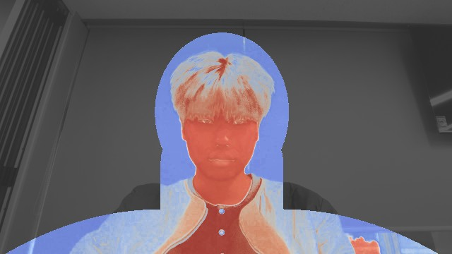</a> pcolor</td><td valign="top" width="25%"> score</td><td valign="top" width="25%"> Binary mask (<i>t</i> = 0.508)</td></tr>
</table>

In shot2, the scenery outside the window at the lower right contains colors absent from both models, biasing pcolor toward the foreground. The mask leaks into the window (the protrusion at the lower right).

## 8. Rule 7 (Clean Cutout) and Reproducibility

`clean_cutout` in `checker.py` passes only when both conditions below are met. If it fails, the background is not replaced.

1. Within the ID-photo crop, pixels with 0.1 < α < 0.9 must make up **less than 2%** of the area outside the hair band (above mouth level and within ±1.1 *fw* of the centerline).
2. At shoulder height (chin + 0.9 *ec*), the color contrast between the clothing on each side (0.45–1.0 *fw* from the centerline) and the background in the same rows (α < 0.1) must be **at least 0.12**, using the weaker side.

| Photo | Uncertain fraction | Shoulder contrast (approx.) | Verdict | Reason |
|----|----|----|----|----|
| test3 | 1.67% | 0.46 | Pass | |
| shot2 | 2.39% | 0.20 | Fail | About 90% of the uncertain pixels are below the chin (jacket shoulder boundary and window) |
| test1 | 1.91% | 0.10 | Fail | Dark jacket versus dark room |
| test5 | 1.33% | 0.005 | Fail | The T-shirt is missing from the mask, so the T-shirt itself enters the “background” (α < 0.1) → contrast approaches 0 |

Only test5's shoulder contrast was measured directly by the pipeline. The other values are approximations recomputed with the same formula from downscaled intermediate values.

**Reproducibility warning** — The landmark detector (`FaceLandmarkDetector`) is created in VIDEO (tracking) mode, so tracking state from the previous photo affects the next photo's landmarks. Processing test5 alone (first) failed rule 7 (contrast 0.005), whereas processing it after test4 passed (contrast 0.305). The previously shared overlays, processed in filename order, included most of the test5 T-shirt; this document's test5 was processed first, which explains the difference. Small landmark changes alter the prior regions and color samples. The result is sensitive enough that entire regions near the threshold (shoulders and side hair) can be included or excluded.

## 9. Parameters (`config.py`)

| Name | Value | Meaning |
|----|----|----|
| `BG_CLUSTERS / FG_CLUSTERS` | 8 / 5 | Number of background / foreground color clusters |
| `CLUSTER_SAMPLES` | 2000 | k-means sample count per cluster |
| `CLUSTER_SPREAD_FLOOR` | 0.03 | Minimum cluster spread (sqrt-linear) |
| `BG_SHADOW_SCALE` | (0.5, 1.25) | Allowed brightness scale for background clusters |
| `FG_SHADE_SCALE` | (0.6, 1.5) | Allowed brightness scale for foreground clusters |
| `SCORE_TAU` | 1.0 | Evidence temperature |
| `OUTLIER_DISTANCE` | 2.5 | Distance cap |
| `PRIOR_CORE / PRIOR_TORSO` | 0.88 / 0.7 | Skull-and-neck / torso prior probability |
| `CROWN_K` | 2.0 | Crown height (1.15·CROWN_K·ec above the chin) |
| Otsu range | [0.35, 0.65] | Threshold limits (code constants) |
| `OPEN_RADIUS / CLOSE_RADIUS` | 2 / 5 | Opening / closing radius (at 640 px width) |
| `GF_RADIUS / GF_EPS` | 6 / 2e-3 | Guided-filter radius (at 640 px width) / regularization |
| `SPILL_ALPHA_FLOOR` | 0.1 | Minimum denominator for spill removal |
| `UNCERTAIN_MAX / CONTRAST_MIN` | 2% / 0.12 | Rule 7 thresholds |
| `PLAIN_WALL_SHARE` | 0.7 | Plain-wall fraction used to choose the guidance message when rule 7 fails |

## 10. Summary

- The face, skull, and central torso are stable thanks to the prior probabilities and face mask. The decisive regions are **side hair (0.5) and outer shoulders (0.7)**, where the prior is neutral or weak.
- These regions depend solely on color contrast, making them vulnerable in dark rooms (black hair), against bright walls (white clothing), and against achromatic walls (gray or khaki clothing). The allowed shadow scaling increases this ambiguity.
- The guided filter follows hair strands at the boundary, but the ±*r*/2 band restriction prevents recovery of flyaway hair already missing from the coarse mask.
- No quantitative evaluation against ground-truth masks (such as IoU) has been performed yet. The numbers in this document are only regional medians and rule 7 verdicts.
