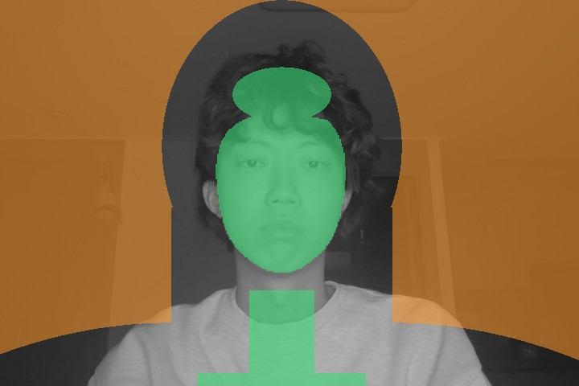
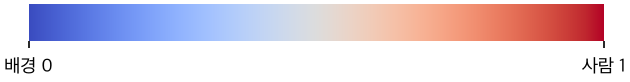
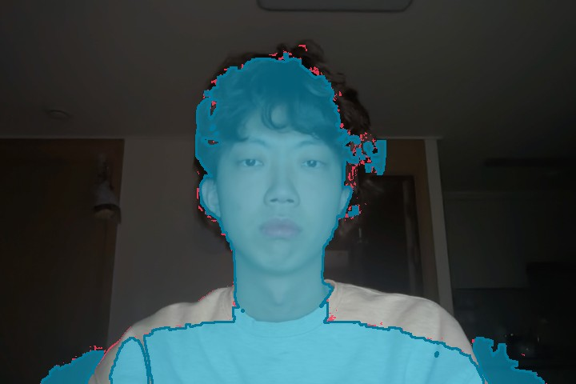
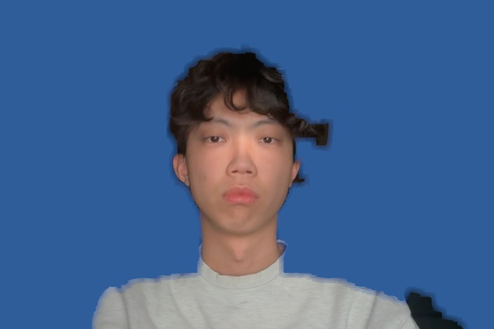
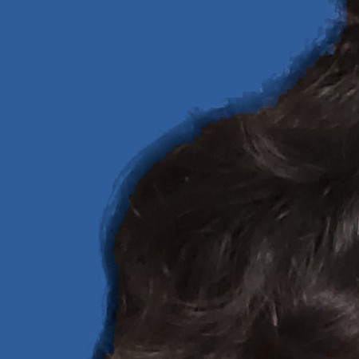
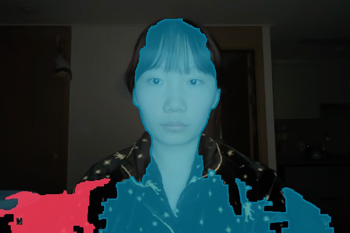
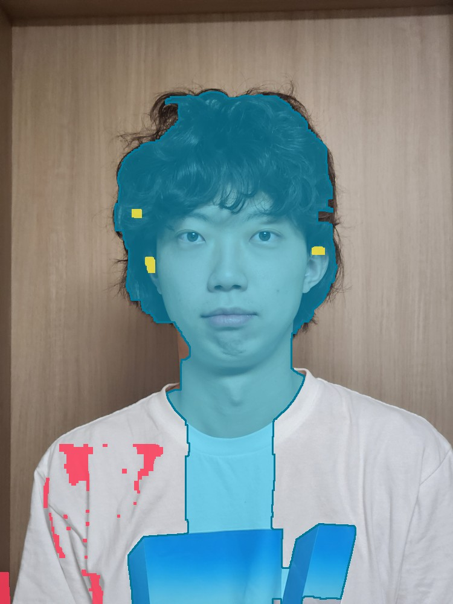
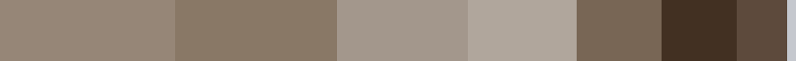
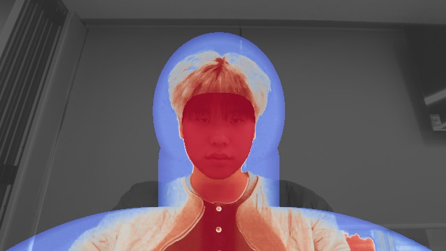

[English](#background-separation-matting-algorithm-visualization) | [한국어](#한국어)

# Background Separation (Matting) Algorithm Visualization

relight `main` e96bb08 · `idphoto/matting.py` (Module B) · Based on the capture (shutter) path, `Matter.process(fast=False)`

- Runs **without a deep learning model**. Face landmarks define where the person could be. Background colors outside that region and foreground colors around the face and neck are modeled with k-means to score each pixel. Thresholding, morphological cleanup, and a guided filter then refine the boundary into an alpha (opacity) matte, which is composited onto a new background.
- Every figure shows intermediate values obtained by running the main-branch code step by step, without changing it. The final alpha is **pixel-for-pixel identical** to the actual pipeline output (maximum difference: 0 for all 4 images).
- No text is drawn over the figures; explanations appear below each image. Click an image to view it at a larger size.

## Overall Flow

<table>
<tr><td valign="top" width="14%"> <b>① Input</b> Landmarks</td><td valign="top" width="14%"> <b>② Prior region</b> gate</td><td valign="top" width="14%"> <b>③ Color samples</b> k-means</td><td valign="top" width="14%"> <b>④ Score</b> Color + prior</td><td valign="top" width="14%"> <b>⑤ Binary mask</b> Otsu · cleanup</td><td valign="top" width="14%"> <b>⑥ Boundary</b> Guided filter</td><td valign="top" width="14%"> <b>⑦ Composite</b> Spill removal</td></tr>
</table>

Four example photos are used.

<table>
<tr><td valign="top" width="25%"> test3</td><td valign="top" width="25%"> test5</td><td valign="top" width="25%"> shot2</td><td valign="top" width="25%"> test1</td></tr>
</table>

| Photo | Original size | Scene | Use in this document |
|----|----|----|----|
| test3 | 1440×960 | Dark room, black curly hair, gray sweatshirt | Main example for the step-by-step explanation |
| test5 | 3000×4000 | Beige wooden wall, white T-shirt | High-resolution boundary close-ups (Sections 5 and 6), failure analysis |
| shot2 | 1280×720 | Bright roller blind, window at the lower right, khaki jacket | Failure analysis |
| test1 | 1440×960 | Very dark room, black hair, dark patterned jacket | Failure analysis |

## 0. Input — Landmarks and Face Mask

From the 478 MediaPipe Face Landmarker points, we obtain the face width *fw* (between the two sides of the face), the eye-to-chin distance *ec* (from the midpoint of the two iris centers to the chin), and the centerline *cx*. All subsequent regions are defined as multiples of these three values. Colors are represented as the square root of linear RGB (sqrt-linear), which approximates perceptual spacing.

<table>
<tr><td valign="top" width="33%"> Original input</td><td valign="top" width="33%"> Green dots: landmarks. Red circles: iris centers, chin, and face sides (reference points for <i>fw</i>, <i>ec</i>, and <i>cx</i>)</td><td valign="top" width="33%"> Light blue: Module A's face mask. This region is always fixed as foreground (score 1, alpha 1)</td></tr>
</table>

## 1. Person Prior — `person_prior`, `foreground_seeds`

- **gate** (where the person could be): a **prior assumption** that the head, neck, and shoulders lie within a region inferred from the face position and size. **Everything outside this region is treated as background** and used for background color samples. Foreground/background classification is performed only inside the region.
- **likely** (prior foreground probability inside gate): 0.88 for the skull and neck, 0.7 for the torso (up to 2.2 *fw* from the centerline), and **0.5 = neutral** elsewhere (side hair, outermost shoulders, and the margin above the crown), where color alone determines the result.
- **Foreground sample candidates**: the face mask (eroded by 1 px), the forehead-to-crown ellipse, a narrow column below the chin (width ±0.25 *fw*), and the chest (±0.65 *fw*).

<table>
<tr><td valign="top" width="33%"> <b>gate</b>: the allowed region is inside the yellow outline; the outside is darkened</td><td valign="top" width="33%"> <b>likely</b>: prior probability inside gate (gray outside gate)</td><td valign="top" width="33%"> Sample candidate regions for the color models</td></tr>
</table>

Orange: background sample candidates (outside gate) · Green: foreground sample candidates

## 2. Color Models — k-means

### How the 2000 px Samples Are Selected

We select **up to 2000 px uniformly at random, without replacement**. Every candidate pixel has the same chance of selection; if there are fewer than 2000 candidate pixels, all are used. The sample count is 2000 regardless of image size, so only 0.26% of the background candidates are selected for test3 (1.4 million pixels), and 0.05% for test5 (12 million pixels).

<table>
<tr><td valign="top" width="50%"> test3 · Actual selected samples. Orange dots = 2000 background samples; green dots = 2000 foreground samples; tinted areas = candidate regions</td><td valign="top" width="50%"> test5 · The white T-shirt at the right shoulder tip lies outside gate, so about 20 background samples come from the T-shirt (see Section 7)</td></tr>
</table>

### Building the Clusters

k-means++ (8 iterations) is applied to the selected background and foreground samples to create **8 background clusters and 5 foreground clusters**. Each cluster stores its center color, spread (RMS, with a minimum of 0.03), and proportion. Distance is measured in units of the nearest cluster's spread, with **shadow tolerance**: colors scaled in brightness by 0.5–1.25 for background clusters or 0.6–1.5 for foreground clusters are treated as belonging to the same cluster. This is intended to absorb wall shadows and facial shading, but it can also confuse white clothing with a bright wall, or black hair with a dark background.

The first maps below color every pixel in the sample candidate regions by its nearest cluster, not just the 2000 selected samples. The full-image maps assign every pixel to its nearest background or foreground cluster using the distance metric employed for scoring. **These figures show clusters, not the final mask.** The bars below the maps identify each cluster's center color. Clusters are built separately for each photo, so each photo has its own bars. The upper part shows the actual center colors (width indicates sample proportion); the lower part shows the colors used to display the clusters in the maps.

<table>
<tr><td valign="top" width="25%"> test3 · Clusters of candidate-region pixels</td><td valign="top" width="25%"> test3 · Nearest cluster for every pixel</td><td valign="top" width="25%"> test5 · Clusters of candidate-region pixels</td><td valign="top" width="25%"> test5 · Nearest cluster for every pixel</td></tr>
</table>

<table>
<tr><td valign="top" width="50%"> test3 background clusters: center colors and map display colors</td><td valign="top" width="50%"> test3 foreground clusters: center colors and map display colors</td></tr>
<tr><td valign="top" width="50%"> test5 background clusters: center colors and map display colors</td><td valign="top" width="50%"> test5 foreground clusters: center colors and map display colors</td></tr>
</table>

<table>
<tr><td valign="top" width="100%"> Sample distribution: warmth (R−B) horizontally, brightness vertically. Small markers are samples (circles = background, triangles = foreground); large markers are cluster centers. The dark-hair cluster (triangle) overlaps the dark-background cluster (circle) at the lower left.</td></tr>
</table>

## 3. Score — Color Evidence + Prior Probability

<blockquote>
evidence = ( min(<i>d</i>bg, 2.5) − min(<i>d</i>fg, 2.5) ) / τ &nbsp;&nbsp;(τ = 1) pcolor = σ(evidence) score = gate · σ( evidence + logit(likely) ), with 1 on the face mask
</blockquote>

*d*bg and *d*fg are the distances to the background and foreground clusters. They are capped at 2.5 so that a color absent from both models (for example, scenery outside a window) does not strongly favor either side. Where likely = 0.5, logit(likely) = 0, so **score = pcolor**: the decision depends entirely on color.

<table>
<tr><td valign="top" width="50%"> <i>d</i>bg: distance to background clusters (larger means less like the background)</td><td valign="top" width="50%"> <i>d</i>fg: distance to foreground clusters</td></tr>
</table>

<table>
<tr><td valign="top" width="50%"> pcolor: foreground probability from color alone</td><td valign="top" width="50%"> score: final score after adding the prior probability and multiplying by gate (face = 1)</td></tr>
</table>

## 4. Thresholding and Cleanup

1. **Otsu threshold**: selected automatically from the score histogram where gate > 0.05, then clamped to [0.35, 0.65]. For test3, *t* = 0.598.
2. **Opening** (radius 2*k* = 4 px, where *k* = image width/640): removes small specks and thin protrusions.
3. **Closing** (radius 5*k* = 11 px): fills narrow gaps and small holes.
4. **Keep only regions connected to the face**: retain components 4-connected to the face on a 1/4-resolution grid, and fill holes that do not touch the image border.

<table>
<tr><td valign="top" width="50%"> Score histogram (log scale) and Otsu threshold (red line)</td><td valign="top" width="50%"> Raw binary mask: score &gt; <i>t</i></td></tr>
</table>

<table>
<tr><td valign="top" width="33%"> After opening</td><td valign="top" width="33%"> After closing</td><td valign="top" width="33%"> Face-connected components + hole filling</td></tr>
</table>

Light blue: mask (person) · Red: removed since the previous step · Yellow: added since the previous step

In test3, closing also fills dark background beside the right side of the hair, creating a bump. The connectivity step removes the detached fragment at the lower left.

## 5. Boundary Refinement — Color Guided Filter

After slightly blurring the binary mask with a 3×3 mean filter, we apply a **color guided filter** (He et al.) using the relit frame's colors as the guide. It fits the local linear model alpha ≈ *a*·color + *b* in each window, allowing the mask boundary to follow actual image edges, including hair strands. The radius is *r* = 6*k* (28 px for test5), with ε = 2·10−3. Pixels farther than *r*/2 (14 px for test5) from the coarse boundary are then fixed to 0 or 1, limiting the soft transition to a band within ±*r*/2 of the boundary. The figures below are native-resolution crops of the hair at the upper left of test5.

<table>
<tr><td valign="top" width="25%"> Close-up location (yellow rectangle)</td><td valign="top" width="25%"> Original</td><td valign="top" width="25%"> Binary mask from Section 4 (white = foreground)</td><td valign="top" width="25%"> Yellow band: region where alpha can remain between 0 and 1 (within ±<i>r</i>/2 of the boundary)</td></tr>
</table>

<table>
<tr><td valign="top" width="33%"> Raw guided-filter output: responds even to flyaway hair strands</td><td valign="top" width="33%"> Final alpha: fixed to 0/1 outside the band, removing flyaway hair beyond it</td><td valign="top" width="33%"> Full alpha (translucent light blue) and the alpha = 0.5 contour (red)</td></tr>
</table>

## 6. Spill Removal and Compositing

<blockquote>
α = 0 → new background color, &nbsp; α = 1 → original 0 &lt; α &lt; 1 : &nbsp; <i>F</i> = ( <i>I</i> − (1 − α) · ratio · <i>B</i>local ) / max(α, 0.1), &nbsp; output = α·<i>F</i> + (1 − α)·new background
</blockquote>

Pixels in the boundary band contain a mixture of foreground and the original wall color. We subtract the wall component using the local background color *B*local (the mean of nearby background pixels) and Module A's relighting ratio (ratio), recover the foreground color *F*, and blend it with the new background. If rule 7 (Section 8) fails, `render_final` keeps the original wall instead of replacing the background. The composites below were produced to show the algorithm output regardless of that rule.

<table>
<tr><td valign="top" width="50%"> test3 on white (#ffffff)</td><td valign="top" width="50%"> test3 on dark blue (#2f5d9a, for inspecting the boundary)</td></tr>
</table>

<table>
<tr><td valign="top" width="50%"> Without spill removal, α·<i>I</i> + (1−α)·background: a beige wall-colored fringe remains</td><td valign="top" width="50%"> After spill removal: the wall-colored fringe is reduced</td></tr>
</table>

## 7. Why Side Hair and Clothing Are Lost — Failure Analysis

Where likely = 0.5 (neutral), score = pcolor. To exceed threshold *t*, evidence must therefore be > logit(*t*) (0.41 for *t* = 0.6, or 0.62 for 0.65). In other words, the pixel must be **distinctly** closer to a foreground cluster than to a background cluster. The torso (likely = 0.7) starts with an advantage of 0.85, but is still excluded if its color favors the background. The values below are medians over landmark-defined regions.

| Photo | Problem region | Cause | *d*bg | *d*fg | pcolor | score | *t* | Included in mask |
|----|----|----|----|----|----|----|----|----|
| test1 | Side hair | Most background clusters are black because the whole room is dark → black hair is closer to the background | 0.16 | 0.56 | 0.42 | 0.44 | 0.613 | 4% |
| test5 | Outer shoulders (white T-shirt) | The right shoulder tip is outside gate, so about 20 background samples are drawn from the white T-shirt, creating a **white background cluster** (1%) → the T-shirt is close to this cluster. Without it, median *d*bg is 4.1 (capped at 2.5) | 0.09 | 0.51 | 0.40 | 0.60 | 0.65\* | 0% |
| shot2 | Outer shoulders (khaki jacket) | Similar to a darker version of a gray roller-blind cluster. The prior of 0.7 puts the score near the threshold, producing a jagged boundary | 0.70 | 1.35 | 0.35 | 0.54 | 0.508 | 59% |
| test3 | Side hair | Although the room is dark, the hair cluster is slightly closer → the score straddles the threshold | 0.52 | 0.15 | 0.59 | 0.61 | 0.598 | 57% |

\* For test5, Otsu selected 0.711, which was clamped to the upper limit of 0.65. Region definitions: side hair = gate 1, likely 0.5, above eye level, 0.35–0.8 *fw* from the centerline, dark pixels / outer shoulders = from 0.5 *ec* below the chin, 1.0–2.0 *fw* from the centerline. Without ground-truth labels, these regions may contain some background pixels.

### test1 — Dark Room

<table>
<tr><td valign="top" width="25%"> Original</td><td valign="top" width="25%"> pcolor</td><td valign="top" width="25%"> score</td><td valign="top" width="25%"> Binary mask (<i>t</i> = 0.613)</td></tr>
</table>

### test5 — White T-shirt and Beige Wall

<table>
<tr><td valign="top" width="25%"> Original</td><td valign="top" width="25%"> pcolor</td><td valign="top" width="25%"> score</td><td valign="top" width="25%"> Binary mask (<i>t</i> = 0.65)</td></tr>
</table>

<table>
<tr><td valign="top" width="50%"> test5 background clusters: beige shades + white (1%) from the right shoulder tip outside gate</td><td valign="top" width="50%"> test5 foreground clusters: skin, hair, white T-shirt, and blue pattern</td></tr>
</table>

### shot2 — Bright Roller Blind and Window

<table>
<tr><td valign="top" width="25%"> Original</td><td valign="top" width="25%"> pcolor</td><td valign="top" width="25%"> score</td><td valign="top" width="25%"> Binary mask (<i>t</i> = 0.508)</td></tr>
</table>

In shot2, the scenery outside the window at the lower right contains colors absent from both models, biasing pcolor toward the foreground. The mask leaks into the window (the protrusion at the lower right).

## 8. Rule 7 (Clean Cutout) and Reproducibility

`clean_cutout` in `checker.py` passes only when both conditions below are met. If it fails, the background is not replaced.

1. Within the ID-photo crop, pixels with 0.1 < α < 0.9 must make up **less than 2%** of the area outside the hair band (above mouth level and within ±1.1 *fw* of the centerline).
2. At shoulder height (chin + 0.9 *ec*), the color contrast between the clothing on each side (0.45–1.0 *fw* from the centerline) and the background in the same rows (α < 0.1) must be **at least 0.12**, using the weaker side.

| Photo | Uncertain fraction | Shoulder contrast (approx.) | Verdict | Reason |
|----|----|----|----|----|
| test3 | 1.67% | 0.46 | Pass | |
| shot2 | 2.39% | 0.20 | Fail | About 90% of the uncertain pixels are below the chin (jacket shoulder boundary and window) |
| test1 | 1.91% | 0.10 | Fail | Dark jacket versus dark room |
| test5 | 1.33% | 0.005 | Fail | The T-shirt is missing from the mask, so the T-shirt itself enters the “background” (α < 0.1) → contrast approaches 0 |

Only test5's shoulder contrast was measured directly by the pipeline. The other values are approximations recomputed with the same formula from downscaled intermediate values.

**Reproducibility warning** — The landmark detector (`FaceLandmarkDetector`) is created in VIDEO (tracking) mode, so tracking state from the previous photo affects the next photo's landmarks. Processing test5 alone (first) failed rule 7 (contrast 0.005), whereas processing it after test4 passed (contrast 0.305). The previously shared overlays, processed in filename order, included most of the test5 T-shirt; this document's test5 was processed first, which explains the difference. Small landmark changes alter the prior regions and color samples. The result is sensitive enough that entire regions near the threshold (shoulders and side hair) can be included or excluded.

## 9. Parameters (`config.py`)

| Name | Value | Meaning |
|----|----|----|
| `BG_CLUSTERS / FG_CLUSTERS` | 8 / 5 | Number of background / foreground color clusters |
| `CLUSTER_SAMPLES` | 2000 | k-means sample count per cluster |
| `CLUSTER_SPREAD_FLOOR` | 0.03 | Minimum cluster spread (sqrt-linear) |
| `BG_SHADOW_SCALE` | (0.5, 1.25) | Allowed brightness scale for background clusters |
| `FG_SHADE_SCALE` | (0.6, 1.5) | Allowed brightness scale for foreground clusters |
| `SCORE_TAU` | 1.0 | Evidence temperature |
| `OUTLIER_DISTANCE` | 2.5 | Distance cap |
| `PRIOR_CORE / PRIOR_TORSO` | 0.88 / 0.7 | Skull-and-neck / torso prior probability |
| `CROWN_K` | 2.0 | Crown height (1.15·CROWN_K·ec above the chin) |
| Otsu range | [0.35, 0.65] | Threshold limits (code constants) |
| `OPEN_RADIUS / CLOSE_RADIUS` | 2 / 5 | Opening / closing radius (at 640 px width) |
| `GF_RADIUS / GF_EPS` | 6 / 2e-3 | Guided-filter radius (at 640 px width) / regularization |
| `SPILL_ALPHA_FLOOR` | 0.1 | Minimum denominator for spill removal |
| `UNCERTAIN_MAX / CONTRAST_MIN` | 2% / 0.12 | Rule 7 thresholds |
| `PLAIN_WALL_SHARE` | 0.7 | Plain-wall fraction used to choose the guidance message when rule 7 fails |

## 10. Summary

- The face, skull, and central torso are stable thanks to the prior probabilities and face mask. The decisive regions are **side hair (0.5) and outer shoulders (0.7)**, where the prior is neutral or weak.
- These regions depend solely on color contrast, making them vulnerable in dark rooms (black hair), against bright walls (white clothing), and against achromatic walls (gray or khaki clothing). The allowed shadow scaling increases this ambiguity.
- The guided filter follows hair strands at the boundary, but the ±*r*/2 band restriction prevents recovery of flyaway hair already missing from the coarse mask.
- No quantitative evaluation against ground-truth masks (such as IoU) has been performed yet. The numbers in this document are only regional medians and rule 7 verdicts.

---

# 한국어

# 배경 분리(마스킹) 알고리즘 시각화

relight `main` e96bb08 · `idphoto/matting.py` (Module B) · 촬영(셔터) 경로 `Matter.process(fast=False)` 기준

- **딥러닝 모델 없이** 동작합니다. 얼굴 랜드마크로 ‘사람이 있을 수 있는 곳’을 정하고, 그 바깥의 배경색과 얼굴·목 주변의 사람색을 k-means로 모델링해 픽셀마다 점수를 매긴 뒤, 임계값 → 형태학 정리 → 가이드 필터로 경계를 다듬어 알파(불투명도)를 만들고 새 배경과 합성합니다.
- 모든 그림은 main 코드를 단계별로 그대로 실행해 중간값을 꺼낸 것입니다. 마지막 알파는 실제 파이프라인 출력과 **픽셀 단위로 동일**합니다(4장 모두 최대 차이 0).
- 그림 위에는 글자를 넣지 않았고, 설명은 각 그림 아래에 있습니다. 그림을 누르면 크게 볼 수 있습니다.

## 전체 흐름

<table>
<tr><td width="14%" valign="top"> <b>① 입력</b> 랜드마크</td><td width="14%" valign="top"> <b>② 사전 영역</b> gate</td><td width="14%" valign="top"> <b>③ 색 표본</b> k-means</td><td width="14%" valign="top"> <b>④ 점수</b> 색 + 사전</td><td width="14%" valign="top"> <b>⑤ 이진 마스크</b> Otsu·정리</td><td width="14%" valign="top"> <b>⑥ 경계</b> 가이드 필터</td><td width="14%" valign="top"> <b>⑦ 합성</b> 번짐 제거</td></tr>
</table>

예시 사진은 네 장입니다.

<table>
<tr><td width="25%" valign="top"> test3</td><td width="25%" valign="top"> test5</td><td width="25%" valign="top"> shot2</td><td width="25%" valign="top"> test1</td></tr>
</table>

| 사진 | 원본 크기 | 장면 | 이 문서에서의 쓰임 |
|----|----|----|----|
| test3 | 1440×960 | 어두운 방, 검은 곱슬머리, 회색 맨투맨 | 단계별 설명의 기본 예시 |
| test5 | 3000×4000 | 베이지 나무 벽, 흰 티셔츠 | 고해상도 경계 확대(5·6절), 실패 분석 |
| shot2 | 1280×720 | 밝은 롤스크린, 오른쪽 아래 창문, 카키 재킷 | 실패 분석 |
| test1 | 1440×960 | 매우 어두운 방, 검은 머리, 어두운 무늬 재킷 | 실패 분석 |

## 0. 입력 — 랜드마크와 얼굴 마스크

MediaPipe Face Landmarker의 478점에서 얼굴폭 *fw*(양쪽 얼굴 끝 사이), 눈–턱 길이 *ec*(두 홍채 중심의 중점 → 턱), 중심선 *cx*를 구합니다. 이후 모든 영역은 이 세 값의 배수로 정해집니다. 색은 선형 RGB의 제곱근(sqrt-linear)으로 다루는데, 지각적인 간격과 비슷합니다.

<table>
<tr><td width="33%" valign="top"> 원본 입력</td><td width="33%" valign="top"> 초록 점: 랜드마크. 빨간 원: 홍채 중심·턱·얼굴 양끝(<i>fw</i>, <i>ec</i>, <i>cx</i>의 기준점)</td><td width="33%" valign="top"> 하늘색: Module A가 만든 얼굴 마스크. 이 영역은 항상 사람(점수 1, 알파 1)으로 고정</td></tr>
</table>

## 1. 사람 사전 영역 — `person_prior`, `foreground_seeds`

- **gate** (사람이 있을 수 있는 곳): 얼굴 위치와 크기로 보아 머리·목·어깨는 이 범위 안에 있을 것이라는 **사전 가정**입니다. 그래서 **이 범위 밖은 모두 배경**으로 보고 배경 색 표본으로 쓰며, 사람인지 아닌지는 범위 안에서만 판정합니다.
- **likely** (gate 안에서 사람일 사전확률): 두개골·목 0.88, 몸통 0.7(중심선에서 최대 2.2 *fw*), 나머지(옆머리, 어깨 맨 끝, 정수리 위 여백)는 **0.5 = 중립**이라 색만으로 결정됩니다.
- **사람 표본 후보**: 얼굴 마스크(1 px 침식), 이마–정수리 타원, 턱 아래 좁은 기둥(폭 ±0.25 *fw*), 가슴(±0.65 *fw*).

<table>
<tr><td width="33%" valign="top"> <b>gate</b>: 노란 선 안이 허용 영역, 바깥은 어둡게 표시</td><td width="33%" valign="top"> <b>likely</b>: gate 안의 사전확률(gate 밖은 회색)</td><td width="33%" valign="top"> 색 모델용 표본 후보 영역</td></tr>
</table>

주황: 배경 표본 후보 (gate 밖) · 초록: 사람 표본 후보

## 2. 색 모델 — k-means

### 표본 2000 px는 어떻게 뽑나

**균일 무작위, 중복 없이 최대 2000 px**를 뽑습니다. 후보 픽셀마다 뽑힐 확률이 같고, 후보가 2000 px보다 적으면 전부 씁니다. 사진 크기와 상관없이 2000개라서 test3(140만 화소)은 배경 후보의 0.26%, test5(1200만 화소)는 0.05%만 뽑힙니다.

<table>
<tr><td width="50%" valign="top"> test3 · 실제로 뽑힌 표본. 주황 점 = 배경 2000개, 초록 점 = 사람 2000개, 옅게 칠한 곳 = 후보 영역</td><td width="50%" valign="top"> test5 · 오른쪽 어깨 끝의 흰 티가 gate 밖이라 배경 표본 약 20개가 흰 티에서 뽑힘(7절 참고)</td></tr>
</table>

### 군집 만들기

이렇게 뽑은 배경·사람 표본으로 k-means++(8회 반복)를 돌려 **배경 8개, 사람 5개** 군집을 만듭니다. 군집마다 중심색, 퍼짐(RMS, 최소 0.03), 비율을 저장합니다. 거리는 ‘가장 가까운 군집 퍼짐의 몇 배인가’로 재는데, **그림자 허용**이 있습니다. 배경 군집은 밝기를 0.5–1.25배, 사람 군집은 0.6–1.5배로 바꾼 색까지 같은 군집으로 봅니다. 벽에 진 그림자나 얼굴의 음영을 흡수하기 위한 장치지만, 흰 옷 ↔ 밝은 벽, 검은 머리 ↔ 어두운 배경을 섞이게 만드는 원인이기도 합니다.

아래 첫 지도에서는 뽑힌 2000개만이 아니라 표본 후보 영역의 모든 픽셀을 가장 가까운 군집 색으로 칠했습니다. 전체 사진 지도는 모든 픽셀을 점수 계산에 쓰이는 거리 기준으로 가장 가까운 배경 또는 사람 군집에 할당한 것입니다. **군집을 보여주는 그림이지, 최종 마스크는 아닙니다.** 각 색이 어느 군집의 중심색인지 지도 아래 막대에서 확인할 수 있습니다. 군집은 사진마다 따로 만들어지므로 막대도 사진별로 있습니다. 막대 위쪽은 실제 중심색(폭은 표본 비율), 아래쪽 색은 사진 지도에서 해당 군집을 표시한 색입니다.

<table>
<tr><td width="25%" valign="top"> test3 · 후보 영역 픽셀의 군집</td><td width="25%" valign="top"> test3 · 전체 픽셀의 가장 가까운 군집</td><td width="25%" valign="top"> test5 · 후보 영역 픽셀의 군집</td><td width="25%" valign="top"> test5 · 전체 픽셀의 가장 가까운 군집</td></tr>
</table>

<table>
<tr><td width="50%" valign="top"> test3 배경 군집: 중심색 및 지도 표시색</td><td width="50%" valign="top"> test3 사람 군집: 중심색 및 지도 표시색</td></tr>
<tr><td width="50%" valign="top"> test5 배경 군집: 중심색 및 지도 표시색</td><td width="50%" valign="top"> test5 사람 군집: 중심색 및 지도 표시색</td></tr>
</table>

<table>
<tr><td width="100%" valign="top"> 표본 분포: 가로 따뜻함(R−B), 세로 밝기. 점은 표본(동그라미 = 배경, 세모 = 사람), 큰 기호는 군집 중심. 어두운 머리 군집(세모)이 어두운 배경 군집(동그라미)과 왼쪽 아래에서 겹칩니다.</td></tr>
</table>

## 3. 점수 — 색 증거 + 사전확률

<blockquote>
evidence = ( min(<i>d</i>bg, 2.5) − min(<i>d</i>fg, 2.5) ) / τ    (τ = 1) pcolor = σ(evidence) score = gate · σ( evidence + logit(likely) ),  얼굴 마스크 위는 1
</blockquote>

*d*bg, *d*fg는 배경·사람 군집까지의 거리입니다. 어느 모델에도 없는 색(예: 창밖 풍경)이 한쪽으로 크게 쏠리지 않도록 2.5에서 자릅니다. likely = 0.5인 곳에서는 logit(likely) = 0이므로 **score = pcolor**, 즉 순수하게 색으로만 결정됩니다.

<table>
<tr><td width="50%" valign="top"> <i>d</i>bg: 배경 군집까지 거리(클수록 배경과 다름)</td><td width="50%" valign="top"> <i>d</i>fg: 사람 군집까지 거리</td></tr>
</table>

<table>
<tr><td width="50%" valign="top"> pcolor: 색만 본 사람 확률</td><td width="50%" valign="top"> score: 사전확률을 더하고 gate를 곱한 최종 점수(얼굴 = 1)</td></tr>
</table>

## 4. 이진화와 정리

1.  **Otsu 임계값**: gate \> 0.05 영역의 점수 히스토그램에서 자동으로 고르고 \[0.35, 0.65\]로 제한합니다. test3은 *t* = 0.598.
2.  **열림**(반경 2*k* = 4 px, *k* = 이미지 폭/640): 작은 잡티와 가는 돌기 제거.
3.  **닫힘**(반경 5*k* = 11 px): 좁은 틈과 작은 구멍 메우기.
4.  **얼굴과 연결된 부분만**: 1/4 격자에서 얼굴과 4-연결된 덩어리만 남기고, 테두리에 닿지 않는 구멍은 채웁니다.

<table>
<tr><td width="50%" valign="top"> 점수 히스토그램(로그 스케일)과 Otsu 임계값(빨간 선)</td><td width="50%" valign="top"> score &gt; <i>t</i> 원본 이진 마스크</td></tr>
</table>

<table>
<tr><td width="33%" valign="top"> 열림 후</td><td width="33%" valign="top"> 닫힘 후</td><td width="33%" valign="top"> 얼굴과 연결된 부분 + 구멍 채움</td></tr>
</table>

하늘색: 마스크(사람) · 빨강: 직전 단계에서 빠진 부분 · 노랑: 직전 단계에서 추가된 부분

test3에서는 닫힘이 오른쪽 머리 옆의 어두운 배경까지 메워 머리 오른쪽에 혹이 생기고, 연결 단계가 왼쪽 아래의 떨어진 조각을 떼어 냅니다.

## 5. 경계 다듬기 — 컬러 가이드 필터

이진 마스크를 3×3 평균으로 살짝 흐린 뒤, 재조명된 프레임의 색을 가이드로 **컬러 가이드 필터**(He et al.)를 적용합니다. 창마다 알파 ≈ *a*·색 + *b*라는 선형 모델을 맞추기 때문에 마스크 경계가 이미지 속 실제 경계(머리카락 가닥 등)를 따라갑니다. 반경 *r* = 6*k*(test5: 28 px), ε = 2·10−3. 그 뒤 거친 경계에서 *r*/2(test5: 14 px)보다 먼 곳은 0 또는 1로 고정해, 부드러운 띠가 경계 ±*r*/2 안에만 생기게 합니다. 아래는 test5 왼쪽 위 머리카락을 원본 해상도로 자른 것입니다.

<table>
<tr><td width="25%" valign="top"> 확대 위치(노란 사각형)</td><td width="25%" valign="top"> 원본</td><td width="25%" valign="top"> 4절의 이진 마스크(흰색 = 사람)</td><td width="25%" valign="top"> 노란 띠: 알파가 0–1 사이로 남을 수 있는 영역(경계 ±<i>r</i>/2)</td></tr>
</table>

<table>
<tr><td width="33%" valign="top"> 가이드 필터 원출력: 잔머리 가닥까지 반응</td><td width="33%" valign="top"> 최종 알파: 띠 밖은 0/1로 고정되어 띠 바깥 잔머리는 사라짐</td><td width="33%" valign="top"> 전체 알파(하늘색 반투명)와 알파 0.5 등고선(빨강)</td></tr>
</table>

## 6. 번짐 제거와 합성

<blockquote>
α = 0 → 새 배경색,   α = 1 → 원본 0 &lt; α &lt; 1 :   <i>F</i> = ( <i>I</i> − (1 − α) · ratio · <i>B</i>local ) / max(α, 0.1),   출력 = α·<i>F</i> + (1 − α)·새 배경
</blockquote>

경계 띠의 픽셀에는 원래 벽색이 섞여 있으므로, 주변 배경색 *B*local(가까운 배경 픽셀 평균)과 Module A의 재조명 비율(ratio)로 벽 성분을 빼서 순수 전경색 *F*를 복원한 뒤 새 배경과 섞습니다. 규칙 7(8절)에 실패하면 `render_final`은 배경을 바꾸지 않고 원래 벽을 유지합니다. 아래 합성은 그와 상관없이 알고리즘 출력을 보여 주려고 만든 것입니다.

<table>
<tr><td width="50%" valign="top"> test3 흰 배경(#ffffff)</td><td width="50%" valign="top"> test3 진한 파랑(#2f5d9a, 경계 확인용)</td></tr>
</table>

<table>
<tr><td width="50%" valign="top"> 번짐 제거 없이 α·<i>I</i> + (1−α)·배경: 경계에 베이지 벽색 테두리가 남음</td><td width="50%" valign="top"> 번짐 제거 후: 벽색 테두리가 줄어듦</td></tr>
</table>

## 7. 왜 옆머리·옷이 빠지나 — 실패 분석

likely = 0.5(중립)인 곳에서는 score = pcolor이므로, 임계값 *t*를 넘으려면 evidence \> logit(*t*) (*t* = 0.6이면 0.41, 0.65면 0.62)이어야 합니다. 즉 그 픽셀이 배경 군집보다 사람 군집에 **뚜렷하게** 더 가까워야 합니다. 몸통(likely = 0.7)은 0.85만큼 유리하게 시작하지만 그래도 색이 배경 쪽이면 빠집니다. 아래 값은 랜드마크 기준으로 정한 영역의 중앙값입니다.

| 사진 | 문제 영역 | 원인 | *d*bg | *d*fg | pcolor | score | *t* | 마스크 포함 |
|----|----|----|----|----|----|----|----|----|
| test1 | 옆머리 | 방 전체가 어두워 배경 군집 대부분이 검정 → 검은 머리가 배경 쪽에 더 가까움 | 0.16 | 0.56 | 0.42 | 0.44 | 0.613 | 4% |
| test5 | 어깨 바깥(흰 티셔츠) | 오른쪽 어깨 끝이 gate 밖이라 흰 티에서 배경 표본 약 20개가 뽑혀 **흰색 배경 군집**(1%)이 생김 → 흰 티가 이 군집에 가까움. 이 군집이 없으면 *d*bg 중앙값 4.1(상한 2.5) | 0.09 | 0.51 | 0.40 | 0.60 | 0.65\* | 0% |
| shot2 | 어깨 바깥(카키 재킷) | 회색 롤스크린 군집의 어두운 버전과 비슷. 사전확률 0.7 덕분에 임계값 근처에서 걸쳐 경계가 들쭉날쭉 | 0.70 | 1.35 | 0.35 | 0.54 | 0.508 | 59% |
| test3 | 옆머리 | 어두운 방이지만 머리 쪽 군집이 약간 더 가까움 → 임계값에 걸침 | 0.52 | 0.15 | 0.59 | 0.61 | 0.598 | 57% |

\* test5는 Otsu가 0.711을 골랐지만 상한 0.65로 잘렸습니다. 영역 정의: 옆머리 = gate 1, likely 0.5, 눈 높이 위, 중심선에서 0.35–0.8 *fw*, 어두운 픽셀 / 어깨 바깥 = 턱 아래 0.5 *ec*부터, 중심선에서 1.0–2.0 *fw*. 정답 라벨이 없어 배경 픽셀이 일부 섞여 있을 수 있습니다.

### test1 — 어두운 방

<table>
<tr><td width="25%" valign="top"> 원본</td><td width="25%" valign="top"> pcolor</td><td width="25%" valign="top"> score</td><td width="25%" valign="top"> 이진 마스크(<i>t</i> = 0.613)</td></tr>
</table>

### test5 — 흰 티셔츠와 베이지 벽

<table>
<tr><td width="25%" valign="top"> 원본</td><td width="25%" valign="top"> pcolor</td><td width="25%" valign="top"> score</td><td width="25%" valign="top"> 이진 마스크(<i>t</i> = 0.65)</td></tr>
</table>

<table>
<tr><td width="50%" valign="top"> test5 배경 군집: 베이지 계열 + gate 밖 오른쪽 어깨 끝에서 온 흰색(1%)</td><td width="50%" valign="top"> test5 사람 군집: 피부, 머리, 흰 티, 파란 무늬</td></tr>
</table>

### shot2 — 밝은 롤스크린과 창문

<table>
<tr><td width="25%" valign="top"> 원본</td><td width="25%" valign="top"> pcolor</td><td width="25%" valign="top"> score</td><td width="25%" valign="top"> 이진 마스크(<i>t</i> = 0.508)</td></tr>
</table>

shot2는 오른쪽 아래 창밖 풍경이 어느 모델에도 없는 색이라 pcolor가 사람 쪽으로 기울어 마스크가 창문으로 새어 나갑니다(오른쪽 아래 돌기).

## 8. 규칙 7(깨끗한 누끼)과 재현성

`checker.py`의 `clean_cutout`는 다음 두 조건을 모두 만족해야 통과입니다. 실패하면 배경 교체를 하지 않습니다.

1.  증명사진 크롭 안에서, 입 높이 위·중심선 ±1.1 *fw*의 머리카락 띠를 뺀 곳에 0.1 \< α \< 0.9인 픽셀이 **2% 미만**.
2.  어깨선 높이(턱 + 0.9 *ec*)에서 양쪽 상의(중심선에서 0.45–1.0 *fw*)와 같은 행의 배경(α \< 0.1)의 색 대비가 **0.12 이상**(약한 쪽 기준).

| 사진 | 불확실 비율 | 어깨 대비(근사) | 판정 | 이유 |
|----|----|----|----|----|
| test3 | 1.67% | 0.46 | 통과 |  |
| shot2 | 2.39% | 0.20 | 실패 | 불확실 픽셀의 약 90%가 턱 아래(재킷 어깨 경계·창문) |
| test1 | 1.91% | 0.10 | 실패 | 어두운 재킷 vs 어두운 방 |
| test5 | 1.33% | 0.005 | 실패 | 티셔츠가 마스크에서 빠져 ‘배경(α \< 0.1)’ 쪽에 티셔츠 자신이 들어감 → 대비가 0에 가까움 |

어깨 대비는 test5만 파이프라인 실측값이고, 나머지는 축소한 중간값으로 같은 식을 다시 계산한 근사값입니다.

**재현성 주의** — 랜드마크 검출기(`FaceLandmarkDetector`)가 VIDEO(추적) 모드로 만들어져서 직전 사진의 추적 상태가 다음 사진의 랜드마크에 영향을 줍니다. test5는 단독(첫 번째)으로 처리하면 규칙 7 실패(대비 0.005), test4 다음에 처리하면 통과(대비 0.305)였습니다. 앞서 보낸 오버레이(파일명 순서로 처리)에서는 test5 티셔츠가 대부분 포함되어 있었는데, 이 문서의 test5(첫 번째로 처리)와 다른 이유가 이것입니다. 랜드마크의 작은 차이로 사전 영역과 색 표본이 바뀌고, 임계값 근처에 걸친 영역(어깨·옆머리)이 통째로 들어가거나 빠질 만큼 결과가 민감합니다.

## 9. 파라미터 (`config.py`)

| 이름 | 값 | 의미 |
|----|----|----|
| `BG_CLUSTERS / FG_CLUSTERS` | 8 / 5 | 배경·사람 색 군집 수 |
| `CLUSTER_SAMPLES` | 2000 | 군집별 k-means 표본 수 |
| `CLUSTER_SPREAD_FLOOR` | 0.03 | 군집 퍼짐 하한(sqrt-linear) |
| `BG_SHADOW_SCALE` | (0.5, 1.25) | 배경 군집 밝기 허용 배율 |
| `FG_SHADE_SCALE` | (0.6, 1.5) | 사람 군집 밝기 허용 배율 |
| `SCORE_TAU` | 1.0 | evidence 온도 |
| `OUTLIER_DISTANCE` | 2.5 | 거리 상한 |
| `PRIOR_CORE / PRIOR_TORSO` | 0.88 / 0.7 | 두개골·목 / 몸통 사전확률 |
| `CROWN_K` | 2.0 | 정수리 높이(턱에서 1.15·CROWN_K·ec) |
| `Otsu 범위` | \[0.35, 0.65\] | 임계값 제한(코드 상수) |
| `OPEN_RADIUS / CLOSE_RADIUS` | 2 / 5 | 열림·닫힘 반경(640 px 기준) |
| `GF_RADIUS / GF_EPS` | 6 / 2e-3 | 가이드 필터 반경(640 px 기준)·정규화 |
| `SPILL_ALPHA_FLOOR` | 0.1 | 번짐 제거 분모 하한 |
| `UNCERTAIN_MAX / CONTRAST_MIN` | 2% / 0.12 | 규칙 7 기준 |
| `PLAIN_WALL_SHARE` | 0.7 | 규칙 7 실패 안내 문구 선택용(단색 벽 비율) |

## 10. 정리

- 얼굴·두개골·몸통 중앙은 사전확률과 얼굴 마스크 덕분에 안정적입니다. 결과를 가르는 곳은 사전확률이 중립이거나 약한 <strong>옆머리(0.5)와 어깨 바깥(0.7)</strong>입니다.
- 그 영역은 색 대비에만 의존하므로 어두운 방(검은 머리), 밝은 벽(흰 옷), 무채색 벽(회색·카키 옷)에서 취약합니다. 그림자 허용 배율이 이 혼동을 키웁니다.
- 경계는 가이드 필터로 머리카락을 따라가지만, ±*r*/2 띠 제한 때문에 거친 마스크에서 빠진 잔머리는 복구되지 않습니다.
- 정답 마스크로 잰 정량 평가(IoU 등)는 아직 없습니다. 이 문서의 수치는 영역 중앙값과 규칙 7 판정뿐입니다.
