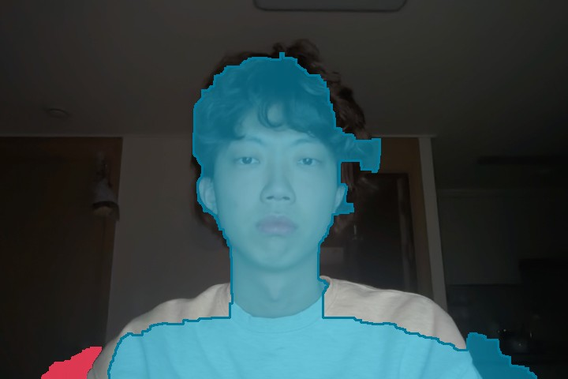
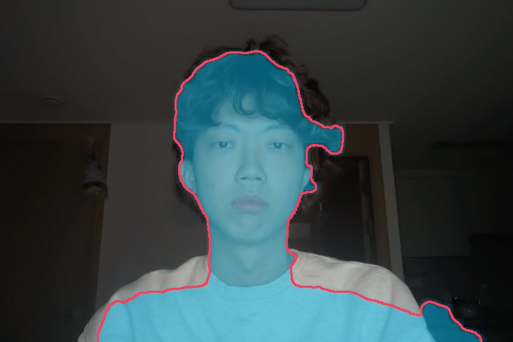
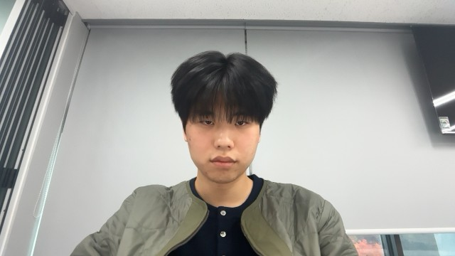
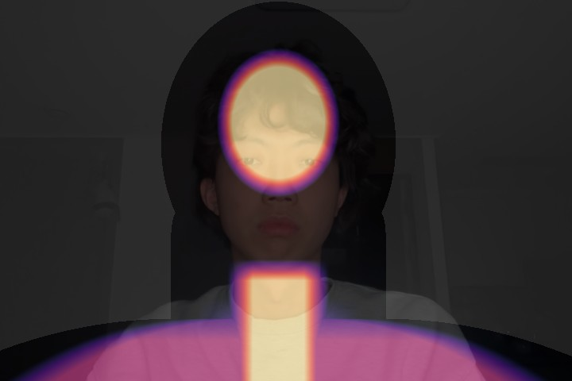
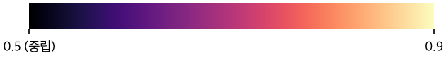
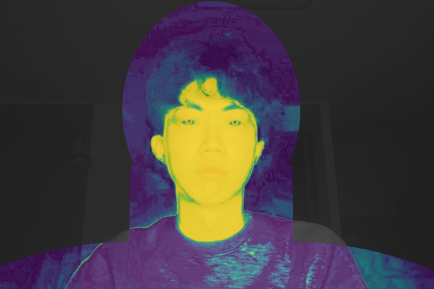
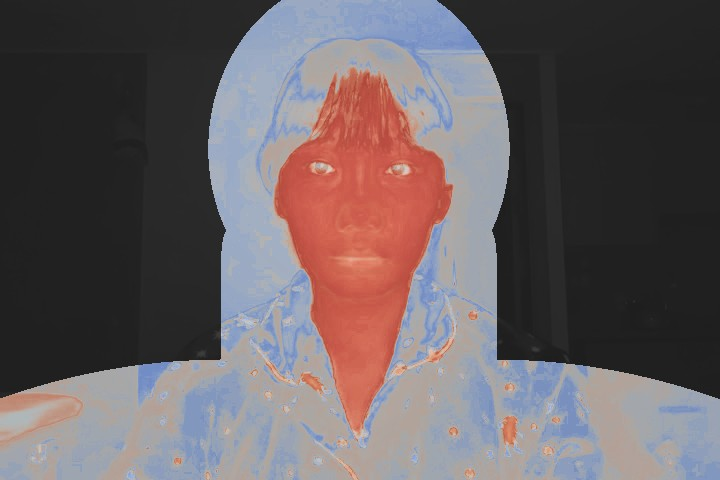
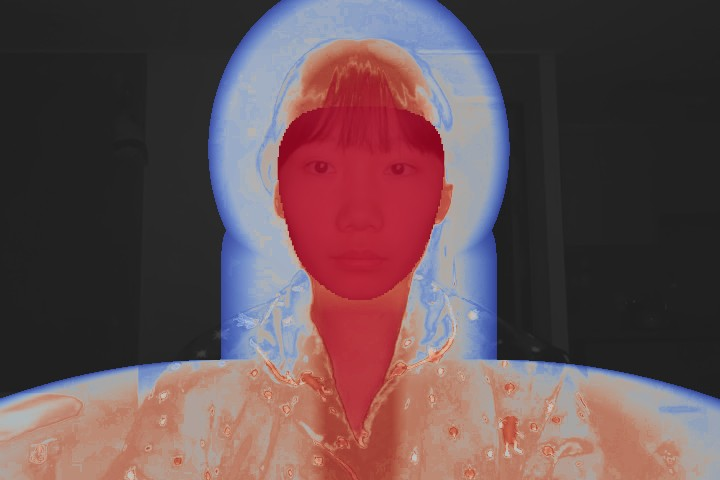
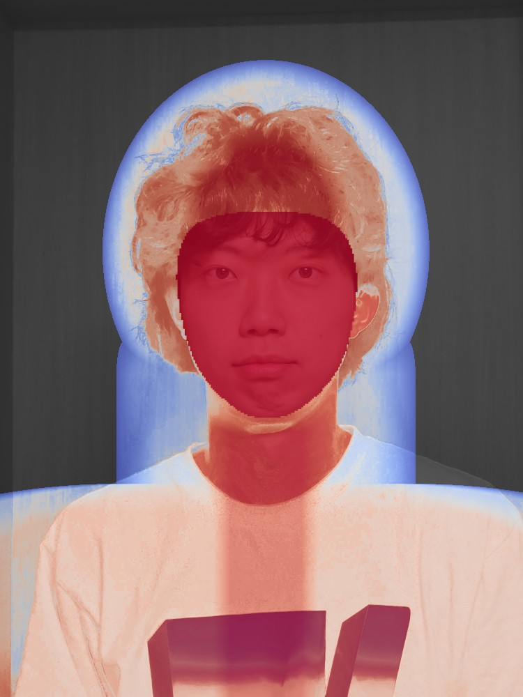
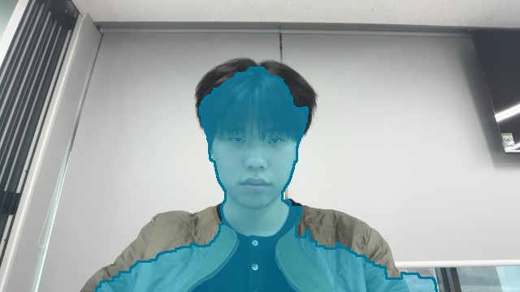

[한국어](README_kr.md)

# Background Separation (Matting) Algorithm Visualization

relight `main` e96bb08 · `idphoto/matting.py` (Module B) · Based on the capture (shutter) path, `Matter.process(fast=False)`

- Runs **without a deep learning model**. Face landmarks define where the person could be. Background colors outside that region and foreground colors around the face and neck are modeled with k-means to score each pixel. Thresholding, morphological cleanup, and a guided filter then refine the boundary into an alpha (opacity) matte, which is composited onto a new background.
- Every figure shows intermediate values obtained by running the main-branch code step by step, without changing it. The final alpha is **pixel-for-pixel identical** to the actual pipeline output (maximum difference: 0 for all 4 images).
- No text is drawn over the figures; explanations appear below each image. Click an image to view it at a larger size.

A separate comparison experiment applying GrabCut and Random Walker while leaving the existing algorithm unchanged is documented in [Section 11](#11-person-prior-alternatives-grabcut-and-random-walker-experiments).

## Overall Flow

<table>
<tr><td valign="top" width="14%"><a href="docs/module-b/matting/test3_0_landmarks.jpg"></a><br/><b>① Input</b><br/>Landmarks</td><td valign="top" width="14%"><a href="docs/module-b/matting/test3_1_gate.jpg"></a><br/><b>② Prior region</b><br/>gate</td><td valign="top" width="14%"><a href="docs/module-b/matting/test3_1_seeds.jpg"></a><br/><b>③ Color samples</b><br/>k-means</td><td valign="top" width="14%"><a href="docs/module-b/matting/test3_3_score.jpg"></a><br/><b>④ Score</b><br/>Color + prior</td><td valign="top" width="14%"><a href="docs/module-b/matting/test3_4_m_conn.jpg"></a><br/><b>⑤ Binary mask</b><br/>Otsu · cleanup</td><td valign="top" width="14%"><a href="docs/module-b/matting/test3_5_alpha_overlay.jpg"></a><br/><b>⑥ Boundary</b><br/>Guided filter</td><td valign="top" width="14%"><a href="docs/module-b/matting/test3_6_white.jpg"></a><br/><b>⑦ Composite</b><br/>Spill removal</td></tr>
</table>

Four example photos are used.

<table>
<tr><td valign="top" width="25%"><a href="docs/module-b/matting/test3_0_input.jpg"></a><br/>test3</td><td valign="top" width="25%"><a href="docs/module-b/matting/test5_0_input.jpg"></a><br/>test5</td><td valign="top" width="25%"><a href="docs/module-b/matting/shot2_0_input.jpg"></a><br/>shot2</td><td valign="top" width="25%"><a href="docs/module-b/matting/test1_0_input.jpg"></a><br/>test1</td></tr>
</table>

| Photo | Original size | Scene | Use in this document |
|----|----|----|----|
| test3 | 1440×960 | Dark room, black curly hair, gray sweatshirt | Main example for the step-by-step explanation |
| test5 | 3000×4000 | Beige wooden wall, white T-shirt | High-resolution boundary close-ups (Sections 5 and 6), failure analysis |
| shot2 | 1280×720 | Bright roller blind, window at the lower right, khaki jacket | Failure analysis |
| test1 | 1440×960 | Very dark room, black hair, dark patterned jacket | Failure analysis |

## 0. Input — Landmarks and Face Mask

From the 478 MediaPipe Face Landmarker points, we obtain the face width *fw* (between the two sides of the face), the eye-to-chin distance *ec* (from the midpoint of the two iris centers to the chin), and the centerline *cx*. All subsequent regions are defined as multiples of these three values. Colors are represented as the square root of linear RGB (sqrt-linear), which approximates perceptual spacing.

<table>
<tr><td valign="top" width="33%"><a href="docs/module-b/matting/test3_0_input.jpg"></a><br/>Original input</td><td valign="top" width="33%"><a href="docs/module-b/matting/test3_0_landmarks.jpg"></a><br/>Green dots: landmarks. Red circles: iris centers, chin, and face sides (reference points for <i>fw</i>, <i>ec</i>, and <i>cx</i>)</td><td valign="top" width="33%"><a href="docs/module-b/matting/test3_0_facemask.jpg"></a><br/>Light blue: Module A's face mask. This region is always fixed as foreground (score 1, alpha 1)</td></tr>
</table>

## 1. Person Prior — `person_prior`, `foreground_seeds`

- **gate** (where the person could be): a **prior assumption** that the head, neck, and shoulders lie within a region inferred from the face position and size. **Everything outside this region is treated as background** and used for background color samples. Foreground/background classification is performed only inside the region.
- **likely** (prior foreground probability inside gate): 0.88 for the skull and neck, 0.7 for the torso (up to 2.2 *fw* from the centerline), and **0.5 = neutral** elsewhere (side hair, outermost shoulders, and the margin above the crown), where color alone determines the result.
- **Foreground sample candidates**: the face mask (eroded by 1 px), the forehead-to-crown ellipse, a narrow column below the chin (width ±0.25 *fw*), and the chest (±0.65 *fw*).

<table>
<tr><td valign="top" width="33%"><a href="docs/module-b/matting/test3_1_gate.jpg"></a><br/><b>gate</b>: the allowed region is inside the yellow outline; the outside is darkened</td><td valign="top" width="33%"><a href="docs/module-b/matting/test3_1_likely.jpg"></a><a href="docs/module-b/matting/cbar_likely.png"></a><br/><b>likely</b>: prior probability inside gate (gray outside gate)</td><td valign="top" width="33%"><a href="docs/module-b/matting/test3_1_seeds.jpg"></a><br/>Sample candidate regions for the color models</td></tr>
</table>

Orange: background sample candidates (outside gate) · Green: foreground sample candidates

## 2. Color Models — k-means

### How the 2000 px Samples Are Selected

We select **up to 2000 px uniformly at random, without replacement**. Every candidate pixel has the same chance of selection; if there are fewer than 2000 candidate pixels, all are used. The sample count is 2000 regardless of image size, so only 0.26% of the background candidates are selected for test3 (1.4 million pixels), and 0.05% for test5 (12 million pixels).

<table>
<tr><td valign="top" width="50%"><a href="docs/module-b/matting/test3_2_samples.jpg"></a><br/>test3 · Actual selected samples. Orange dots = 2000 background samples; green dots = 2000 foreground samples; tinted areas = candidate regions</td><td valign="top" width="50%"><a href="docs/module-b/matting/test5_2_samples.jpg"></a><br/>test5 · The white T-shirt at the right shoulder tip lies outside gate, so about 20 background samples come from the T-shirt (see Section 7)</td></tr>
</table>

### Building the Clusters

k-means++ (8 iterations) is applied to the selected background and foreground samples to create **8 background clusters and 5 foreground clusters**. Each cluster stores its center color, spread (RMS, with a minimum of 0.03), and proportion. Distance is measured in units of the nearest cluster's spread, with **shadow tolerance**: colors scaled in brightness by 0.5–1.25 for background clusters or 0.6–1.5 for foreground clusters are treated as belonging to the same cluster. This is intended to absorb wall shadows and facial shading, but it can also confuse white clothing with a bright wall, or black hair with a dark background.

The first maps below color every pixel in the sample candidate regions by its nearest cluster, not just the 2000 selected samples. The full-image maps assign every pixel to its nearest background or foreground cluster using the distance metric employed for scoring. **These figures show clusters, not the final mask.** The bars below the maps identify each cluster's center color. Clusters are built separately for each photo, so each photo has its own bars. The upper part shows the actual center colors (width indicates sample proportion); the lower part shows the colors used to display the clusters in the maps.

<table>
<tr><td valign="top" width="25%"><a href="docs/module-b/matting/test3_2_clusters_seed.jpg"></a><br/>test3 · Clusters of candidate-region pixels</td><td valign="top" width="25%"><a href="docs/module-b/matting/test3_2_clusters_all.jpg"></a><br/>test3 · Nearest cluster for every pixel</td><td valign="top" width="25%"><a href="docs/module-b/matting/test5_2_clusters_seed.jpg"></a><br/>test5 · Clusters of candidate-region pixels</td><td valign="top" width="25%"><a href="docs/module-b/matting/test5_2_clusters_all.jpg"></a><br/>test5 · Nearest cluster for every pixel</td></tr>
</table>

<table>
<tr><td valign="top" width="50%"><a href="docs/module-b/matting/test3_2_bg_palette_key.png"></a><br/>test3 background clusters: center colors and map display colors</td><td valign="top" width="50%"><a href="docs/module-b/matting/test3_2_fg_palette_key.png"></a><br/>test3 foreground clusters: center colors and map display colors</td></tr>
<tr><td valign="top" width="50%"><a href="docs/module-b/matting/test5_2_bg_palette_key.png"></a><br/>test5 background clusters: center colors and map display colors</td><td valign="top" width="50%"><a href="docs/module-b/matting/test5_2_fg_palette_key.png"></a><br/>test5 foreground clusters: center colors and map display colors</td></tr>
</table>

<table>
<tr><td valign="top" width="100%"><a href="docs/module-b/matting/test3_2_scatter.png"></a><br/>Sample distribution: warmth (R−B) horizontally, brightness vertically. Small markers are samples (circles = background, triangles = foreground); large markers are cluster centers. The dark-hair cluster (triangle) overlaps the dark-background cluster (circle) at the lower left.</td></tr>
</table>

## 3. Score — Color Evidence + Prior Probability

<blockquote>
evidence = ( min(<i>d</i><sub>bg</sub>, 2.5) − min(<i>d</i><sub>fg</sub>, 2.5) ) / τ &nbsp;&nbsp;(τ = 1)<br/>p<sub>color</sub> = σ(evidence)<br/>score = gate · σ( evidence + logit(likely) ), with 1 on the face mask
</blockquote>

*d*<sub>bg</sub> and *d*<sub>fg</sub> are the distances to the background and foreground clusters. They are capped at 2.5 so that a color absent from both models (for example, scenery outside a window) does not strongly favor either side. Where likely = 0.5, logit(likely) = 0, so **score = p<sub>color</sub>**: the decision depends entirely on color.

<table>
<tr><td valign="top" width="50%"><a href="docs/module-b/matting/test3_3_dbg.jpg"></a><br/><i>d</i><sub>bg</sub>: distance to background clusters (larger means less like the background)</td><td valign="top" width="50%"><a href="docs/module-b/matting/test3_3_dfg.jpg"></a><br/><i>d</i><sub>fg</sub>: distance to foreground clusters</td></tr>
</table>

<a href="docs/module-b/matting/cbar_dist.png"></a>

<table>
<tr><td valign="top" width="50%"><a href="docs/module-b/matting/test3_3_pcolor.jpg"></a><br/>p<sub>color</sub>: foreground probability from color alone</td><td valign="top" width="50%"><a href="docs/module-b/matting/test3_3_score.jpg"></a><br/>score: final score after adding the prior probability and multiplying by gate (face = 1)</td></tr>
</table>

<a href="docs/module-b/matting/cbar_prob.png"></a>

## 4. Thresholding and Cleanup

1. **Otsu threshold**: selected automatically from the score histogram where gate > 0.05, then clamped to [0.35, 0.65]. For test3, *t* = 0.598.
2. **Opening** (radius 2*k* = 4 px, where *k* = image width/640): removes small specks and thin protrusions.
3. **Closing** (radius 5*k* = 11 px): fills narrow gaps and small holes.
4. **Keep only regions connected to the face**: retain components 4-connected to the face on a 1/4-resolution grid, and fill holes that do not touch the image border.

<table>
<tr><td valign="top" width="50%"><a href="docs/module-b/matting/test3_4_hist.png"></a><br/>Score histogram (log scale) and Otsu threshold (red line)</td><td valign="top" width="50%"><a href="docs/module-b/matting/test3_4_m_raw.jpg"></a><br/>Raw binary mask: score &gt; <i>t</i></td></tr>
</table>

<table>
<tr><td valign="top" width="33%"><a href="docs/module-b/matting/test3_4_m_open.jpg"></a><br/>After opening</td><td valign="top" width="33%"><a href="docs/module-b/matting/test3_4_m_close.jpg"></a><br/>After closing</td><td valign="top" width="33%"><a href="docs/module-b/matting/test3_4_m_conn.jpg"></a><br/>Face-connected components + hole filling</td></tr>
</table>

Light blue: mask (person) · Red: removed since the previous step · Yellow: added since the previous step

In test3, closing also fills dark background beside the right side of the hair, creating a bump. The connectivity step removes the detached fragment at the lower left.

## 5. Boundary Refinement — Color Guided Filter

After slightly blurring the binary mask with a 3×3 mean filter, we apply a **color guided filter** (He et al.) using the relit frame's colors as the guide. It fits the local linear model alpha ≈ *a*·color + *b* in each window, allowing the mask boundary to follow actual image edges, including hair strands. The radius is *r* = 6*k* (28 px for test5), with ε = 2·10<sup>−3</sup>. Pixels farther than *r*/2 (14 px for test5) from the coarse boundary are then fixed to 0 or 1, limiting the soft transition to a band within ±*r*/2 of the boundary. The figures below are native-resolution crops of the hair at the upper left of test5.

<table>
<tr><td valign="top" width="25%"><a href="docs/module-b/matting/test5_5_cropbox.jpg"></a><br/>Close-up location (yellow rectangle)</td><td valign="top" width="25%"><a href="docs/module-b/matting/test5_5_crop_img.jpg"></a><br/>Original</td><td valign="top" width="25%"><a href="docs/module-b/matting/test5_5_crop_mask.jpg"></a><br/>Binary mask from Section 4 (white = foreground)</td><td valign="top" width="25%"><a href="docs/module-b/matting/test5_5_crop_band.jpg"></a><br/>Yellow band: region where alpha can remain between 0 and 1 (within ±<i>r</i>/2 of the boundary)</td></tr>
</table>

<table>
<tr><td valign="top" width="33%"><a href="docs/module-b/matting/test5_5_crop_gf.jpg"></a><br/>Raw guided-filter output: responds even to flyaway hair strands</td><td valign="top" width="33%"><a href="docs/module-b/matting/test5_5_crop_alpha.jpg"></a><br/>Final alpha: fixed to 0/1 outside the band, removing flyaway hair beyond it</td><td valign="top" width="33%"><a href="docs/module-b/matting/test5_5_alpha_overlay.jpg"></a><br/>Full alpha (translucent light blue) and the alpha = 0.5 contour (red)</td></tr>
</table>

## 6. Spill Removal and Compositing

<blockquote>
α = 0 → new background color, &nbsp; α = 1 → original<br/>0 &lt; α &lt; 1 : &nbsp; <i>F</i> = ( <i>I</i> − (1 − α) · ratio · <i>B</i><sub>local</sub> ) / max(α, 0.1), &nbsp; output = α·<i>F</i> + (1 − α)·new background
</blockquote>

Pixels in the boundary band contain a mixture of foreground and the original wall color. We subtract the wall component using the local background color *B*<sub>local</sub> (the mean of nearby background pixels) and Module A's relighting ratio (ratio), recover the foreground color *F*, and blend it with the new background. If rule 7 (Section 8) fails, `render_final` keeps the original wall instead of replacing the background. The composites below were produced to show the algorithm output regardless of that rule.

<table>
<tr><td valign="top" width="50%"><a href="docs/module-b/matting/test3_6_white.jpg"></a><br/>test3 on white (#ffffff)</td><td valign="top" width="50%"><a href="docs/module-b/matting/test3_6_demo.jpg"></a><br/>test3 on dark blue (#2f5d9a, for inspecting the boundary)</td></tr>
</table>

<table>
<tr><td valign="top" width="50%"><a href="docs/module-b/matting/test5_6_crop_naive.jpg"></a><br/>Without spill removal, α·<i>I</i> + (1−α)·background: a beige wall-colored fringe remains</td><td valign="top" width="50%"><a href="docs/module-b/matting/test5_6_crop_spill.jpg"></a><br/>After spill removal: the wall-colored fringe is reduced</td></tr>
</table>

## 7. Why Side Hair and Clothing Are Lost — Failure Analysis

Where likely = 0.5 (neutral), score = p<sub>color</sub>. To exceed threshold *t*, evidence must therefore be > logit(*t*) (0.41 for *t* = 0.6, or 0.62 for 0.65). In other words, the pixel must be **distinctly** closer to a foreground cluster than to a background cluster. The torso (likely = 0.7) starts with an advantage of 0.85, but is still excluded if its color favors the background. The values below are medians over landmark-defined regions.

| Photo | Problem region | Cause | *d*<sub>bg</sub> | *d*<sub>fg</sub> | p<sub>color</sub> | score | *t* | Included in mask |
|----|----|----|----|----|----|----|----|----|
| test1 | Side hair | Most background clusters are black because the whole room is dark → black hair is closer to the background | 0.16 | 0.56 | 0.42 | 0.44 | 0.613 | 4% |
| test5 | Outer shoulders (white T-shirt) | The right shoulder tip is outside gate, so about 20 background samples are drawn from the white T-shirt, creating a **white background cluster** (1%) → the T-shirt is close to this cluster. Without it, median *d*<sub>bg</sub> is 4.1 (capped at 2.5) | 0.09 | 0.51 | 0.40 | 0.60 | 0.65\* | 0% |
| shot2 | Outer shoulders (khaki jacket) | Similar to a darker version of a gray roller-blind cluster. The prior of 0.7 puts the score near the threshold, producing a jagged boundary | 0.70 | 1.35 | 0.35 | 0.54 | 0.508 | 59% |
| test3 | Side hair | Although the room is dark, the hair cluster is slightly closer → the score straddles the threshold | 0.52 | 0.15 | 0.59 | 0.61 | 0.598 | 57% |

\* For test5, Otsu selected 0.711, which was clamped to the upper limit of 0.65. Region definitions: side hair = gate 1, likely 0.5, above eye level, 0.35–0.8 *fw* from the centerline, dark pixels / outer shoulders = from 0.5 *ec* below the chin, 1.0–2.0 *fw* from the centerline. Without ground-truth labels, these regions may contain some background pixels.

### test1 — Dark Room

<table>
<tr><td valign="top" width="25%"><a href="docs/module-b/matting/test1_0_input.jpg"></a><br/>Original</td><td valign="top" width="25%"><a href="docs/module-b/matting/test1_3_pcolor.jpg"></a><br/>p<sub>color</sub></td><td valign="top" width="25%"><a href="docs/module-b/matting/test1_3_score.jpg"></a><br/>score</td><td valign="top" width="25%"><a href="docs/module-b/matting/test1_4_m_conn.jpg"></a><br/>Binary mask (<i>t</i> = 0.613)</td></tr>
</table>

### test5 — White T-shirt and Beige Wall

<table>
<tr><td valign="top" width="25%"><a href="docs/module-b/matting/test5_0_input.jpg"></a><br/>Original</td><td valign="top" width="25%"><a href="docs/module-b/matting/test5_3_pcolor.jpg"></a><br/>p<sub>color</sub></td><td valign="top" width="25%"><a href="docs/module-b/matting/test5_3_score.jpg"></a><br/>score</td><td valign="top" width="25%"><a href="docs/module-b/matting/test5_4_m_conn.jpg"></a><br/>Binary mask (<i>t</i> = 0.65)</td></tr>
</table>

<table>
<tr><td valign="top" width="50%"><a href="docs/module-b/matting/test5_2_bg_palette.png"></a><br/>test5 background clusters: beige shades + white (1%) from the right shoulder tip outside gate</td><td valign="top" width="50%"><a href="docs/module-b/matting/test5_2_fg_palette.png"></a><br/>test5 foreground clusters: skin, hair, white T-shirt, and blue pattern</td></tr>
</table>

### shot2 — Bright Roller Blind and Window

<table>
<tr><td valign="top" width="25%"><a href="docs/module-b/matting/shot2_0_input.jpg"></a><br/>Original</td><td valign="top" width="25%"><a href="docs/module-b/matting/shot2_3_pcolor.jpg"></a><br/>p<sub>color</sub></td><td valign="top" width="25%"><a href="docs/module-b/matting/shot2_3_score.jpg"></a><br/>score</td><td valign="top" width="25%"><a href="docs/module-b/matting/shot2_4_m_conn.jpg"></a><br/>Binary mask (<i>t</i> = 0.508)</td></tr>
</table>

In shot2, the scenery outside the window at the lower right contains colors absent from both models, biasing p<sub>color</sub> toward the foreground. The mask leaks into the window (the protrusion at the lower right).

## 8. Rule 7 (Clean Cutout) and Reproducibility

`clean_cutout` in `checker.py` passes only when both conditions below are met. If it fails, the background is not replaced.

1. Within the ID-photo crop, pixels with 0.1 < α < 0.9 must make up **less than 2%** of the area outside the hair band (above mouth level and within ±1.1 *fw* of the centerline).
2. At shoulder height (chin + 0.9 *ec*), the color contrast between the clothing on each side (0.45–1.0 *fw* from the centerline) and the background in the same rows (α < 0.1) must be **at least 0.12**, using the weaker side.

| Photo | Uncertain fraction | Shoulder contrast (approx.) | Verdict | Reason |
|----|----|----|----|----|
| test3 | 1.67% | 0.46 | Pass | |
| shot2 | 2.39% | 0.20 | Fail | About 90% of the uncertain pixels are below the chin (jacket shoulder boundary and window) |
| test1 | 1.91% | 0.10 | Fail | Dark jacket versus dark room |
| test5 | 1.33% | 0.005 | Fail | The T-shirt is missing from the mask, so the T-shirt itself enters the “background” (α < 0.1) → contrast approaches 0 |

Only test5's shoulder contrast was measured directly by the pipeline. The other values are approximations recomputed with the same formula from downscaled intermediate values.

**Reproducibility warning** — The landmark detector (`FaceLandmarkDetector`) is created in VIDEO (tracking) mode, so tracking state from the previous photo affects the next photo's landmarks. Processing test5 alone (first) failed rule 7 (contrast 0.005), whereas processing it after test4 passed (contrast 0.305). The previously shared overlays, processed in filename order, included most of the test5 T-shirt; this document's test5 was processed first, which explains the difference. Small landmark changes alter the prior regions and color samples. The result is sensitive enough that entire regions near the threshold (shoulders and side hair) can be included or excluded.

## 9. Parameters (`config.py`)

| Name | Value | Meaning |
|----|----|----|
| `BG_CLUSTERS / FG_CLUSTERS` | 8 / 5 | Number of background / foreground color clusters |
| `CLUSTER_SAMPLES` | 2000 | k-means sample count per cluster |
| `CLUSTER_SPREAD_FLOOR` | 0.03 | Minimum cluster spread (sqrt-linear) |
| `BG_SHADOW_SCALE` | (0.5, 1.25) | Allowed brightness scale for background clusters |
| `FG_SHADE_SCALE` | (0.6, 1.5) | Allowed brightness scale for foreground clusters |
| `SCORE_TAU` | 1.0 | Evidence temperature |
| `OUTLIER_DISTANCE` | 2.5 | Distance cap |
| `PRIOR_CORE / PRIOR_TORSO` | 0.88 / 0.7 | Skull-and-neck / torso prior probability |
| `CROWN_K` | 2.0 | Crown height (1.15·CROWN_K·ec above the chin) |
| Otsu range | [0.35, 0.65] | Threshold limits (code constants) |
| `OPEN_RADIUS / CLOSE_RADIUS` | 2 / 5 | Opening / closing radius (at 640 px width) |
| `GF_RADIUS / GF_EPS` | 6 / 2e-3 | Guided-filter radius (at 640 px width) / regularization |
| `SPILL_ALPHA_FLOOR` | 0.1 | Minimum denominator for spill removal |
| `UNCERTAIN_MAX / CONTRAST_MIN` | 2% / 0.12 | Rule 7 thresholds |
| `PLAIN_WALL_SHARE` | 0.7 | Plain-wall fraction used to choose the guidance message when rule 7 fails |

## 10. Summary

- The face, skull, and central torso are stable thanks to the prior probabilities and face mask. The decisive regions are **side hair (0.5) and outer shoulders (0.7)**, where the prior is neutral or weak.
- These regions depend solely on color contrast, making them vulnerable in dark rooms (black hair), against bright walls (white clothing), and against achromatic walls (gray or khaki clothing). The allowed shadow scaling increases this ambiguity.
- The guided filter follows hair strands at the boundary, but the ±*r*/2 band restriction prevents recovery of flyaway hair already missing from the coarse mask.
- No quantitative evaluation against ground-truth masks (such as IoU) has been performed yet. The numbers in this document are only regional medians and rule 7 verdicts.

## 11. Person-Prior Alternatives: GrabCut and Random Walker Experiments

`tools/compare_matting.py` is an **offline comparison tool** that runs the existing method and public implementations of two research methods on the same photos. It does not change the app's `Matter`, GUI, or save path. Unlike the core project's NumPy implementation, it uses OpenCV `grabCut` and scikit-image `random_walker` only for this research comparison. It is not a full reproduction of either paper or a final matting implementation.

- **[GrabCut (Rother et al., SIGGRAPH 2004)](https://www.microsoft.com/en-us/research/publication/grabcut-interactive-foreground-extraction-using-iterated-graph-cuts/)**: iterative graph cuts using foreground/background GMMs and color-boundary costs. Seed colors are each modeled with 5 k-means clusters; initial probable FG/BG labels are assigned by distance to the clusters, without brightness scaling. OpenCV then iterates 5 times, and the initial probable labels may change.
- **[Random Walker (Grady, TPAMI 2006)](https://doi.org/10.1109/TPAMI.2006.233)**: computes foreground reachability probabilities on a graph whose edge weights depend on color boundaries, using the same seeds. It uses sqrt-linear RGB, beta 130, `cg_j`, tolerance `1e-6`, and a foreground probability > 0.5.

Neither method uses the existing `gate` or `likely`; pixels outside the gate are also segmented. However, **these methods are not assumption-free.** Automatic foreground seeds are the eroded face interior and small hair/chest patches; background seeds are the top and side borders above the chin, excluding a generous head box (thickness: 4% of the shorter image dimension). The bottom border is not labeled background because it may contain clothing. The hair/chest patches and border-background assumption may also be wrong, and **these seeds are hard labels shared by both research methods**. The existing method continues to use its original samples and priors.

For each photo, landmarks are detected independently in IMAGE mode, and comparisons run on the full image with a maximum long edge of 480 px. Relighting is disabled. Comparison figures show, from left to right, input/seeds, the existing method, GrabCut, and Random Walker; the top row composites on a blue background and the bottom row shows binary masks. The existing method uses `coarse_mask` after morphology and connected-component cleanup; the two alternatives receive no such post-processing or silhouette cropping. **The guided filter, spill removal, and rule 7 fallback are not applied to comparison composites.** Random Walker probabilities are not physical alpha mattes either.

### Run

```bash
uv sync --extra research
uv run python tools/fetch_model.py
uv run --extra research python tools/compare_matting.py \
  docs/evaluation/test/test5.jpg docs/evaluation/test/test3.jpg \
  docs/evaluation/test/shot2.jpg docs/evaluation/test/test1.jpg \
  --out out/matting-real
uv run --extra research python tools/compare_matting.py \
  --synthetic --out out/matting-synthetic
```

For each photo, the tool saves the input, seeds, three masks, comparison figure, and Random Walker probabilities (16-bit PNG, 0–65535), and records image size, settings, library versions, foreground area ratios, runtime, and solver warnings in `report.json`. Timing excludes detection and I/O; because the existing method also includes additional work such as the guided filter, these are not rigorous speed-comparison numbers. IoU, precision, and recall are computed only for synthetic scenes, where the renderer provides ground truth; for real photos without ground truth, these metrics are `null`. An increase in foreground area must not be interpreted as improved accuracy.

To edit automatic seeds, copy `seeds.png` and edit it as `<photo name>.png` at the same working resolution. Use only **0=unknown, 128=background, 255=foreground** in an 8-bit grayscale image, with at least 5 pixels for both foreground and background.

```bash
uv run --extra research python tools/compare_matting.py \
  docs/evaluation/test/test5.jpg --seeds-dir out/edited-seeds \
  --out out/matting-edited
```

### First Results

These results use automatic seeds and the default settings above. The real-photo comparisons below are qualitative observations, not rankings based on ground truth.

| Photo | GrabCut | Random Walker |
|---|---|---|
| test5 | Hair and shoulder boundaries look more natural than the existing method, but some omissions remain | Keeps the white T-shirt but also includes the wall beside the hair and neck |
| test3 | Preserves the hair and sweatshirt outline relatively well | Connects the background between the hair and shoulders |
| shot2 | Removes part of the khaki jacket as background | Includes the roller blind around the person |
| test1 | Much of the black clothing is lost and the dark background is mixed in | Keeps the black clothing but mixes in the background above and beside the hair |

| Synthetic scene | Existing IoU | GrabCut IoU | Random Walker IoU |
|---|---:|---:|---:|
| Bright wall, navy top | 1.000 | 1.000 | 0.849 |
| Beige wall, red top | 0.999 | 1.000 | 0.843 |
| Top similar to wall | 0.735 | 0.650 | 0.765 |

Three simple synthetic scenes cannot generalize performance on real photos. For now, **there is reason to investigate GrabCut further, but not enough evidence to replace the default algorithm.** Seed placement and color-model initialization matter. In an initial experiment, labeling all unknown pixels probable foreground kept most of the background; labeling them all probable background left only the small chest seed and removed much of the clothing. The results above use seed-color-based initialization to address this.

## 12. Native-Resolution Hair Matting Experiment

`tools/matte_hair.py` is an offline experiment that crops the area around the hair at its **original pixel resolution** and estimates a continuous alpha and foreground color. It distinguishes this from shrinking the full image and enlarging its mask, and allows direct inspection of the original flyaway strands. It produces a head matte that includes the face; it is not semantic hair-only segmentation or video tracking. **The app's `idphoto/` processing path was not changed, and no additional training was performed.**

The comparison methods are [Closed-Form Matting](https://webee.technion.ac.il/people/anat.levin/), [KNN Matting](https://dingzeyu.li/projects/knn/), and learned [F, B, Alpha Matting](https://arxiv.org/abs/2003.07711) (FBA). The first two use [PyMatting](https://pymatting.github.io/); FBA uses [the authors' public implementation and weights](https://github.com/MarcoForte/FBA_Matting). Deep Image Matting was not run in this experiment.

### Run

The FBA authors' code is MIT-licensed, but **the public weights may be used for noncommercial purposes only.** This must not be interpreted as a license that permits product use. The commands below download external code and about 139 MB of weights after this restriction is acknowledged. Photos are not uploaded; inference runs locally. The model and outputs are saved under ignored `models/` and `out/` directories, respectively.

```bash
uv sync --extra hair-matting
uv run --extra hair-matting python tools/fba_reference.py --accept-noncommercial

# FBA: process large original hair crops in overlapping tiles
uv run --extra hair-matting python tools/matte_hair.py \
  docs/evaluation/test/test5.jpg --out out/hair-native-large

# Compare FBA with non-learned matting on the same original crop and trimap
uv run --extra hair-matting python tools/matte_hair.py \
  docs/evaluation/test/test3.jpg docs/evaluation/test/test1.jpg \
  docs/evaluation/test/shot2.jpg --methods fba cf knn \
  --out out/hair-native-small
```

The pinned author-source commit is `8dd100d760186150710510ee8d78ed916cdb17a4`, and the weights' SHA-256 is `f3f8a2b6cefd7200368b6008a712468ed1debc6658693db31b0f719f658a2967`. Before running, the tool verifies the source version and modifications and checks the weights' hash; it loads weights with `torch.load(..., weights_only=True)`. Inference does not automatically download assets or silently substitute another model if assets are missing.

### Constraints from the Crop and Trimap

Only face detection and generation of the existing mask run at a maximum long edge of 640 pixels. After mapping landmarks back to original coordinates, a generous head ROI is defined from face width and eye-to-chin distance, and **the RGB crop and matting input are not resized.** An ROI can also be specified in original-image coordinates with `--box x0 y0 x1 y1` (one photo only). The default crop ends a little below the chin, so it is not guaranteed to include all long hair.

The automatic trimap interpolates the existing alpha and thresholds it at 0.5, then marks an inner region at 0.06 times the face width as sure foreground, and the area outside a dilation of `--band` (default 0.25) as sure background. The face interior is also sure foreground; everything else is unknown. Therefore, **this experiment does not completely remove the influence of the existing person prior.** FBA cannot recover flyaway strands incorrectly labeled as sure background, or hair outside the crop. A warning is issued if foreground touches the top, left, or right ROI edge, but the crop is not automatically expanded.

To separate the effect of this prior, edit the original-resolution trimap directly.

```bash
# Prepare crop.png and trimap.png without inference
uv run python tools/matte_hair.py docs/evaluation/test/test3.jpg \
  --prepare-only --out out/hair-prepare
mkdir -p out/hair-edited
cp out/hair-prepare/test3/trimap.png out/hair-edited/test3.png

# Edit out/hair-edited/test3.png, then rerun on the same crop
uv run --extra hair-matting python tools/matte_hair.py \
  docs/evaluation/test/test3.jpg --trimap-dir out/hair-edited \
  --out out/hair-replay
```

The trimap is an 8-bit grayscale PNG with the same size as the crop: **0=sure background, 128=unknown, 255=sure foreground**. These labels differ from the seed-map values in Section 11, so do not reuse that map as-is. Both foreground and background must be present. Invalid sizes or values raise an error; they are not automatically corrected or resized.

FBA's inductive bias comes from the trimap constraints, a model trained on the spatial structure of images, and its joint estimation of foreground, background, and alpha. However, the color-mixture equation does not have a unique solution, and this architecture does not guarantee that it will distinguish hair from wood grain.

### Native Resolution and Interpreting Results

With the defaults `--tile-size 768 --overlap 96`, FBA runs inference only on tiles that contain unknown regions, then computes a weighted average over overlaps. Tiles are **padded** to a multiple of 8, not resized. Context differences between tiles and boundary errors can remain, so this is not claimed to reproduce the paper's full-image inference. CF/KNN limit crops to 1 million pixels for memory safety; larger crops produce an error directing the user to `--methods fba`.

This adapter supports CPU inference only. On Apple MPS, some adaptive-pooling dimensions in the reference model could not be processed; the adapter does not work around this by arbitrarily resizing inputs or silently changing devices.

Each photo's output includes:

| File | Meaning |
|---|---|
| `crop.png`, `trimap.png` | Original RGB crop and the trimap actually used |
| `comparison.jpg` | Downscaled full comparison for viewing; composites above, alpha below |
| `detail_1to1.png` | Original-pixel comparison, up to 256×256, selected from the upper-center boundary of the existing mask; no scaling |
| `*_alpha.png`, `*_rgba.png` | Original-size 16-bit alpha and 8-bit straight RGBA |
| `*_blue.png`, `*_white.png` | Composites using the estimated foreground color |
| `*_naive.png` | Composite using original RGB with the same alpha (FBA/CF/KNN), to isolate foreground-color recovery |

`current` is a **baseline that interpolates the existing alpha calculated on a 640-pixel working image and composites it with the original RGB**. It does not reproduce the existing app's despill compositing exactly. By contrast, FBA/CF/KNN estimate alpha and foreground color from the original crop, so not every compositing difference can be attributed to an improved alpha. Compositing and model input follow the reference implementation's sRGB conventions and are distinct from the app's linear-light compositing.

`report.json` records original crop coordinates and size, input/trimap hashes, library and model versions, settings, tile count, inference time, crop-edge contact, and Python solver warnings. Performance warnings from CF's incomplete Cholesky preconditioner may also appear in the console when it retries with a shift. **There is no ground-truth alpha, so accuracy metrics are `null`.** Unknown-region or semitransparent-alpha area ratios are not accuracy scores either.

### First Results and Limitations

These results were observed with the default automatic trimap and four CPU threads. Times are approximate for the matting stage only, excluding model loading, detection, and I/O; they do not represent real-time performance.

| Photo | Original crop | Observation |
|---|---|---|
| test3 | 673×732 | FBA and CF recover much of the curly hair missing from the existing mask. CF leaves some nearby background fragments; KNN leaves a wider haze |
| test1 | 692×654 | FBA/CF improve the outline, but ambiguity with the dark background remains. KNN foreground reaches the top of the crop |
| shot2 | 439×501 | FBA/CF recover the hair outline, but background structures such as the blind or its cord may remain |
| test5 | 2152×2431 | 16 FBA tiles, about 11–12 seconds. Fine flyaway strands are recovered, but wood grain and a faint haze remain above and beside the hair |

FBA took about 0.3–1.2 seconds on small crops, CF about 0.5–1.8 seconds, and KNN about 0.8–2.4 seconds. These ranges include initialization cost for the first inference and variation across repeated runs. Since test5 exceeds 1 million pixels, CF/KNN were not run on it. The new shadow-heavy test9 was not used in this experiment.

We also ran the following comparison on test5 to isolate the effect of the trimap:

```bash
uv run --extra hair-matting python tools/matte_hair.py \
  docs/evaluation/test/test5.jpg --band 0.12 --out out/hair-native-narrow
```

Reducing the unknown region by changing the face-width band from 0.25 to 0.12 decreases the share of unknown pixels in the crop from about 41% to 24%, and visibly reduces the wood-grain haze. However, it also increases the risk of cutting off distant flyaway strands as sure background. **There is no evidence that 0.12 is a generally optimal value, so the default was not changed.** The current conclusion is that native-resolution matting is worth applying, but changing the model alone does not solve the problem; the sure regions in the crop and trimap must also be validated.

## 13. Suppressing Broad FBA Alpha Leakage

The implementation of color-based protection, alpha attenuation, and connectivity cleanup is described in the [FBA alpha post-processing notes (Korean)](docs/module-b/fba-alpha-refinement.md).

`tools/refine_hair.py` conservatively post-processes the saved FBA results from Section 12 while **leaving the wide trimap unchanged**. It does not shrink the crop or clip it to a fixed person silhouette. Without training or rerunning inference, it reads the original-size 16-bit alpha and 8-bit foreground-color PNGs, so these have storage quantization differences from FBA's original float32 foreground colors. This experiment is not connected to the app either.

```bash
# Compare with the wide and narrow results generated in Section 12
uv run python tools/refine_hair.py out/hair-native-large \
  --narrow out/hair-native-narrow --out out/hair-color-refined

# Also check other photos with the same settings
uv run python tools/refine_hair.py out/hair-native-small \
  --out out/hair-color-refined-small
```

The photo hashes, crop coordinates, and actual crop pixels must match to include narrow-trimap results as a comparison column. `--narrow` is **for comparison only** and is not used to compute the refined result. The tool rejects an `--out` directory that is the same as an input run.

### Protecting Thin Structures While Suppressing Broad Leakage

Local means and variances are computed from actual RGB in regions with alpha ≥0.98 that are connected to sure foreground. The **foreground colors recovered by FBA** at unknown pixels are compared with the nearby opaque-region color distribution. This avoids rejecting fine hair based only on the original RGB, which may appear bright because it is mixed with the background.

An initial attempt that multiplied the whole alpha by a color score damaged real hair strands. In the final experiment, **only the broad alpha floor, represented by a local minimum, is reduced where color evidence is weak.** Thin structures rising above this floor remain, and opacity protection increases smoothly from alpha 0.25 to 0.8. Finally, regions with alpha above 0.005 that are 8-connected to sure foreground are retained.

The color-statistics radius is about 1/64 of the crop's shorter dimension; the detail radius is about 1/800 (at least 1 pixel). The sRGB color standard-deviation floor is 0.08, and the normalized color distance fades smoothly from 2 to 4. These are exploratory settings, not standard parameters from a paper or validated optimum values.

**The method does not increase alpha or change foreground colors.** It preserves sure foreground/background, and in these four real photos it also left pixels with alpha ≥0.8 unchanged. This makes it conservative about filling new holes inside the hair, but it cannot fill interior alpha that was already estimated too low. No spatial prior that forces opacity based on distance from the face center or hair outline has been added.

### Results and Remaining Issues

The test5 comparison columns are **original / existing baseline / wide FBA / narrow FBA / wide FBA after post-processing**. The run saves `comparison.jpg`, `detail_1to1.png`, and original-size alpha, RGBA, and composites for each method. The displayed trimap is the wide one; the narrow comparison input is saved separately as `narrow_trimap.png`. `support_confidence.png` shows color, opacity, and connectivity support; it is not a multiplier applied directly to alpha.

The wood grain above the hair was substantially reduced, while many fine curls extending to the side remained. We manually selected the wall rectangle at original crop coordinates **(1200, 180)–(1650, 360)** and measured the mean alpha:

| Wide FBA | Narrow FBA | Wide FBA after post-processing |
|---:|---:|---:|
| 0.11028 | 0.00002 | 0.01958 |

The selected wall patch decreased by about 82%, but **this is not an overall false-positive rate or a ground-truth accuracy metric.** It does not mean the result is always better than the narrow trimap. Another background patch on the left barely changed, from 0.02165 to 0.02157. Background haze recovered as hair color, fine background texture, and false positives that already received high alpha can remain. Some real hair strands also weaken, and very faint tips disconnected from the rest may be removed.

The same settings were also applied to test3, test1, and shot2. Distinct hair masses remained, but background ambiguity was not fully resolved. In particular, this post-processor does not semantically recognize hair. The part, scalp, and face are still foreground, and must not be treated as background holes just because they are bright or dark.

Post-processing test5 took about 0.5–0.7 seconds on CPU. A reference-method time of 0 in `report.json` means a saved result was read; it is not FBA inference speed. The report records settings, color/detail radii, input-file hashes, code hash, and library versions. The original FBA weights' noncommercial-use restriction still applies.
