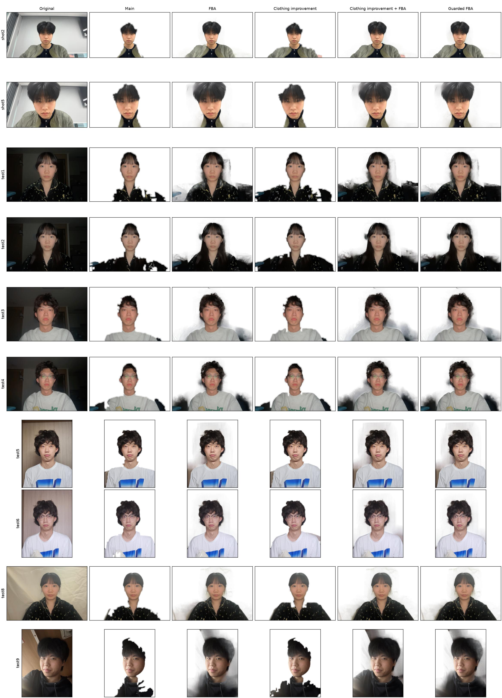
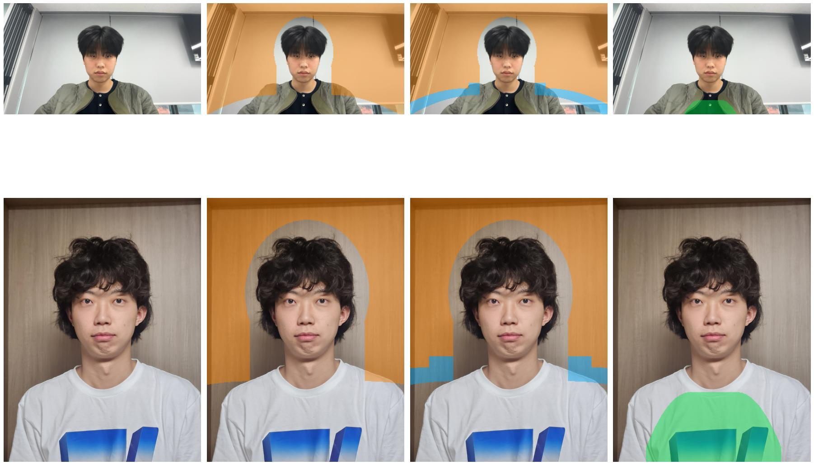

[English](README.md) | [한국어](README_kr.md)

# Module B Clothing-Recovery Experiments



If the existing background-separation pipeline is unfamiliar, first read the [Module B matting overview](https://github.com/hanbin5/relight/blob/module-b/matting/README.md). This report does not repeat that pipeline; it describes the attempts to recover missing clothing and their results. The selected change is in the app's `idphoto/matting.py`, not just an offline experiment.

The **person prior** uses facial landmarks to assume where a person might be, and the **gate** limits that region. **Color-sample candidates** are pixels eligible to be sampled for a color model. **Alpha** is 0 for background, 1 for foreground, and intermediate where the two colors are mixed. The app has no semantic clothing-segmentation model; FBA and the combined result are offline noncommercial research comparisons, not app features.

## Full-Dataset Evaluation: 12 Photo Files

We compared `shot2`–`shot5`, `test1`–`test6`, `test8`, and `test9` in `docs/evaluation/test`. The four photos in `docs/evaluation/crown-crop/originals/` are byte-identical copies of `shot2`–`shot5`, so they are not counted again.

The 12 files are not 12 independent scenes: `shot2`–`shot4` are very similar views of the same scene. The comparison and trimap sheets show `shot2` as their representative and retain the differently framed `shot5`; the table and CSVs still include all 12 photos.

The existing baseline is main commit `e96bb08cb678634207ea3aa45f086152c4c96f11`; the clothing implementation is `06ec619158d68d7c3417fd47ce8fd3703ae269ca`. The FBA reference uses a trimap derived from main alpha and landmarks; the existing combination uses a trimap derived from clothing alpha and the same landmarks. The more conservative Guarded FBA combination is described below. All process the **whole 640 px-wide frame**, including clothing, not the earlier head-only FBA crop. Each input and set of landmarks is shared; relighting strength is 0 and the replacement background is white. Each app run uses a new `Matter` with `update=False`, so color models do not carry over from another photograph.

**There are no ground-truth masks for the real photos.** The first table's numbers count pixels whose alpha was at most 0.5 in main and above 0.5 in ours; they are not comparisons against FBA. They are not counts of actual clothing pixels, accuracy, or recall; added background is included. Images have different sizes, so counts across photos are not comparable as quality scores. Observations refer to the live result; left and right are as viewed in the image.

| Photo | Ours added: live | Ours added: full grid | Ours: live result and remaining problem | FBA: live observation |
|---|---:|---:|---|---|
| shot2 | 15,927 | 5,355 | Much more khaki jacket remains, but outer sleeves and a small bright hole are still missing. | The jacket and hair remain more broadly, although the jacket is partly translucent. |
| shot3 | 7,916 | 14,472 | More jacket remains on both sides, but much of the left sleeve is missing. | More jacket is retained; the left side is partly transparent and some background remains. |
| shot4 | 6,699 | 6,157 | More outer jacket remains, but so does room clutter on the right. | Most of the jacket remains, with some background at the right. |
| shot5 | 0 | 0 | The close-up has no clothing samples, so the extra recovery is skipped. | Hair is retained more broadly, but much of the jacket still fades away. |
| test1 | 26,880 | 10,719 | More black patterned clothing remains, with shoulder holes and dark-room leakage. | More hair and clothing remain, with conspicuous room objects and haze. |
| test2 | 15,067 | 16,128 | More patterned clothing remains, but dark objects at the sides stay connected. | Hair and clothing remain, but the dark room and haze remain at both sides. |
| test3 | 7,138 | 7,011 | More gray clothing remains near the neck and shoulders; a neck notch remains. | The hair and shoulders remain more fully, with background haze on the right. |
| test4 | 7,185 | 7,109 | More clothing remains near the shoulder, along with a blue object and dark side clutter. | The hair and shoulders remain more fully, but dark objects remain at both sides. |
| test5 | 12,618 | 12,714 | The right white shoulder returns, but a left wall strip remains. | The shirt remains, together with wall texture and a dark strip on the left. |
| test6 | 11,753 | 12,569 | More outer white clothing remains, but wall behind the shoulders is also newly included. | The shirt remains, with faint wall texture behind the head. |
| test8 | 15,664 | 14,794 | Outer black sleeves return, with collar notches and blocky edges remaining. | The top remains more fully, but the fabric backdrop leaves haze. |
| test9 | 34,428 | 15,183 | More dark hoodie remains, but shadow-side gaps, attached background, and a clipped hair edge remain. | Hair and hoodie extend farther, but broad background haze remains. |

### FBA and Clothing Improvement + FBA: 12 Photos

The counts below are pixels added / removed by the **combined live result relative to FBA**. Each counts whole-frame pixels crossing the alpha 0.5 threshold in one direction. These are not actual clothing pixels or ground-truth errors; they include background leakage.

| Photo | Added / removed vs FBA | Combined result |
|---|---:|---|
| shot2 | 2,079 / 0 | The translucent jacket becomes more opaque, but some background remains on the right. |
| shot3 | 1,111 / 999 | The left jacket is less translucent, but some background remains. |
| shot4 | 22 / 433 | Most of the jacket remains, much like FBA, along with a background object on the right. |
| shot5 | 0 / 0 | No clothing samples are available; both trimaps and FBA alphas match, and the jacket still fades. |
| test1 | 18,831 / 439 | The top remains, but dark room objects at the sides are more prominent than in FBA. |
| test2 | 8,747 / 1 | The top remains connected to dark background objects on both sides. |
| test3 | 2,044 / 10 | The shoulders remain, but so does background haze on the right. |
| test4 | 2,979 / 91 | Hair and shoulders remain along with dark objects and haze on both sides. |
| test5 | 1,090 / 43 | The white top remains along with the left wall strip and wall texture. |
| test6 | 10,256 / 36 | The wall behind the right shoulder is more prominent than in FBA. |
| test8 | 38 / 2,640 | The black top and faint fabric-backdrop haze remain, with some alpha changes from FBA. |
| test9 | 65,273 / 0 | The hoodie is more opaque, but background around the head and upper left is much more prominent. |

### Guarded FBA: 12 Photos

Converting the existing clothing result to a trimap promotes added regions to sure foreground and also relaxes surrounding sure background to unknown. In live test6 and test9, respectively 16,263 and 31,940 pixels became sure foreground in the existing combined trimap, and 2,885 and 6,788 pixels changed from sure background to unknown. No sure-background pixels changed directly to sure foreground in these two photos. Many of the new sure-foreground pixels are clothing, but FBA can retain wall or shadow in the enlarged unknown area. These are class transitions, not counts of mislabeled background.

Guarded FBA **keeps the main trimap**, promoting an unknown pixel to sure foreground only when the clothing trimap marks it sure foreground and the first, main-based FBA alpha exceeds 0.75. Main's sure background is not relaxed; FBA then runs again on the original photo. The 0.75 cutoff is an experimental choice made after inspecting these photos, not validated on an independent set.

The live counts below are added / removed pixels relative to the existing clothing + FBA result at alpha 0.5. They include both clothing and background and are neither accuracy nor clothing-recovery measurements.

| Photo | Added / removed vs existing combination | Guarded FBA observation |
|---|---:|---|
| shot2 | 572 / 875 | The jacket is more opaque than in FBA, but partly less opaque than in the existing combination. |
| shot3 | 397 / 4 | Most of the jacket remains, although the left side is partly translucent. |
| shot4 | 51 / 8 | Similar to the existing combination, including a background object at the right. |
| shot5 | 0 / 0 | No clothing samples are available; the result matches FBA and the jacket still fades. |
| test1 | 134 / 11,701 | The top remains, but room objects and haze remain at both sides. |
| test2 | 24 / 1,728 | The top remains connected to dark room objects. |
| test3 | 6 / 1,895 | The shoulders remain along with background haze on the right. |
| test4 | 5 / 4,016 | Hair and clothing remain, with objects at both sides. |
| test5 | 0 / 1,072 | The white top remains along with the left wall strip and wall texture. |
| test6 | 0 / 9,456 | The top remains and wall behind the shoulder is lighter than in the existing combination, but not gone. |
| test8 | 803 / 3 | The top remains with background haze; its boundary differs from the existing combination. |
| test9 | 0 / 48,623 | The hoodie remains and background around the head is lighter than in the existing combination, but haze remains. |

In live experiments we also required `clothing_evidence` to exceed 0, 0.5, or 1.0: this reduced some background but from 0.5 removed the shot2 jacket again. Broadening the clothing shade range to `(0.6, 1.5)`, `(0.4, 2.5)`, or `(0.25, 4.0)` kept more clothing in some cases, but also retained more wall in test6 and test8, so neither variant was adopted. Guarded FBA is a limited offline experiment that reduces leakage in test6 and test9; it does not fix the standalone clothing result or change the app algorithm. The first FBA can itself mistakenly confirm background or miss clothing, and unknown regions can change on the second pass. It is not uniformly better on all photos.

### Jackets: shot2–shot5

Much of shot2's previously missing khaki jacket returns, but not every sleeve or background error is fixed. In shot5 the face fills the frame and there are zero clothing-sample candidates, so the baseline result is left unchanged.

### Dark room: test1–test4

In test1 and test2, a wider area of black clothing remains, but dark objects in the room remain with it. A larger mask alone does not establish that the clothing has been separated correctly.

### Light walls and other poses: test5, test6, test8, test9

The right white shoulder in test5 is wider than before, but in test6 the bright wall behind the shoulders is newly included as well. Separating similarly colored clothing and wall remains unsolved.

### FBA Reference, Combination, and Trimaps

FBA estimates foreground, background, and alpha from an image and a **trimap**, not from the image alone. The reference receives a trimap derived from main alpha; the combination receives a trimap derived from **clothing-improved alpha using the same rules**. Both use the original photo as FBA input. Thus this experiment runs clothing improvement first to change FBA's input, rather than applying the clothing model as a postprocess to an FBA result.

We threshold each alpha at 0.5, erode by 0.06 face widths to mark sure foreground, and mark the face mask as foreground. Pixels beyond a 0.5-face-width dilation are sure background, except inside a generous landmark-based body envelope below the chin; those pixels remain unknown unless already sure foreground. The envelope's half-width grows from 1 to 3.5 face widths over one eye-to-chin distance, using the square root of the normalized distance. Erosion and dilation use square windows, with radii rounded to the nearest pixel and a minimum of one pixel.


These are **FBA conditioned on the main or improved mask and landmarks**, not an independent automatic segmentation baseline or a manually corrected trimap. Background erroneously marked sure foreground cannot be removed, and clothing marked sure background cannot be recovered. If clothing improvement wrongly includes background that becomes sure foreground in the combined trimap, FBA cannot remove it. The wide body region allows FBA to decide on sleeves outside the old mask, but also allows wall leakage. The unknown share of the main-derived live trimaps ranges from 31.1% to 59.7% (median 42.5%); this describes the input, not quality. The combination makes shot2's jacket more opaque, but also makes background more prominent in test6 and test9, so it is not uniformly better.

FBA runs on the same resized 640 px input as the app comparisons, on CPU with four threads and a 1024 px tile size. All 12 frames fit in one tile; padding to a multiple of eight preserves the input pixel grid. The reference enforces the trimap's known labels and uses FBA's estimated foreground and alpha for an sRGB white composite, without additional refinement. The app instead composites in linear light with its own spill removal, so composite colors are not strictly like-for-like. In the previous single live run, the FBA call took a median 291 ms (234–1,491 ms range) and the existing combined call 292 ms (236–683 ms range). The existing combination and Guarded FBA are later calls on the same model, and Guarded FBA also needs the first FBA result. The numbers exclude model loading, trimap generation, landmark detection, and input-mask generation; they are not fair speed comparisons, end-to-end times, or real-time measurements.

The live path calculates color decisions and filter coefficients on a **half-size grid, `s=2`**, from the 640 px input. The [full-grid comparison](docs/evaluation/clothing/full-grid-fba/comparison.jpg) applies the shutter algorithm's **`s=1` to the same 640 px input** and derives both trimaps from that mode's main and improved alphas. The clothing-only shoulders in shot2 and shot4 remain fragmented on this path, while shot3 gains more than in live mode. **This is not an original-resolution export evaluation**, nor evidence that the two paths produce identical boundaries.

The [full-grid FBA trimaps and alphas](docs/evaluation/clothing/full-grid-fba/trimap.jpg) and [main-versus-ours live alpha comparison](docs/evaluation/clothing/comparison.jpg) are also available.

The [live CSV](docs/evaluation/clothing/measurements.csv) and [full-grid CSV](docs/evaluation/clothing/full-grid/measurements.csv) record thresholds, sample-candidate counts, application status, and single-run times for all 12 photos. Across the set, live mode adds 161,275 pixels and removes 9; full grid adds 122,211 and removes 6. Removed pixels had alpha above 0.5 before and at most 0.5 after. Recovery only adds to the binary mask **before** cleanup; subsequent cleanup and guided-filter recomputation can also change existing edges.

The [FBA live CSV](docs/evaluation/clothing/fba/measurements.csv) and [FBA full-grid CSV](docs/evaluation/clothing/full-grid-fba/measurements.csv) also record trimap class sizes, pixels added/removed for the existing results and Guarded FBA at alpha 0.5, tile counts, and processing times. These differences are not ground-truth errors or clothing accuracy.

The figures show white-background composites regardless of rule 7. The app can retain the original wall when rule 7 fails at the shutter, so the figures do not necessarily represent what would be saved.

## 1. Why Clothing Was Missing

The old gate serves two roles: in the scoring stage it excludes the person outside the assumed shape, and pixels outside it are candidates for the background color model. A shoulder wider than assumed can therefore be cut off and also teach the model that its fabric is background.

In the earlier [matting failure analysis](https://github.com/hanbin5/relight/blob/module-b/matting/README.md), about 20 background samples came from the end of test5's right white shoulder and formed a white cluster. In shot2, the khaki jacket resembled a dark shade of the gray blind cluster, and 59% of a landmark-defined outer-shoulder region was included in the mask. These are **observations from the earlier original-resolution analysis**, not recall against labeled clothing. They are not a before/after measurement paired with the 640 px comparison above.

The old person-color samples represent the face, hair, neck, and a narrow chest together. If a black inner top occupies the middle of the chest, an outer jacket's color may be poorly represented. In a dark room, black clothing and room objects can have similar colors. The torso prior of 0.7 is not certain foreground, so background color evidence and the threshold can still exclude clothing.

## 2. Separate Clothing Models and Guarded Background Samples

### Why and What Was Selected

The first attempt widened the global shoulder gate higher up and expanded chest samples. More clothing remained, but the global background/person models and Otsu threshold also changed, with visible changes to the hair boundary in shot3 and test9. Rather than redefine the head color model, we selected a separate clothing score. The intermediate code and figures for that first attempt were not retained, so this is not an independently reproducible quantitative ablation.

We also narrowed the allowed shading of clothing colors and required a close match to the clothing samples. This still did not prevent wall leakage in test6. Instead of replacing existing body labels, the selected method **adds only supported pixels to the existing mask** to reduce new holes; it can also retain background that was already incorrectly included.

### Process

1. Face width `fw`, eye-to-chin distance `ec`, and the midline from the landmarks define a clothing search region that widens higher up than the old shoulder gate. Pixels in a wide guard below the chin are excluded **only from clothing-background candidates**; the whole guard is not forced to foreground.
2. Clothing-color candidates come from the chest below the chin; clothing-background candidates are old background candidates outside the guard. For example, test5 has 20,243 clothing and 44,745 background candidates on the live processing grid; at most 2,000 from each are used by the models. Candidate regions can contain pixels that are not actually clothing or background.
3. Separate clothing foreground/background color models score the search region using color distances and a torso prior. A pixel is added only if its clothing score exceeds the original Otsu threshold and its distance to the clothing model is below 2.5.
4. The added decisions are combined with the old binary mask before the existing opening/closing, face connectivity, hole filling, and guided filter. The original head color models and scoring definitions are unchanged, but later connectivity and edge processing are not guaranteed to be pixel-identical.



For test5, the guard excludes 4,607 of the 49,352 old background candidates, leaving 44,745 for the clothing-background model. The blue region includes wall as well: it is not all contaminated samples or all clothing. The green region is not guaranteed to be clothing either.

The app's image processing uses NumPy. There is no additional segmentation or depth model, calibration frame, manual per-photo region, or photo-name-specific threshold. Facial landmarks still use the existing MediaPipe model.

### Settings and Insufficient Samples

| Item | Setting |
|---|---|
| Clothing search region | Starts at chin + 0.2 `ec`; half-width increases from 0.6 `fw` to 2.8 `fw` with a square-root progression over 0.8 `ec`, then fades across 0.25 `fw` |
| Background guard | Below the chin, excludes old background candidates inside that half-width plus 0.6 `fw` from clothing-background candidates |
| Clothing candidates | Chin + 0.65 `ec` through + 2.5 `ec`; half-width grows from 0.35 `fw` to 1.0 `fw` with a square-root progression over 1 `ec` |
| Neck protection | Additional decisions only below chin + 0.65 `ec` or at least 0.45 `fw` from the midline |
| Clothing prior | 0.5 at the margin, up to the existing `PRIOR_TORSO=0.7` inside the torso |
| Color models | 8 background and 5 clothing clusters, at most 2,000 samples each; sampling RNG seeds 3 and 4 respectively |
| k-means | 8 iterations cold, 3 on an updating frame with previous models |
| Shading and color support | Clothing linear-intensity scale 0.8–1.2; its square root is used for color distance. Distance to the clothing model must be below the existing cap of 2.5 |
| Threshold | Original score's Otsu value, clipped to 0.35–0.65 |

If either the clothing candidates or guarded background candidates number fewer than 50 on the processing grid, the additional pass is skipped. On an updating frame, the old clothing models are also cleared; `Matter.reset()` clears both original and clothing models. Application status and candidate counts are recorded in `ctx.stats["matting"]`.

**The frame-border fallback still matters.** If the old background or old foreground candidates number fewer than 50, the original code replaces background candidates with the frame border. The clothing-background candidates then also come from that border minus the guard; if at least 50 remain, they can train the clothing-background model. They are not guaranteed to be clean wall pixels.

The guarded background model is used only for clothing scoring. The original head/background models, wall statistics, plain-wall check, and local-spill estimation keep their original definitions. This does not purify every background estimate in the pipeline.

## 3. Synthetic Regression Scenes With Known Masks

Unlike the real photos, the person region in each 320 × 280 synthetic scene is known when it is rendered. We constructed wider, higher shoulders and compared the same baseline and improved code. Retention below is the fraction of the **specified synthetic target region** whose alpha exceeds 0.5, not full-image IoU.

| Synthetic target | Target pixels | Baseline retention: live / full grid | Improved: live / full grid |
|---|---:|---:|---:|
| Khaki jacket outside a black inner top | 13,932 | 0% / 0% | 100% / 100% |
| White sleeve where the old gate is below 0.05 | 658 | 0% / 0% | 100% / 100% |
| Dark top with separate dark room clutter | 26,304 | 95.38% / 95.15% | 100% / 100% |

After recovery, false foreground in these scenes occupied about 0.013–0.016% of the **whole image**, not of the background alone. The tests require target retention above 98% and false foreground below 0.5% of the whole image. They also check the sampling guard and clearing warm state when the chest is cropped.

These simple scenes check the intended clothing-only regressions; they do not evaluate the FBA combination or establish accuracy on real photos, separation of identical clothing and wall colors, coverage of varied poses, or hair-boundary quality.

## 4. Reproduction and Limitations

Python 3.12 and [uv](https://docs.astral.sh/uv/) are required. These commands write under `out/` rather than overwriting the tracked figures and CSVs.

```bash
uv sync --group dev
uv run python tools/fetch_model.py

uv run python tools/eval_clothing.py --sample-figure --out out/clothing-report/live
uv run python tools/eval_clothing.py --full-grid --out out/clothing-report/full-grid

uv run pytest tests/test_matting_checker.py -q
uv run pytest -q
```

Each evaluation writes one comparison figure and `measurements.csv`; the figure shows 10 photos and the CSV retains all 12. `--sample-figure` also produces the `sample-regions.jpg` shown above. The default baseline is the fixed main commit above; `--baseline SHA` overrides it. The tool loads that revision's `matting.py` from Git using the current shared configuration, so the baseline commit must be present locally. The only shared-configuration difference from the fixed baseline is the new clothing-shade constant, which the baseline code does not use.

To reproduce the FBA comparison, first review the [authors' license and model notice](https://github.com/MarcoForte/FBA_Matting). The source is MIT-licensed, but the released weights are **noncommercial only**; this comparison does not authorize commercial or product use. After acknowledging that restriction:

```bash
uv sync --extra fba --group dev
uv run --extra fba python tools/fba_reference.py --accept-noncommercial
uv run --extra fba python tools/eval_clothing.py --fba --out out/clothing-report/live-fba
uv run --extra fba python tools/eval_clothing.py --fba --full-grid --out out/clothing-report/full-grid-fba
uv run --extra fba pytest tests/test_matting_checker.py -q
uv run --extra fba pytest -q
```

The commands download the authors' source and approximately 139 MB of weights into ignored `models/fba/`; photos remain local. The adapter verifies source revision `8dd100d760186150710510ee8d78ed916cdb17a4` and weight SHA-256 `f3f8a2b6cefd7200368b6008a712468ed1debc6658693db31b0f719f658a2967` and loads weights with `weights_only=True`. Each FBA run writes one comparison figure including Guarded FBA, one trimap and alpha figure, and a CSV. Missing or invalid assets and trimaps raise errors rather than silently substituting another method.

Landmarks are detected in image mode and cached by default in `out/clothing-landmarks/`; the same values are used within each before/after pair. The cache is not tracked by Git. Redetection in a fresh environment or with a fresh `--cache` directory can change landmarks and measurements. Missing photos or faces raise errors instead of being silently omitted. `test9.jpg` was restored unchanged from `e8e798c8eee3118bebba4ba8f34c37808f84c250` on `module-b/person-prior`.

Validation with the FBA assets passed 215 tests overall, including 45 matting/checker tests. Main and improved CSV times are single cold-run measurements of the matting stage only; they exclude loading, landmark detection, and relighting. They are diagnostics, not a latency guarantee or a 10 fps claim.

This is a **bounded clothing-recovery improvement, not a general portrait-segmentation solution**. It cannot recover clothing without samples, as in shot5; similar-colored objects in test1/test2/test9 and the wall in test6 can remain. Crossed arms or an occluded chest can invalidate the assumed sample and shoulder locations. Original-resolution export, warm starts on real sequences, landmark jitter, and sustained webcam performance were not evaluated. Accuracy or production-readiness claims need hand-drawn masks and temporal evaluation.

For general app usage, see the [main README](https://github.com/hanbin5/relight/blob/main/README.md). The app produces edited photos and is not for passports or other government IDs.
