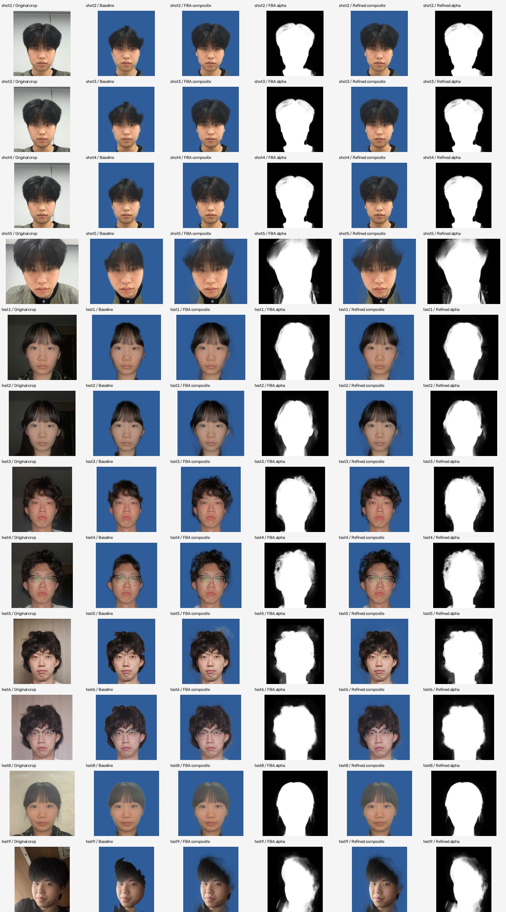
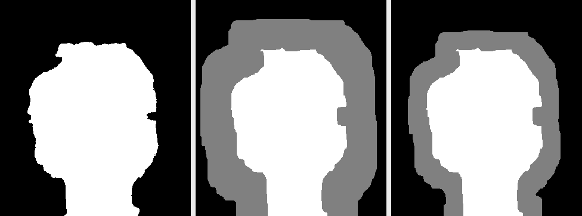
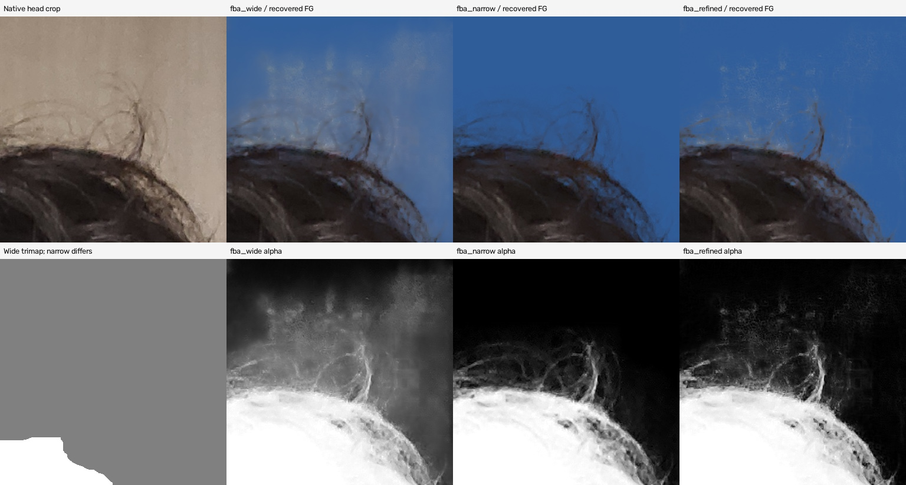
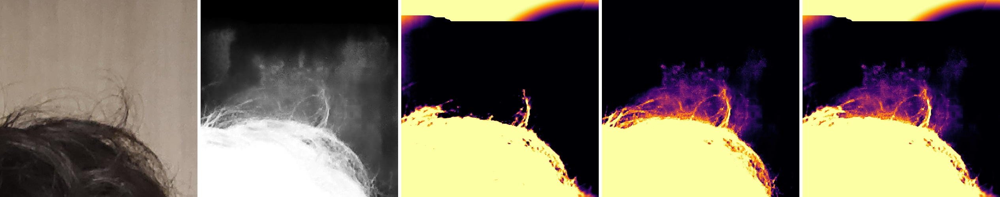
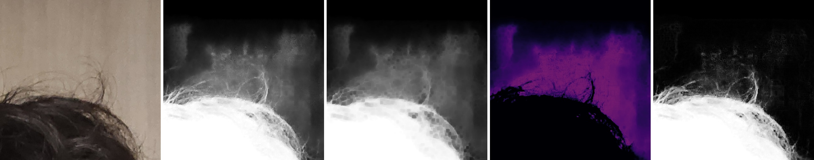
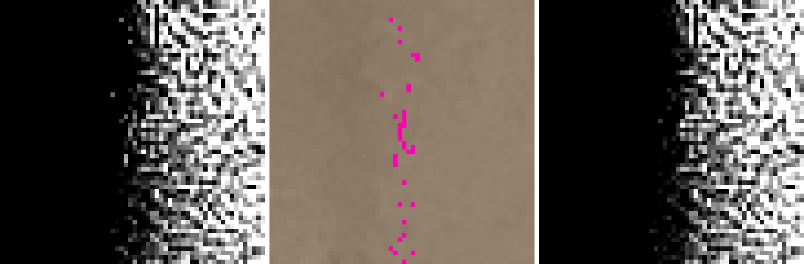
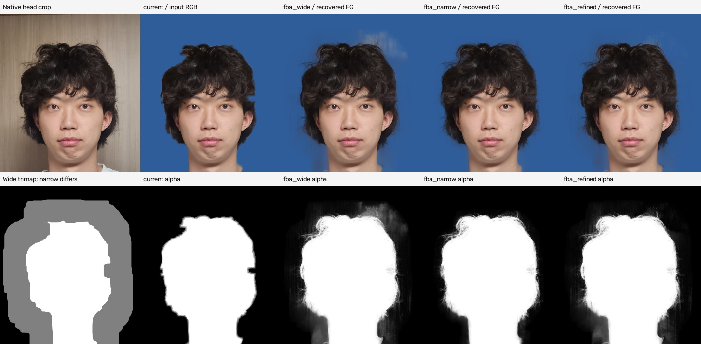

[한국어](README_kr.md)

# FBA Head-Matting Experiments

If you have not read how the existing background-separation pipeline works, read the [English matting overview](https://github.com/hanbin5/relight/blob/module-b/matting/README.md) first. This document assumes that context and focuses on original-resolution FBA head matting and its alpha refinement, motivated by limitations in the existing mask.

The terms used below are brief reminders: the **person prior** is the existing face-landmark-based assumption about where a person can be; the **existing alpha** is its rough person/background mask; and a **trimap** marks sure foreground, sure background, and pixels left for a matting method to decide. These terms refer to the prior, alpha, and boundary stages in the overview.

## Full-Dataset FBA Evaluation (12 Unique Photos)

We enumerated `docs/evaluation/test` and found 12 unique photos. The four files in `docs/evaluation/crown-crop/originals/` are byte-identical copies of `shot2`–`shot5`, not additional cases.

All 12 photos completed FBA head matting and post-processing without runtime errors. The existing landmarks and alpha defined an original-resolution head crop and default wide trimap (`--band 0.25`); FBA used 768 px tiles, 96 px overlap, and 4 CPU threads, followed by `refine_hair.py`. The output is a head matte including the face, not a full-body mask or hair-only segmentation.

**None of these real photos has a ground-truth mask.** The last numeric column is the percentage decrease in the sum of FBA alpha across the entire head crop after post-processing, not the percentage of errors removed. Across these 12 photos it has a median of 0.35% and a range of 0.04–1.75%; a visible change in one selected patch does not imply a comparable whole-image improvement. Median FBA inference took 0.59 s (0.29–11.93 s), and post-processing took 0.038 s (0.019–0.408 s); these are CPU timings, not quality scores.



*Each row shows the original head crop, the existing-mask baseline composite, the FBA composite and alpha, then the post-processed composite and alpha. Alpha is white at 1 (foreground) and black at 0 (background). The crop includes the face and is not hair-only segmentation.*

| Photo | FBA head crop (pixels; tiles) | Whole-crop FBA alpha mass reduced | Observed FBA result |
|---|---:|---:|---|
| shot2 | 439×501; 1 | 0.05% | FBA and the existing alpha produce similar head outlines; refinement changes little. |
| shot3 | 425×491; 1 | 0.04% | FBA adds a soft hair edge; refinement has little further effect. |
| shot4 | 420×492; 1 | 0.05% | FBA and refined head mattes remain similar. |
| shot5 | 721×645; 1 | 0.54% | FBA softens the hair boundary, while some haze remains. |
| test1 | 692×654; 1 | 0.25% | FBA retains a soft hair edge; refinement makes a small difference. |
| test2 | 661×645; 1 | 0.41% | FBA/refinement do not remove all hair-adjacent haze. |
| test3 | 673×732; 1 | 0.68% | FBA recovers curl detail but leaves some haze. |
| test4 | 598×635; 1 | 0.53% | FBA recovers hair-edge detail, but background ambiguity remains. |
| test5 | 2152×2431; 16 | 1.75% | FBA recovers fine curls but leaves wall texture; this has the largest whole-crop alpha reduction, still below 2%. |
| test6 | 2095×2246; 16 | 0.29% | FBA preserves hair detail, with a small whole-crop change after refinement. |
| test8 | 641×642; 1 | 0.04% | FBA and refinement are close to the existing-mask baseline around the hairline. |
| test9 | 1282×1518; 6 | 0.42% | FBA creates a soft, hazy head edge; refinement reduces little of the full-crop alpha. |

Across the set, FBA completes on all 12 head crops and can recover softer hair detail, but the result remains dependent on the existing prior and trimap; the broad haze in some crops is not reliably removed by the current post-processing.

## 1. Native-Resolution Hair/Head Matting

### Why This Experiment

The existing mask can miss fine hair before the edge-refinement stage. The conventional guided-filter boundary is limited to a band around the coarse silhouette, so strands outside that band cannot be recovered there. We tested whether matting the head crop at its original resolution, with a trimap that leaves uncertain hair to the model, would retain more strands.

This is an offline experiment that estimates a continuous alpha and foreground color from a crop. It produces a **head matte that includes the face**, not hair-only semantic segmentation or video tracking. It did not change the app's `idphoto/` path and involved no additional training.

### Process and Evidence

The initial alpha and landmarks come from the existing `Matter.process`/face-landmark path. They guide a generous head ROI in the original photo; the crop pixels are not downscaled. The initial alpha is interpolated into the crop, thresholded at 0.5, and expanded into a trimap. Erosion by 0.06 face widths defines sure foreground; pixels outside a dilation by the selected band are sure background; the region between is unknown. The face interior is also fixed foreground. Thus the previous person prior still influences this experiment.



*Left to right: thresholded initial mask, wide trimap, and narrow trimap. White = sure foreground; black = sure background; gray = unknown.*

FBA (**Foreground, Background, Alpha**) is a learned model that estimates foreground color, background color, and alpha together from the crop and trimap. Alpha is the blend amount: 0 means background, 1 means foreground, and intermediate values represent partially covered pixels such as fine strands. We compared it with [Closed-Form Matting](https://webee.technion.ac.il/people/anat.levin/) and [KNN Matting](https://dingzeyu.li/projects/knn/) via [PyMatting](https://pymatting.github.io/). FBA uses [the authors' public implementation and weights](https://github.com/MarcoForte/FBA_Matting). Deep Image Matting was not run.



*Top: original crop and recovered foreground color from wide FBA, narrow FBA, and post-processing. Bottom: their alpha mattes in the same order.*

The wide trimap leaves more uncertain pixels for FBA, which can retain distant strands but also permits broad wall haze. Narrowing the band reduced haze in this example, but risks marking distant flyaway hair as definite background.

### Results and Limitations

With the default automatic trimap and four CPU threads:

| Photo | Original crop | Observation |
|---|---|---|
| test3 | 673×732 | FBA and CF recover much of the curly hair missing from the existing mask. CF leaves nearby background fragments; KNN leaves wider haze |
| test1 | 692×654 | FBA/CF improve the outline, but ambiguity with the dark background remains. KNN foreground reaches the top of the crop |
| shot2 | 439×501 | FBA/CF recover the hair outline, but background structures such as the blind or its cord may remain |
| test5 | 2152×2431 | 16 FBA tiles, about 11–12 seconds. Fine strands are recovered, but wood grain and faint haze remain above and beside the hair |

On the earlier small-crop comparison, FBA took about 0.3–1.2 seconds, CF 0.5–1.8 seconds, and KNN 0.8–2.4 seconds. These ranges include first-inference initialization and variation between runs. That comparison did not run CF/KNN on test5 because it exceeded 1 million pixels, and did not include test9. The full-dataset run above includes test5, test6, and test9 with FBA only; all three native head crops exceed 1 million pixels. These are matting-stage times, not real-time performance.

For test5, changing `--band` from 0.25 to 0.12 reduced the unknown-pixel share from about 41% to 24% and visibly reduced wood-grain haze, but increased the risk of losing distant strands. There is no evidence that 0.12 is generally optimal, so the default was not changed. The conclusion is that native-resolution matting is worth testing, but changing the model alone does not solve the problem; the sure regions in the crop and trimap also need validation.

The crop can exclude long hair. FBA cannot recover strands incorrectly labeled sure background. Tile context and boundary errors remain, so this is not a claim to reproduce the paper's full-image inference. No ground-truth alpha is available; accuracy metrics are `null`, and unknown-region or partial-alpha area is not an accuracy score. The adapter supports CPU only; it does not silently resize inputs or switch devices to work around Apple MPS adaptive-pooling limitations. Model input and compositing use the reference implementation's sRGB conventions, unlike the app's linear-light compositing.

### Reproduction and Technical Details

The FBA authors' code is MIT-licensed, but **the public weights may be used for noncommercial purposes only**; this does not authorize product use. After acknowledging this restriction, the commands download external code and about 139 MB of weights. Photos remain local. The model and outputs are saved under ignored `models/` and `out/` directories.

```bash
uv sync --extra hair-matting
uv run --extra hair-matting python tools/fba_reference.py --accept-noncommercial

# FBA: process large original hair crops in overlapping tiles
uv run --extra hair-matting python tools/matte_hair.py \
  docs/evaluation/test/test5.jpg --out out/hair-native-large

# Compare FBA with non-learned methods on the same original crop and trimap
uv run --extra hair-matting python tools/matte_hair.py \
  docs/evaluation/test/test3.jpg docs/evaluation/test/test1.jpg \
  docs/evaluation/test/shot2.jpg --methods fba cf knn \
  --out out/hair-native-small
```

The pinned author-source commit is `8dd100d760186150710510ee8d78ed916cdb17a4`; the weights' SHA-256 is `f3f8a2b6cefd7200368b6008a712468ed1debc6658693db31b0f719f658a2967`. Before running, the tool checks the source version, modifications, and weight hash; weights load with `torch.load(..., weights_only=True)`. Inference does not download assets automatically or substitute another model if assets are missing.

Only face detection and generation of the initial mask use an image with a maximum long edge of 640 px. Landmarks are mapped to original coordinates to define the head ROI from face width and eye-to-chin distance. The default crop extends 1.05 face widths to each side, from 1.7 eye-to-chin distances above the eye line to 0.2 below the chin. RGB pixels and matting input are not resized. `--box x0 y0 x1 y1` can set an original-coordinate crop for one photo. The default crop ends just below the chin and may omit long hair; edge contact is reported but the crop is not automatically expanded.

The default outer trimap band is `--band 0.25`; the narrower test used `--band 0.12`. The sure-foreground erosion is 0.06 face widths, and the face interior is also sure foreground. The rest is unknown. This does **not** eliminate the old prior. The native trimap is an 8-bit grayscale PNG with **0=sure background, 128=unknown, 255=sure foreground**. Both sure classes are required, and invalid sizes/values raise an error rather than being silently corrected.

To prepare and edit a native-resolution trimap without inference:

```bash
uv run python tools/matte_hair.py docs/evaluation/test/test3.jpg \
  --prepare-only --out out/hair-prepare
mkdir -p out/hair-edited
cp out/hair-prepare/test3/trimap.png out/hair-edited/test3.png

# Edit out/hair-edited/test3.png, then rerun on the same crop
uv run --extra hair-matting python tools/matte_hair.py \
  docs/evaluation/test/test3.jpg --trimap-dir out/hair-edited \
  --out out/hair-replay
```

FBA runs only tiles containing unknown regions, using `--tile-size 768 --overlap 96`; overlaps are weighted together. Tiles are padded to a multiple of 8, not resized. CF/KNN are limited to 1 million pixels for memory safety; larger crops require `--methods fba`.

Each photo output includes:

| File | Meaning |
|---|---|
| `crop.png`, `trimap.png` | Original RGB crop and trimap used |
| `comparison.jpg` | Downscaled overview; composites above, alpha below |
| `detail_1to1.png` | Up to 256×256 original-pixel crop near the upper-center existing-mask boundary; no scaling |
| `*_alpha.png`, `*_rgba.png` | Original-size 16-bit alpha and 8-bit straight RGBA |
| `*_blue.png`, `*_white.png` | Composites using estimated foreground color |
| `*_naive.png` | Composite using original RGB with the same alpha, to isolate foreground-color recovery |

`current` is a baseline made by interpolating the existing alpha calculated on a 640-pixel working image and compositing with original RGB; it does not exactly reproduce app despill compositing. FBA/CF/KNN estimate both alpha and foreground color on the original crop, so composite differences are not all due to alpha quality. `report.json` records crop coordinates/size, input and trimap hashes, library/model versions, settings, tile count, inference time, crop-edge contact, and solver warnings. CF's incomplete Cholesky preconditioner may emit performance warnings when retrying with a shift.

## 2. Suppressing Broad FBA Alpha Leakage

### Why and What Changed

Wide-trimap FBA recovered fine flyaway strands in test5, but also left a broad haze and wall texture above and beside the hair. Narrowing the trimap reduced the haze but risked excluding distant strands. This experiment therefore leaves the **wide trimap unchanged** and post-processes the saved FBA alpha without shrinking the crop or clipping it to a fixed person silhouette. It does not train or rerun FBA and is not connected to the app.

The first attempt multiplied the entire alpha by a color score and damaged genuine strands. The final method instead:

1. Compares FBA-recovered foreground colors with local RGB statistics from alpha ≥0.98 regions connected to sure foreground. This avoids judging a translucent hair pixel only by its original RGB, which may be mixed with the background.
2. Protects pixels with matching recovered foreground colors or high alpha, then subtracts only the broad local alpha floor where that evidence is weak. Thin ridges above that floor can remain.
3. Removes alpha regions disconnected from sure foreground. It does not fill holes or force opacity based on distance to a face or silhouette.



*Left to right: crop, input alpha, color match, opacity protection, and combined protection. In the heat maps, darker means weaker protection and yellow means stronger protection.*



*Left to right: crop, input alpha, local minimum, amount subtracted, and alpha before connectivity cleanup. Yellow marks more attenuation; some fine strands also weaken.*



*Left to right: alpha before cleanup, removed pixels in magenta, and alpha after cleanup. Only 701 of about 3.88 million candidate pixels (0.02%) were removed in this test, so connectivity cleanup had little effect here.*

### Results and Limitations

The test5 comparison shows original / existing baseline / wide FBA / narrow FBA / post-processed wide FBA:



*Top row: native head crop and composites. Bottom row: wide trimap, baseline alpha, wide FBA, narrow FBA, and post-processed wide-FBA alpha.*

The crown detail shows the reduced wall texture and remaining fine hair:


On a manually selected wall patch at original crop coordinates **(1200, 180)–(1650, 360)**, mean alpha was:

| Wide FBA | Narrow FBA | Wide FBA after post-processing |
|---:|---:|---:|
| 0.11028 | 0.00002 | 0.01958 |

The reduction is about **82% in that selected wall region only**, not an overall false-positive rate or ground-truth accuracy score. Another left-side background patch changed only from 0.02165 to 0.02157. Background haze whose recovered color resembles hair, fine background texture, and false positives already given high alpha can remain. Some actual strands weaken, and very faint disconnected tips can be removed. The same settings kept the distinct hair masses in test3, test1, and shot2 but did not resolve all background ambiguity. This is not semantic hair recognition: the part, scalp, and face remain foreground.

The method does not increase alpha or change foreground colors. It preserves sure foreground/background and, in these four real photos, left alpha ≥0.8 unchanged. The color-statistics radius is about 1/64 of the crop's shorter dimension; the detail radius is about 1/800 (minimum 1 px). The sRGB color-standard-deviation floor is 0.08, and normalized color-distance attenuation transitions from 2 to 4. These are exploratory settings, not validated optima or paper standards. The input alpha is 16-bit and foreground color 8-bit PNG, so storage quantization differs from FBA's original float32 foreground.

Post-processing test5 took about 0.5–0.7 seconds on CPU. A reference-method time of 0 in `report.json` means a saved result was read, not that FBA inference took zero time. The report records settings, radii, input-file hashes, code hash, and library versions. FBA's original weight-license restriction still applies.

### Reproduction

Generate the wide and narrow FBA runs as described in Experiment 1, then run:

```bash
# Compare the wide result with the narrow reference
uv run python tools/refine_hair.py out/hair-native-large \
  --narrow out/hair-native-narrow --out out/hair-color-refined

# Apply the same settings to other photos
uv run python tools/refine_hair.py out/hair-native-small \
  --out out/hair-color-refined-small
```

The photo hashes, crop coordinates, and actual crop pixels must match for the narrow result to appear as a comparison column. `--narrow` is **comparison-only** and does not affect the refined output. The tool rejects an output directory that is also an input directory. Detailed intermediate diagrams and implementation notes are in the [FBA alpha post-processing notes (Korean)](docs/module-b/fba-alpha-refinement.md).
