# 배경 분리(마스킹) 알고리즘 시각화

relight `main` e96bb08 · `idphoto/matting.py` (Module B) · 촬영(셔터) 경로 `Matter.process(fast=False)` 기준

- **딥러닝 모델 없이** 동작합니다. 얼굴 랜드마크로 ‘사람이 있을 수 있는 곳’을 정하고, 그 바깥의 배경색과 얼굴·목 주변의 사람색을 k-means로 모델링해 픽셀마다 점수를 매긴 뒤, 임계값 → 형태학 정리 → 가이드 필터로 경계를 다듬어 알파(불투명도)를 만들고 새 배경과 합성합니다.
- 모든 그림은 main 코드를 단계별로 그대로 실행해 중간값을 꺼낸 것입니다. 마지막 알파는 실제 파이프라인 출력과 **픽셀 단위로 동일**합니다(4장 모두 최대 차이 0).
- 그림 위에는 글자를 넣지 않았고, 설명은 각 그림 아래에 있습니다. 그림을 누르면 크게 볼 수 있습니다.

기존 알고리즘을 유지한 채 GrabCut·Random Walker를 적용한 별도 비교 실험은 [11절](#11-사람-prior-대안--grabcutrandom-walker-실험)에 정리했습니다.

## 전체 흐름

<table>
<tr><td width="14%" valign="top"><a href="docs/module-b/matting/test3_0_landmarks.jpg"></a><br><b>① 입력</b><br>랜드마크</td><td width="14%" valign="top"><a href="docs/module-b/matting/test3_1_gate.jpg"></a><br><b>② 사전 영역</b><br>gate</td><td width="14%" valign="top"><a href="docs/module-b/matting/test3_1_seeds.jpg"></a><br><b>③ 색 표본</b><br>k-means</td><td width="14%" valign="top"><a href="docs/module-b/matting/test3_3_score.jpg">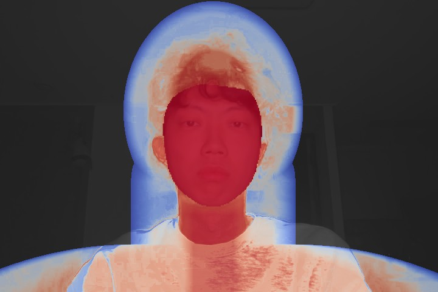</a><br><b>④ 점수</b><br>색 + 사전</td><td width="14%" valign="top"><a href="docs/module-b/matting/test3_4_m_conn.jpg"></a><br><b>⑤ 이진 마스크</b><br>Otsu·정리</td><td width="14%" valign="top"><a href="docs/module-b/matting/test3_5_alpha_overlay.jpg"></a><br><b>⑥ 경계</b><br>가이드 필터</td><td width="14%" valign="top"><a href="docs/module-b/matting/test3_6_white.jpg">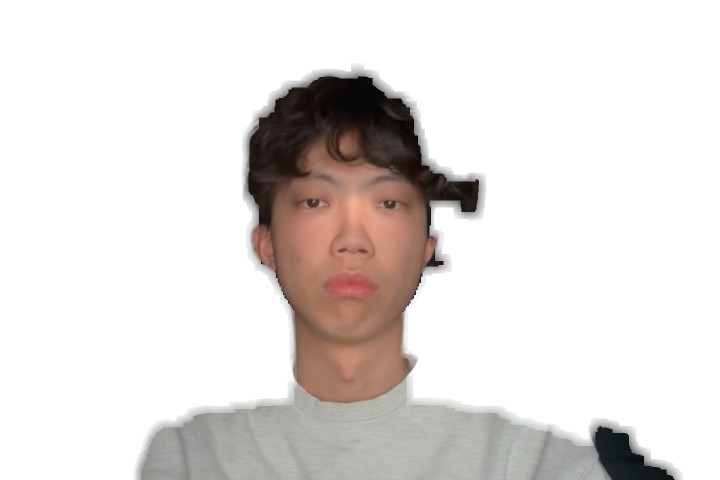</a><br><b>⑦ 합성</b><br>번짐 제거</td></tr>
</table>

예시 사진은 네 장입니다.

<table>
<tr><td width="25%" valign="top"><a href="docs/module-b/matting/test3_0_input.jpg"></a><br>test3</td><td width="25%" valign="top"><a href="docs/module-b/matting/test5_0_input.jpg"></a><br>test5</td><td width="25%" valign="top"><a href="docs/module-b/matting/shot2_0_input.jpg"></a><br>shot2</td><td width="25%" valign="top"><a href="docs/module-b/matting/test1_0_input.jpg">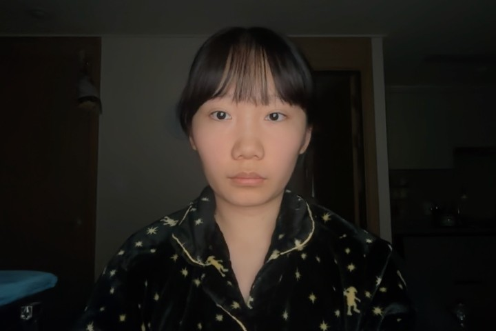</a><br>test1</td></tr>
</table>

| 사진 | 원본 크기 | 장면 | 이 문서에서의 쓰임 |
|----|----|----|----|
| test3 | 1440×960 | 어두운 방, 검은 곱슬머리, 회색 맨투맨 | 단계별 설명의 기본 예시 |
| test5 | 3000×4000 | 베이지 나무 벽, 흰 티셔츠 | 고해상도 경계 확대(5·6절), 실패 분석 |
| shot2 | 1280×720 | 밝은 롤스크린, 오른쪽 아래 창문, 카키 재킷 | 실패 분석 |
| test1 | 1440×960 | 매우 어두운 방, 검은 머리, 어두운 무늬 재킷 | 실패 분석 |

## 0. 입력 — 랜드마크와 얼굴 마스크

MediaPipe Face Landmarker의 478점에서 얼굴폭 *fw*(양쪽 얼굴 끝 사이), 눈–턱 길이 *ec*(두 홍채 중심의 중점 → 턱), 중심선 *cx*를 구합니다. 이후 모든 영역은 이 세 값의 배수로 정해집니다. 색은 선형 RGB의 제곱근(sqrt-linear)으로 다루는데, 지각적인 간격과 비슷합니다.

<table>
<tr><td width="33%" valign="top"><a href="docs/module-b/matting/test3_0_input.jpg"></a><br>원본 입력</td><td width="33%" valign="top"><a href="docs/module-b/matting/test3_0_landmarks.jpg"></a><br>초록 점: 랜드마크. 빨간 원: 홍채 중심·턱·얼굴 양끝(<i>fw</i>, <i>ec</i>, <i>cx</i>의 기준점)</td><td width="33%" valign="top"><a href="docs/module-b/matting/test3_0_facemask.jpg"></a><br>하늘색: Module A가 만든 얼굴 마스크. 이 영역은 항상 사람(점수 1, 알파 1)으로 고정</td></tr>
</table>

## 1. 사람 사전 영역 — `person_prior`, `foreground_seeds`

- **gate** (사람이 있을 수 있는 곳): 얼굴 위치와 크기로 보아 머리·목·어깨는 이 범위 안에 있을 것이라는 **사전 가정**입니다. 그래서 **이 범위 밖은 모두 배경**으로 보고 배경 색 표본으로 쓰며, 사람인지 아닌지는 범위 안에서만 판정합니다.
- **likely** (gate 안에서 사람일 사전확률): 두개골·목 0.88, 몸통 0.7(중심선에서 최대 2.2 *fw*), 나머지(옆머리, 어깨 맨 끝, 정수리 위 여백)는 **0.5 = 중립**이라 색만으로 결정됩니다.
- **사람 표본 후보**: 얼굴 마스크(1 px 침식), 이마–정수리 타원, 턱 아래 좁은 기둥(폭 ±0.25 *fw*), 가슴(±0.65 *fw*).

<table>
<tr><td width="33%" valign="top"><a href="docs/module-b/matting/test3_1_gate.jpg"></a><br><b>gate</b>: 노란 선 안이 허용 영역, 바깥은 어둡게 표시</td><td width="33%" valign="top"><a href="docs/module-b/matting/test3_1_likely.jpg"></a><a href="docs/module-b/matting/cbar_likely.png"></a><br><b>likely</b>: gate 안의 사전확률(gate 밖은 회색)</td><td width="33%" valign="top"><a href="docs/module-b/matting/test3_1_seeds.jpg"></a><br>색 모델용 표본 후보 영역</td></tr>
</table>

주황: 배경 표본 후보 (gate 밖) · 초록: 사람 표본 후보

## 2. 색 모델 — k-means

### 표본 2000 px는 어떻게 뽑나

**균일 무작위, 중복 없이 최대 2000 px**를 뽑습니다. 후보 픽셀마다 뽑힐 확률이 같고, 후보가 2000 px보다 적으면 전부 씁니다. 사진 크기와 상관없이 2000개라서 test3(140만 화소)은 배경 후보의 0.26%, test5(1200만 화소)는 0.05%만 뽑힙니다.

<table>
<tr><td width="50%" valign="top"><a href="docs/module-b/matting/test3_2_samples.jpg"></a><br>test3 · 실제로 뽑힌 표본. 주황 점 = 배경 2000개, 초록 점 = 사람 2000개, 옅게 칠한 곳 = 후보 영역</td><td width="50%" valign="top"><a href="docs/module-b/matting/test5_2_samples.jpg"></a><br>test5 · 오른쪽 어깨 끝의 흰 티가 gate 밖이라 배경 표본 약 20개가 흰 티에서 뽑힘(7절 참고)</td></tr>
</table>

### 군집 만들기

이렇게 뽑은 배경·사람 표본으로 k-means++(8회 반복)를 돌려 **배경 8개, 사람 5개** 군집을 만듭니다. 군집마다 중심색, 퍼짐(RMS, 최소 0.03), 비율을 저장합니다. 거리는 ‘가장 가까운 군집 퍼짐의 몇 배인가’로 재는데, **그림자 허용**이 있습니다. 배경 군집은 밝기를 0.5–1.25배, 사람 군집은 0.6–1.5배로 바꾼 색까지 같은 군집으로 봅니다. 벽에 진 그림자나 얼굴의 음영을 흡수하기 위한 장치지만, 흰 옷 ↔ 밝은 벽, 검은 머리 ↔ 어두운 배경을 섞이게 만드는 원인이기도 합니다.

아래 첫 지도에서는 뽑힌 2000개만이 아니라 표본 후보 영역의 모든 픽셀을 가장 가까운 군집 색으로 칠했습니다. 전체 사진 지도는 모든 픽셀을 점수 계산에 쓰이는 거리 기준으로 가장 가까운 배경 또는 사람 군집에 할당한 것입니다. **군집을 보여주는 그림이지, 최종 마스크는 아닙니다.** 각 색이 어느 군집의 중심색인지 지도 아래 막대에서 확인할 수 있습니다. 군집은 사진마다 따로 만들어지므로 막대도 사진별로 있습니다. 막대 위쪽은 실제 중심색(폭은 표본 비율), 아래쪽 색은 사진 지도에서 해당 군집을 표시한 색입니다.

<table>
<tr><td width="25%" valign="top"><a href="docs/module-b/matting/test3_2_clusters_seed.jpg">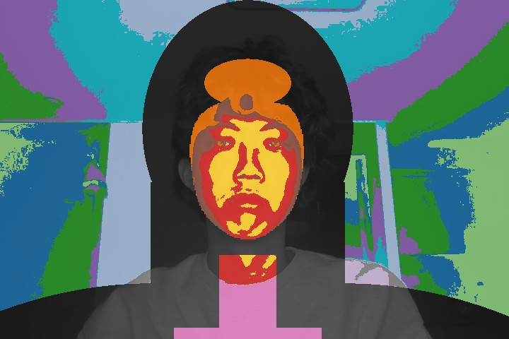</a><br>test3 · 후보 영역 픽셀의 군집</td><td width="25%" valign="top"><a href="docs/module-b/matting/test3_2_clusters_all.jpg">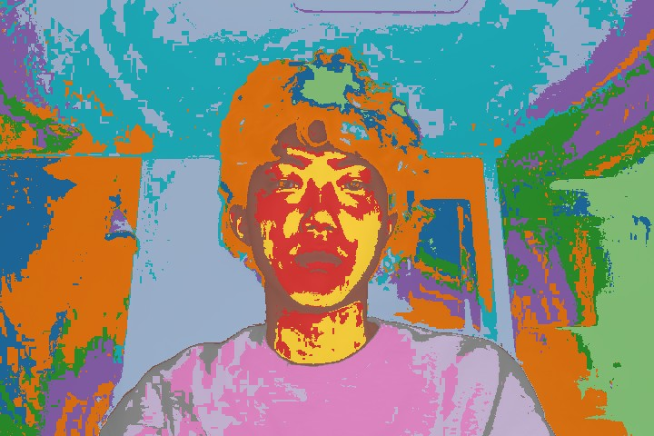</a><br>test3 · 전체 픽셀의 가장 가까운 군집</td><td width="25%" valign="top"><a href="docs/module-b/matting/test5_2_clusters_seed.jpg"></a><br>test5 · 후보 영역 픽셀의 군집</td><td width="25%" valign="top"><a href="docs/module-b/matting/test5_2_clusters_all.jpg"></a><br>test5 · 전체 픽셀의 가장 가까운 군집</td></tr>
</table>

<table>
<tr><td width="50%" valign="top"><a href="docs/module-b/matting/test3_2_bg_palette_key.png"></a><br>test3 배경 군집: 중심색 및 지도 표시색</td><td width="50%" valign="top"><a href="docs/module-b/matting/test3_2_fg_palette_key.png"></a><br>test3 사람 군집: 중심색 및 지도 표시색</td></tr>
<tr><td width="50%" valign="top"><a href="docs/module-b/matting/test5_2_bg_palette_key.png"></a><br>test5 배경 군집: 중심색 및 지도 표시색</td><td width="50%" valign="top"><a href="docs/module-b/matting/test5_2_fg_palette_key.png"></a><br>test5 사람 군집: 중심색 및 지도 표시색</td></tr>
</table>

<table>
<tr><td width="100%" valign="top"><a href="docs/module-b/matting/test3_2_scatter.png">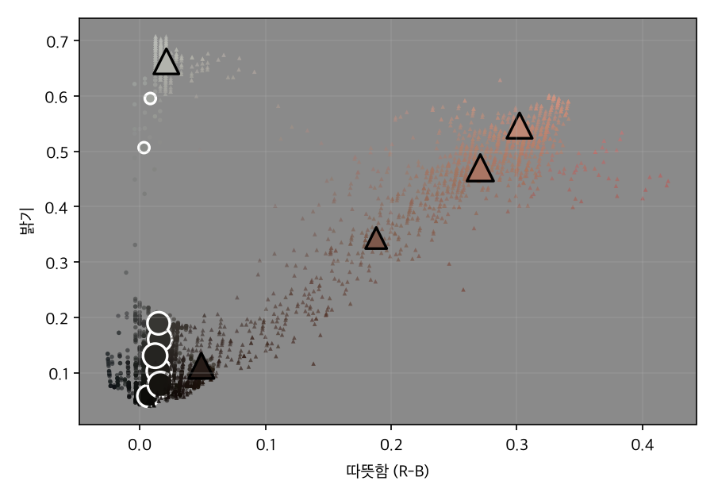</a><br>표본 분포: 가로 따뜻함(R−B), 세로 밝기. 점은 표본(동그라미 = 배경, 세모 = 사람), 큰 기호는 군집 중심. 어두운 머리 군집(세모)이 어두운 배경 군집(동그라미)과 왼쪽 아래에서 겹칩니다.</td></tr>
</table>

## 3. 점수 — 색 증거 + 사전확률

<blockquote>
evidence = ( min(<i>d</i><sub>bg</sub>, 2.5) − min(<i>d</i><sub>fg</sub>, 2.5) ) / τ    (τ = 1)<br/>p<sub>color</sub> = σ(evidence)<br/>score = gate · σ( evidence + logit(likely) ),  얼굴 마스크 위는 1
</blockquote>

*d*<sub>bg</sub>, *d*<sub>fg</sub>는 배경·사람 군집까지의 거리입니다. 어느 모델에도 없는 색(예: 창밖 풍경)이 한쪽으로 크게 쏠리지 않도록 2.5에서 자릅니다. likely = 0.5인 곳에서는 logit(likely) = 0이므로 **score = p<sub>color</sub>**, 즉 순수하게 색으로만 결정됩니다.

<table>
<tr><td width="50%" valign="top"><a href="docs/module-b/matting/test3_3_dbg.jpg"></a><br><i>d</i><sub>bg</sub>: 배경 군집까지 거리(클수록 배경과 다름)</td><td width="50%" valign="top"><a href="docs/module-b/matting/test3_3_dfg.jpg">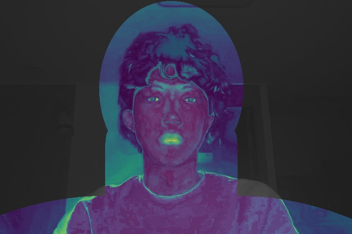</a><br><i>d</i><sub>fg</sub>: 사람 군집까지 거리</td></tr>
</table>

<a href="docs/module-b/matting/cbar_dist.png"></a>

<table>
<tr><td width="50%" valign="top"><a href="docs/module-b/matting/test3_3_pcolor.jpg"></a><br>p<sub>color</sub>: 색만 본 사람 확률</td><td width="50%" valign="top"><a href="docs/module-b/matting/test3_3_score.jpg"></a><br>score: 사전확률을 더하고 gate를 곱한 최종 점수(얼굴 = 1)</td></tr>
</table>

<a href="docs/module-b/matting/cbar_prob.png"></a>

## 4. 이진화와 정리

1.  **Otsu 임계값**: gate \> 0.05 영역의 점수 히스토그램에서 자동으로 고르고 \[0.35, 0.65\]로 제한합니다. test3은 *t* = 0.598.
2.  **열림**(반경 2*k* = 4 px, *k* = 이미지 폭/640): 작은 잡티와 가는 돌기 제거.
3.  **닫힘**(반경 5*k* = 11 px): 좁은 틈과 작은 구멍 메우기.
4.  **얼굴과 연결된 부분만**: 1/4 격자에서 얼굴과 4-연결된 덩어리만 남기고, 테두리에 닿지 않는 구멍은 채웁니다.

<table>
<tr><td width="50%" valign="top"><a href="docs/module-b/matting/test3_4_hist.png">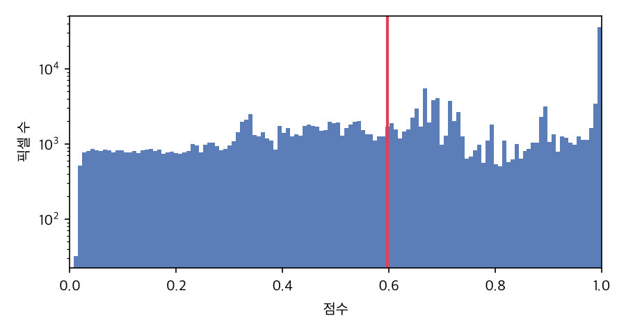</a><br>점수 히스토그램(로그 스케일)과 Otsu 임계값(빨간 선)</td><td width="50%" valign="top"><a href="docs/module-b/matting/test3_4_m_raw.jpg"></a><br>score &gt; <i>t</i> 원본 이진 마스크</td></tr>
</table>

<table>
<tr><td width="33%" valign="top"><a href="docs/module-b/matting/test3_4_m_open.jpg"></a><br>열림 후</td><td width="33%" valign="top"><a href="docs/module-b/matting/test3_4_m_close.jpg">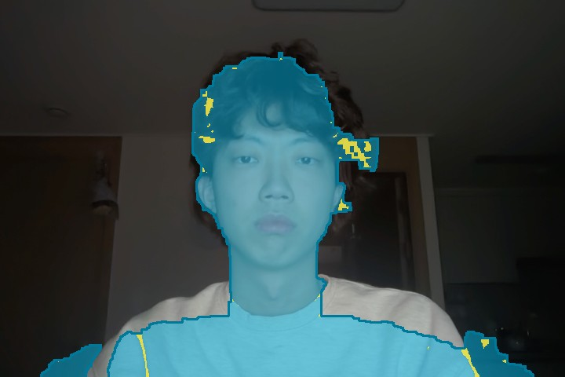</a><br>닫힘 후</td><td width="33%" valign="top"><a href="docs/module-b/matting/test3_4_m_conn.jpg"></a><br>얼굴과 연결된 부분 + 구멍 채움</td></tr>
</table>

하늘색: 마스크(사람) · 빨강: 직전 단계에서 빠진 부분 · 노랑: 직전 단계에서 추가된 부분

test3에서는 닫힘이 오른쪽 머리 옆의 어두운 배경까지 메워 머리 오른쪽에 혹이 생기고, 연결 단계가 왼쪽 아래의 떨어진 조각을 떼어 냅니다.

## 5. 경계 다듬기 — 컬러 가이드 필터

이진 마스크를 3×3 평균으로 살짝 흐린 뒤, 재조명된 프레임의 색을 가이드로 **컬러 가이드 필터**(He et al.)를 적용합니다. 창마다 알파 ≈ *a*·색 + *b*라는 선형 모델을 맞추기 때문에 마스크 경계가 이미지 속 실제 경계(머리카락 가닥 등)를 따라갑니다. 반경 *r* = 6*k*(test5: 28 px), ε = 2·10<sup>−3</sup>. 그 뒤 거친 경계에서 *r*/2(test5: 14 px)보다 먼 곳은 0 또는 1로 고정해, 부드러운 띠가 경계 ±*r*/2 안에만 생기게 합니다. 아래는 test5 왼쪽 위 머리카락을 원본 해상도로 자른 것입니다.

<table>
<tr><td width="25%" valign="top"><a href="docs/module-b/matting/test5_5_cropbox.jpg">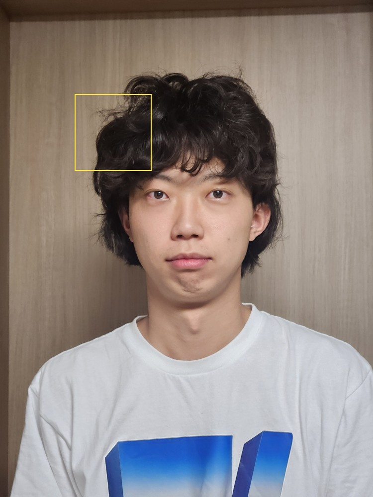</a><br>확대 위치(노란 사각형)</td><td width="25%" valign="top"><a href="docs/module-b/matting/test5_5_crop_img.jpg"></a><br>원본</td><td width="25%" valign="top"><a href="docs/module-b/matting/test5_5_crop_mask.jpg"></a><br>4절의 이진 마스크(흰색 = 사람)</td><td width="25%" valign="top"><a href="docs/module-b/matting/test5_5_crop_band.jpg">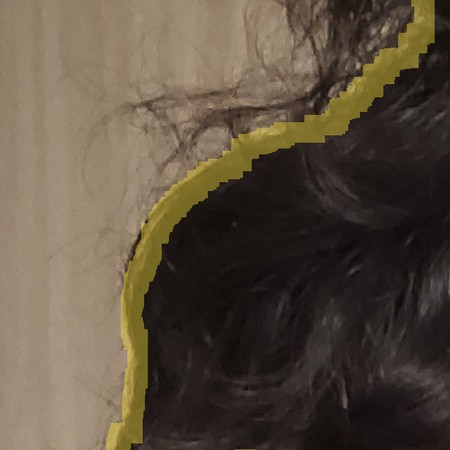</a><br>노란 띠: 알파가 0–1 사이로 남을 수 있는 영역(경계 ±<i>r</i>/2)</td></tr>
</table>

<table>
<tr><td width="33%" valign="top"><a href="docs/module-b/matting/test5_5_crop_gf.jpg"></a><br>가이드 필터 원출력: 잔머리 가닥까지 반응</td><td width="33%" valign="top"><a href="docs/module-b/matting/test5_5_crop_alpha.jpg">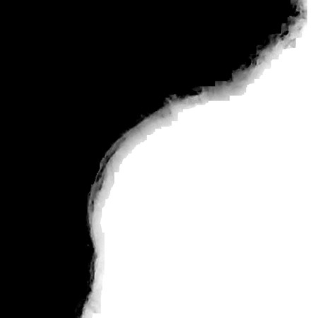</a><br>최종 알파: 띠 밖은 0/1로 고정되어 띠 바깥 잔머리는 사라짐</td><td width="33%" valign="top"><a href="docs/module-b/matting/test5_5_alpha_overlay.jpg"></a><br>전체 알파(하늘색 반투명)와 알파 0.5 등고선(빨강)</td></tr>
</table>

## 6. 번짐 제거와 합성

<blockquote>
α = 0 → 새 배경색,   α = 1 → 원본<br/>0 &lt; α &lt; 1 :   <i>F</i> = ( <i>I</i> − (1 − α) · ratio · <i>B</i><sub>local</sub> ) / max(α, 0.1),   출력 = α·<i>F</i> + (1 − α)·새 배경
</blockquote>

경계 띠의 픽셀에는 원래 벽색이 섞여 있으므로, 주변 배경색 *B*<sub>local</sub>(가까운 배경 픽셀 평균)과 Module A의 재조명 비율(ratio)로 벽 성분을 빼서 순수 전경색 *F*를 복원한 뒤 새 배경과 섞습니다. 규칙 7(8절)에 실패하면 `render_final`은 배경을 바꾸지 않고 원래 벽을 유지합니다. 아래 합성은 그와 상관없이 알고리즘 출력을 보여 주려고 만든 것입니다.

<table>
<tr><td width="50%" valign="top"><a href="docs/module-b/matting/test3_6_white.jpg"></a><br>test3 흰 배경(#ffffff)</td><td width="50%" valign="top"><a href="docs/module-b/matting/test3_6_demo.jpg"></a><br>test3 진한 파랑(#2f5d9a, 경계 확인용)</td></tr>
</table>

<table>
<tr><td width="50%" valign="top"><a href="docs/module-b/matting/test5_6_crop_naive.jpg">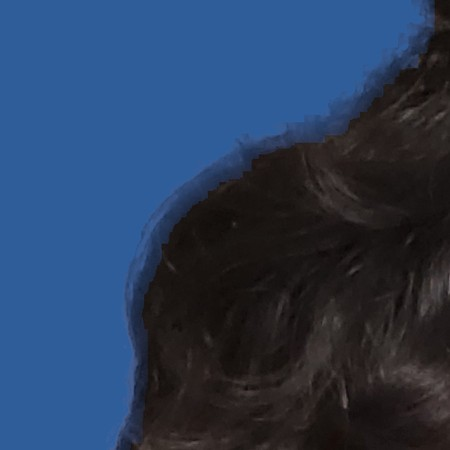</a><br>번짐 제거 없이 α·<i>I</i> + (1−α)·배경: 경계에 베이지 벽색 테두리가 남음</td><td width="50%" valign="top"><a href="docs/module-b/matting/test5_6_crop_spill.jpg"></a><br>번짐 제거 후: 벽색 테두리가 줄어듦</td></tr>
</table>

## 7. 왜 옆머리·옷이 빠지나 — 실패 분석

likely = 0.5(중립)인 곳에서는 score = p<sub>color</sub>이므로, 임계값 *t*를 넘으려면 evidence \> logit(*t*) (*t* = 0.6이면 0.41, 0.65면 0.62)이어야 합니다. 즉 그 픽셀이 배경 군집보다 사람 군집에 **뚜렷하게** 더 가까워야 합니다. 몸통(likely = 0.7)은 0.85만큼 유리하게 시작하지만 그래도 색이 배경 쪽이면 빠집니다. 아래 값은 랜드마크 기준으로 정한 영역의 중앙값입니다.

| 사진 | 문제 영역 | 원인 | *d*<sub>bg</sub> | *d*<sub>fg</sub> | p<sub>color</sub> | score | *t* | 마스크 포함 |
|----|----|----|----|----|----|----|----|----|
| test1 | 옆머리 | 방 전체가 어두워 배경 군집 대부분이 검정 → 검은 머리가 배경 쪽에 더 가까움 | 0.16 | 0.56 | 0.42 | 0.44 | 0.613 | 4% |
| test5 | 어깨 바깥(흰 티셔츠) | 오른쪽 어깨 끝이 gate 밖이라 흰 티에서 배경 표본 약 20개가 뽑혀 **흰색 배경 군집**(1%)이 생김 → 흰 티가 이 군집에 가까움. 이 군집이 없으면 *d*<sub>bg</sub> 중앙값 4.1(상한 2.5) | 0.09 | 0.51 | 0.40 | 0.60 | 0.65\* | 0% |
| shot2 | 어깨 바깥(카키 재킷) | 회색 롤스크린 군집의 어두운 버전과 비슷. 사전확률 0.7 덕분에 임계값 근처에서 걸쳐 경계가 들쭉날쭉 | 0.70 | 1.35 | 0.35 | 0.54 | 0.508 | 59% |
| test3 | 옆머리 | 어두운 방이지만 머리 쪽 군집이 약간 더 가까움 → 임계값에 걸침 | 0.52 | 0.15 | 0.59 | 0.61 | 0.598 | 57% |

\* test5는 Otsu가 0.711을 골랐지만 상한 0.65로 잘렸습니다. 영역 정의: 옆머리 = gate 1, likely 0.5, 눈 높이 위, 중심선에서 0.35–0.8 *fw*, 어두운 픽셀 / 어깨 바깥 = 턱 아래 0.5 *ec*부터, 중심선에서 1.0–2.0 *fw*. 정답 라벨이 없어 배경 픽셀이 일부 섞여 있을 수 있습니다.

### test1 — 어두운 방

<table>
<tr><td width="25%" valign="top"><a href="docs/module-b/matting/test1_0_input.jpg"></a><br>원본</td><td width="25%" valign="top"><a href="docs/module-b/matting/test1_3_pcolor.jpg"></a><br>p<sub>color</sub></td><td width="25%" valign="top"><a href="docs/module-b/matting/test1_3_score.jpg"></a><br>score</td><td width="25%" valign="top"><a href="docs/module-b/matting/test1_4_m_conn.jpg"></a><br>이진 마스크(<i>t</i> = 0.613)</td></tr>
</table>

### test5 — 흰 티셔츠와 베이지 벽

<table>
<tr><td width="25%" valign="top"><a href="docs/module-b/matting/test5_0_input.jpg"></a><br>원본</td><td width="25%" valign="top"><a href="docs/module-b/matting/test5_3_pcolor.jpg">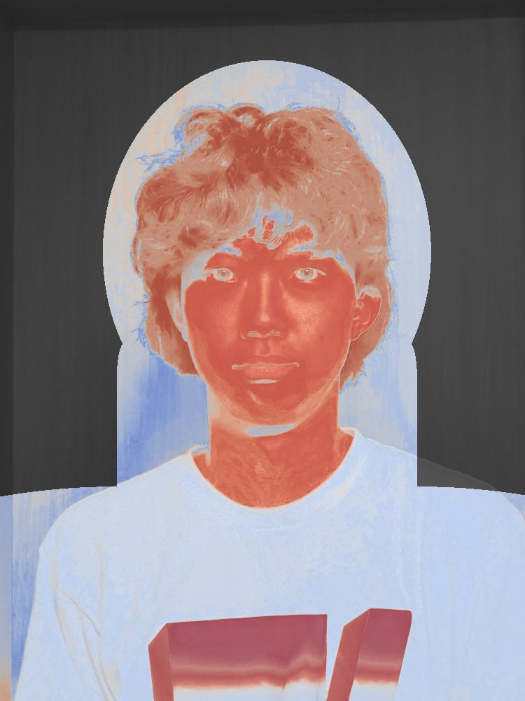</a><br>p<sub>color</sub></td><td width="25%" valign="top"><a href="docs/module-b/matting/test5_3_score.jpg"></a><br>score</td><td width="25%" valign="top"><a href="docs/module-b/matting/test5_4_m_conn.jpg"></a><br>이진 마스크(<i>t</i> = 0.65)</td></tr>
</table>

<table>
<tr><td width="50%" valign="top"><a href="docs/module-b/matting/test5_2_bg_palette.png"></a><br>test5 배경 군집: 베이지 계열 + gate 밖 오른쪽 어깨 끝에서 온 흰색(1%)</td><td width="50%" valign="top"><a href="docs/module-b/matting/test5_2_fg_palette.png"></a><br>test5 사람 군집: 피부, 머리, 흰 티, 파란 무늬</td></tr>
</table>

### shot2 — 밝은 롤스크린과 창문

<table>
<tr><td width="25%" valign="top"><a href="docs/module-b/matting/shot2_0_input.jpg"></a><br>원본</td><td width="25%" valign="top"><a href="docs/module-b/matting/shot2_3_pcolor.jpg"></a><br>p<sub>color</sub></td><td width="25%" valign="top"><a href="docs/module-b/matting/shot2_3_score.jpg"></a><br>score</td><td width="25%" valign="top"><a href="docs/module-b/matting/shot2_4_m_conn.jpg"></a><br>이진 마스크(<i>t</i> = 0.508)</td></tr>
</table>

shot2는 오른쪽 아래 창밖 풍경이 어느 모델에도 없는 색이라 p<sub>color</sub>가 사람 쪽으로 기울어 마스크가 창문으로 새어 나갑니다(오른쪽 아래 돌기).

## 8. 규칙 7(깨끗한 누끼)과 재현성

`checker.py`의 `clean_cutout`는 다음 두 조건을 모두 만족해야 통과입니다. 실패하면 배경 교체를 하지 않습니다.

1.  증명사진 크롭 안에서, 입 높이 위·중심선 ±1.1 *fw*의 머리카락 띠를 뺀 곳에 0.1 \< α \< 0.9인 픽셀이 **2% 미만**.
2.  어깨선 높이(턱 + 0.9 *ec*)에서 양쪽 상의(중심선에서 0.45–1.0 *fw*)와 같은 행의 배경(α \< 0.1)의 색 대비가 **0.12 이상**(약한 쪽 기준).

| 사진 | 불확실 비율 | 어깨 대비(근사) | 판정 | 이유 |
|----|----|----|----|----|
| test3 | 1.67% | 0.46 | 통과 |  |
| shot2 | 2.39% | 0.20 | 실패 | 불확실 픽셀의 약 90%가 턱 아래(재킷 어깨 경계·창문) |
| test1 | 1.91% | 0.10 | 실패 | 어두운 재킷 vs 어두운 방 |
| test5 | 1.33% | 0.005 | 실패 | 티셔츠가 마스크에서 빠져 ‘배경(α \< 0.1)’ 쪽에 티셔츠 자신이 들어감 → 대비가 0에 가까움 |

어깨 대비는 test5만 파이프라인 실측값이고, 나머지는 축소한 중간값으로 같은 식을 다시 계산한 근사값입니다.

**재현성 주의** — 랜드마크 검출기(`FaceLandmarkDetector`)가 VIDEO(추적) 모드로 만들어져서 직전 사진의 추적 상태가 다음 사진의 랜드마크에 영향을 줍니다. test5는 단독(첫 번째)으로 처리하면 규칙 7 실패(대비 0.005), test4 다음에 처리하면 통과(대비 0.305)였습니다. 앞서 보낸 오버레이(파일명 순서로 처리)에서는 test5 티셔츠가 대부분 포함되어 있었는데, 이 문서의 test5(첫 번째로 처리)와 다른 이유가 이것입니다. 랜드마크의 작은 차이로 사전 영역과 색 표본이 바뀌고, 임계값 근처에 걸친 영역(어깨·옆머리)이 통째로 들어가거나 빠질 만큼 결과가 민감합니다.

## 9. 파라미터 (`config.py`)

| 이름 | 값 | 의미 |
|----|----|----|
| `BG_CLUSTERS / FG_CLUSTERS` | 8 / 5 | 배경·사람 색 군집 수 |
| `CLUSTER_SAMPLES` | 2000 | 군집별 k-means 표본 수 |
| `CLUSTER_SPREAD_FLOOR` | 0.03 | 군집 퍼짐 하한(sqrt-linear) |
| `BG_SHADOW_SCALE` | (0.5, 1.25) | 배경 군집 밝기 허용 배율 |
| `FG_SHADE_SCALE` | (0.6, 1.5) | 사람 군집 밝기 허용 배율 |
| `SCORE_TAU` | 1.0 | evidence 온도 |
| `OUTLIER_DISTANCE` | 2.5 | 거리 상한 |
| `PRIOR_CORE / PRIOR_TORSO` | 0.88 / 0.7 | 두개골·목 / 몸통 사전확률 |
| `CROWN_K` | 2.0 | 정수리 높이(턱에서 1.15·CROWN_K·ec) |
| `Otsu 범위` | \[0.35, 0.65\] | 임계값 제한(코드 상수) |
| `OPEN_RADIUS / CLOSE_RADIUS` | 2 / 5 | 열림·닫힘 반경(640 px 기준) |
| `GF_RADIUS / GF_EPS` | 6 / 2e-3 | 가이드 필터 반경(640 px 기준)·정규화 |
| `SPILL_ALPHA_FLOOR` | 0.1 | 번짐 제거 분모 하한 |
| `UNCERTAIN_MAX / CONTRAST_MIN` | 2% / 0.12 | 규칙 7 기준 |
| `PLAIN_WALL_SHARE` | 0.7 | 규칙 7 실패 안내 문구 선택용(단색 벽 비율) |

## 10. 정리

- 얼굴·두개골·몸통 중앙은 사전확률과 얼굴 마스크 덕분에 안정적입니다. 결과를 가르는 곳은 사전확률이 중립이거나 약한 <strong>옆머리(0.5)와 어깨 바깥(0.7)</strong>입니다.
- 그 영역은 색 대비에만 의존하므로 어두운 방(검은 머리), 밝은 벽(흰 옷), 무채색 벽(회색·카키 옷)에서 취약합니다. 그림자 허용 배율이 이 혼동을 키웁니다.
- 경계는 가이드 필터로 머리카락을 따라가지만, ±*r*/2 띠 제한 때문에 거친 마스크에서 빠진 잔머리는 복구되지 않습니다.
- 정답 마스크로 잰 정량 평가(IoU 등)는 아직 없습니다. 이 문서의 수치는 영역 중앙값과 규칙 7 판정뿐입니다.

## 11. 사람 prior 대안 — GrabCut·Random Walker 실험

`tools/compare_matting.py`는 기존 방법과 두 연구의 공개 구현을 같은 사진에 실행하는 **오프라인 비교 도구**입니다. 앱의 `Matter`, GUI, 저장 경로는 변경하지 않았습니다. 본체의 NumPy 구현 원칙과 구분해, 연구 비교에만 OpenCV `grabCut`과 scikit-image `random_walker`를 사용합니다. 논문 전체의 재현이나 최종 매팅 구현은 아닙니다.

- **[GrabCut (Rother 등, SIGGRAPH 2004)](https://www.microsoft.com/en-us/research/publication/grabcut-interactive-foreground-extraction-using-iterated-graph-cuts/)**: 전경·배경 GMM과 색 경계 비용을 이용한 반복 graph cut. seed 색을 각각 k-means 5개로 모델링하고, 밝기 배율 허용 없이 군집까지의 거리로 초기 probable FG/BG를 정합니다. 이후에는 OpenCV 구현을 5회 반복하며, 초기 probable 라벨은 바뀔 수 있습니다.
- **[Random Walker (Grady, TPAMI 2006)](https://doi.org/10.1109/TPAMI.2006.233)**: 같은 seed에서 색 경계에 따른 그래프 가중치로 전경 도달 확률을 구합니다. sqrt-linear RGB, beta 130, `cg_j`, 허용오차 `1e-6`, 전경 확률 > 0.5를 사용합니다.

두 방법 모두 기존 `gate`와 `likely`를 사용하지 않으며, gate 바깥도 분할 대상입니다. 다만 **아무 사전 가정도 없는 것은 아닙니다.** 자동 전경 seed는 침식한 얼굴 내부와 작은 머리·가슴 패치이고, 배경 seed는 넉넉한 머리 박스를 제외한 위쪽·턱 위 옆쪽 테두리(두께: 짧은 변의 4%)입니다. 아래 테두리는 옷일 수 있어 배경으로 지정하지 않습니다. 머리·가슴 패치나 테두리의 배경 가정도 틀릴 수 있으며, **이 seed는 두 연구 방법에 똑같이 적용되는 hard label**입니다. 기존 방법은 원래의 표본·prior를 그대로 사용합니다.

사진마다 IMAGE 모드로 랜드마크를 독립 검출하고, 긴 변 최대 480 px의 전체 사진에서 비교합니다. 재조명은 끕니다. 비교 그림은 왼쪽부터 입력/seed, 기존 방법, GrabCut, Random Walker이며 위는 파란 배경 합성, 아래는 이진 마스크입니다. 기존 방법은 형태학·연결 영역 정리까지 마친 `coarse_mask`이고, 두 대안은 그런 후처리나 실루엣 자르기를 추가하지 않은 결과입니다. **가이드 필터·번짐 제거·규칙 7 fallback은 비교 합성에 적용하지 않습니다.** Random Walker의 확률도 물리적인 알파 매트가 아닙니다.

### 실행

```bash
uv sync --extra research
uv run python tools/fetch_model.py
uv run --extra research python tools/compare_matting.py \
  docs/evaluation/test/test5.jpg docs/evaluation/test/test3.jpg \
  docs/evaluation/test/shot2.jpg docs/evaluation/test/test1.jpg \
  --out out/matting-real
uv run --extra research python tools/compare_matting.py \
  --synthetic --out out/matting-synthetic
```

사진별 입력, seed, 세 마스크, 비교 그림, Random Walker 확률(16-bit PNG, 0–65535)을 저장하고 `report.json`에 해상도·설정·라이브러리 버전·전경 면적 비율·실행 시간·solver 경고를 남깁니다. 시간은 검출·입출력을 제외하며 기존 방법만 가이드 필터 등 추가 작업도 포함하므로, 엄밀한 속도 비교용 수치는 아닙니다. 합성 장면만 렌더러의 정답으로 IoU·precision·recall을 계산하고, **정답이 없는 실제 사진의 해당 지표는 `null`**로 둡니다. 전경 면적 증가를 정확도 향상으로 해석해서는 안 됩니다.

자동 seed를 고치려면 저장된 `seeds.png`를 복사해 작업 해상도 그대로 `<사진 이름>.png`로 편집합니다. 8-bit 회색조에서 **0=미정, 128=배경, 255=전경**만 사용하며 전경·배경 각각 최소 5픽셀이 필요합니다.

```bash
uv run --extra research python tools/compare_matting.py \
  docs/evaluation/test/test5.jpg --seeds-dir out/edited-seeds \
  --out out/matting-edited
```

### 첫 적용 결과

자동 seed, 위의 기본 설정으로 실행한 결과입니다. 아래 실제 사진 비교는 정성 관찰이며 정답 기반 순위가 아닙니다.

| 사진 | GrabCut | Random Walker |
|---|---|---|
| test5 | 기존보다 머리·어깨 경계가 자연스러워졌지만 일부 누락은 남음 | 흰 티셔츠는 유지하나 머리·목 옆 벽도 포함 |
| test3 | 머리와 맨투맨 외곽을 비교적 잘 유지 | 머리와 어깨 사이 배경까지 연결 |
| shot2 | 카키 재킷 일부를 배경으로 제거 | 인물 주변 롤스크린까지 포함 |
| test1 | 검은 옷이 많이 빠지고 어두운 배경이 섞임 | 검은 옷은 유지하나 머리 위·옆 배경이 섞임 |

| 합성 장면 | 기존 IoU | GrabCut IoU | Random Walker IoU |
|---|---:|---:|---:|
| 밝은 벽·남색 상의 | 1.000 | 1.000 | 0.849 |
| 베이지 벽·빨간 상의 | 0.999 | 1.000 | 0.843 |
| 벽과 비슷한 상의 | 0.735 | 0.650 | 0.765 |

단순한 합성 장면 세 개의 결과로 실제 사진 성능을 일반화할 수 없습니다. 현재로서는 **GrabCut을 더 살펴볼 근거는 있지만 기본 알고리즘을 대체할 근거는 부족합니다.** 특히 seed 배치와 색 모델 초기화가 중요합니다. 초기 실험에서 미정 영역을 모두 probable FG로 놓으면 배경까지 대부분 남았고, 모두 probable BG로 놓으면 작은 가슴 seed만 남고 옷이 크게 사라졌습니다. 위 결과는 이를 seed 색 기반 초기화로 보완한 설정입니다.

## 12. 원본 해상도 머리 매팅 실험

`tools/matte_hair.py`는 머리 주변을 원본 픽셀 그대로 잘라 **연속적인 alpha와 전경색**을 추정하는 오프라인 실험입니다. 전체 사진을 축소한 뒤 마스크를 키우는 방법과, 원본 잔머리를 직접 관찰하는 방법을 구분합니다. 얼굴도 포함하는 head matte이며, 머리카락만의 의미 분할이나 동영상 추적은 아닙니다. **앱의 `idphoto/` 처리 경로는 변경하지 않았고, 추가 학습도 하지 않았습니다.**

비교 대상은 [Closed-Form Matting](https://webee.technion.ac.il/people/anat.levin/), [KNN Matting](https://dingzeyu.li/projects/knn/), 학습형 [F, B, Alpha Matting](https://arxiv.org/abs/2003.07711)(FBA)입니다. 앞의 두 방법은 [PyMatting](https://pymatting.github.io/), FBA는 [저자 공개 구현과 가중치](https://github.com/MarcoForte/FBA_Matting)를 사용합니다. Deep Image Matting은 이번에 실행하지 않았습니다.

### 실행

FBA 저자 코드는 MIT이지만 **공개 가중치는 비상업적 용도로만 사용 가능합니다.** 제품 적용을 허용하는 라이선스로 해석하면 안 됩니다. 아래 명령은 이 제약을 확인한 후 외부 코드와 약 139 MB의 가중치를 내려받습니다. 사진은 업로드하지 않으며 추론은 로컬에서만 수행합니다. 모델과 출력은 각각 무시된 `models/`, `out/`에 저장합니다.

```bash
uv sync --extra hair-matting
uv run --extra hair-matting python tools/fba_reference.py --accept-noncommercial

# FBA: 원본 머리 crop이 크면 겹치는 타일로 처리
uv run --extra hair-matting python tools/matte_hair.py \
  docs/evaluation/test/test5.jpg --out out/hair-native-large

# 같은 원본 crop / trimap으로 FBA와 비학습형 매팅 비교
uv run --extra hair-matting python tools/matte_hair.py \
  docs/evaluation/test/test3.jpg docs/evaluation/test/test1.jpg \
  docs/evaluation/test/shot2.jpg --methods fba cf knn \
  --out out/hair-native-small
```

고정한 저자 소스 커밋은 `8dd100d760186150710510ee8d78ed916cdb17a4`, 가중치 SHA-256은 `f3f8a2b6cefd7200368b6008a712468ed1debc6658693db31b0f719f658a2967`입니다. 실행 전에 소스 버전·수정 여부와 가중치 해시를 확인하고, 가중치는 `torch.load(..., weights_only=True)`로 읽습니다. 추론 중 자산을 자동 다운로드하거나 누락 시 다른 모델로 대체하지 않습니다.

### Crop과 trimap이 주는 제약

얼굴 검출과 기존 마스크 생성만 긴 변 최대 640픽셀에서 수행합니다. 랜드마크를 원본 좌표로 옮긴 뒤 얼굴 폭과 눈–턱 거리로 넉넉한 head ROI를 정하고, **RGB crop과 매팅 입력은 축소하지 않습니다.** `--box x0 y0 x1 y1`로 원본 좌표의 ROI를 직접 지정할 수도 있습니다(사진 한 장만 가능). 기본 crop은 턱 조금 아래에서 끝나므로 긴 머리를 모두 포함한다는 보장은 없습니다.

자동 trimap은 기존 alpha를 보간하고 0.5에서 이진화한 뒤, 얼굴 폭의 0.06만큼 안쪽을 확정 전경으로, `--band`(기본 0.25)만큼 팽창한 바깥을 확정 배경으로 정합니다. 얼굴 내부도 확정 전경으로 둡니다. 나머지가 미정 영역입니다. 따라서 **기존 person prior의 영향을 완전히 제거한 실험은 아닙니다.** 확정 배경으로 잘못 지정한 잔머리나 crop 밖의 머리는 FBA도 복구할 수 없습니다. ROI 위·좌·우 끝에 전경이 닿으면 경고하지만 자동 확장하지는 않습니다.

원본 해상도의 trimap을 직접 고쳐 이 영향을 분리할 수 있습니다.

```bash
# 추론 없이 crop.png / trimap.png 준비
uv run python tools/matte_hair.py docs/evaluation/test/test3.jpg \
  --prepare-only --out out/hair-prepare
mkdir -p out/hair-edited
cp out/hair-prepare/test3/trimap.png out/hair-edited/test3.png

# out/hair-edited/test3.png를 편집한 뒤 동일 crop으로 재실행
uv run --extra hair-matting python tools/matte_hair.py \
  docs/evaluation/test/test3.jpg --trimap-dir out/hair-edited \
  --out out/hair-replay
```

Trimap은 crop과 같은 크기의 8-bit 회색조 PNG로 **0=확정 배경, 128=미정, 255=확정 전경**입니다. 11절의 seed-map 부호와 다르므로 그대로 재사용하면 안 됩니다. 전경·배경이 모두 있어야 하며, 잘못된 크기나 값은 오류로 처리하고 자동 보정/축소하지 않습니다.

FBA의 inductive bias는 trimap 조건, 영상의 공간 구조를 학습한 모델, 전경·배경·alpha를 함께 추정하는 구조에서 옵니다. 하지만 색 혼합식을 만족하는 해는 유일하지 않으며, 이 구조가 머리카락과 나뭇결을 반드시 구분해 준다는 뜻은 아닙니다.

### 원본 해상도와 결과 해석

FBA는 기본 `--tile-size 768 --overlap 96`으로 미정 영역이 있는 타일만 추론하고, 겹친 예측을 가중 평균합니다. 각 타일은 8의 배수 크기로 **패딩**할 뿐 리사이즈하지 않습니다. 타일별 문맥 차이와 경계 오차는 남을 수 있으므로 논문의 전체 영상 추론을 그대로 재현했다고 주장하지 않습니다. CF/KNN은 메모리 안전을 위해 crop을 100만 픽셀 이하로 제한하며, 초과하면 `--methods fba`를 안내하는 오류를 냅니다.

이 어댑터는 CPU 추론만 지원합니다. Apple MPS에서는 참고 모델의 일부 adaptive pooling 크기를 처리하지 못하는 것을 확인했으며, 입력을 임의로 리사이즈하거나 장치를 조용히 바꾸는 우회는 하지 않았습니다.

사진별 출력은 다음과 같습니다.

| 파일 | 의미 |
|---|---|
| `crop.png`, `trimap.png` | 원본 RGB crop과 실제 사용한 trimap |
| `comparison.jpg` | 보기 좋게 축소한 전체 비교. 위는 합성, 아래는 alpha |
| `detail_1to1.png` | 기존 마스크의 위쪽 중앙 경계에서 고른 최대 256×256 원본 픽셀 비교. 확대/축소 없음 |
| `*_alpha.png`, `*_rgba.png` | 원본 크기의 16-bit alpha와 8-bit straight RGBA |
| `*_blue.png`, `*_white.png` | 추정한 전경색을 이용한 합성 |
| `*_naive.png` | 같은 alpha에 원본 RGB를 사용한 합성(FBA/CF/KNN). 전경색 복원 효과를 분리해 확인 |

`current`는 **640픽셀 작업 영상에서 계산한 기존 alpha를 보간하고 원본 RGB로 합성한 기준선**입니다. 기존 앱의 despill 합성을 그대로 재현한 결과는 아닙니다. 반면 FBA/CF/KNN은 원본 crop에서 alpha와 전경색을 추정하므로, 합성 차이가 모두 alpha 개선 때문이라고 해석하면 안 됩니다. 합성과 모델 입력은 참고 구현의 sRGB 관례를 따르며 앱의 선형광 합성과도 구분합니다.

`report.json`에는 원본 crop 좌표·크기, 입력/trimap 해시, 라이브러리 버전, 모델 버전, 설정, 타일 수, 추론 시간, crop 끝 접촉 여부와 Python solver 경고를 저장합니다. CF의 불완전 Cholesky 전처리기가 shift를 자동 재시도하며 출력하는 성능 경고는 콘솔에도 나타날 수 있습니다. **실제 alpha 정답이 없어 정확도 지표는 `null`입니다.** 미정 영역이나 반투명 alpha의 면적 비율도 정확도 점수가 아닙니다.

### 첫 적용 결과와 한계

기본 자동 trimap, CPU 4스레드에서 관찰한 결과입니다. 시간은 모델 로딩·검출·입출력을 제외한 해당 매팅 단계의 대략적인 값이며, 실시간 처리 성능을 뜻하지 않습니다.

| 사진 | 원본 crop | 관찰 |
|---|---|---|
| test3 | 673×732 | FBA와 CF가 기존 마스크에서 빠진 곱슬머리를 상당 부분 복원. CF는 주변 배경 조각, KNN은 더 넓은 잔상을 남김 |
| test1 | 692×654 | FBA/CF 외곽은 개선되지만 어두운 배경과의 모호함이 남음. KNN 전경은 crop 위쪽까지 닿음 |
| shot2 | 439×501 | FBA/CF가 머리 외곽을 복원하지만 블라인드·끈 같은 배경 구조가 남을 수 있음 |
| test5 | 2152×2431 | FBA 16타일, 약 11–12초. 가는 잔머리를 복원하지만 머리 위·옆에 벽의 나뭇결과 옅은 잔상도 남음 |

작은 crop의 FBA는 약 0.3–1.2초, CF는 약 0.5–1.8초, KNN은 약 0.8–2.4초였습니다. 첫 추론의 초기화 비용과 반복 실행에 따른 편차도 포함합니다. test5는 100만 픽셀을 넘으므로 CF/KNN을 실행하지 않았습니다. 새 그림자 사진 test9는 이번 실험에 사용하지 않았습니다.

test5에서 trimap 영향만 보기 위해 다음 비교도 수행했습니다.

```bash
uv run --extra hair-matting python tools/matte_hair.py \
  docs/evaluation/test/test5.jpg --band 0.12 --out out/hair-native-narrow
```

미정 영역을 얼굴 폭 0.25에서 0.12로 줄이면 crop 내 미정 픽셀 비율이 약 41%에서 24%로 줄고, 나뭇결 잔상도 눈에 띄게 감소했습니다. 그러나 멀리 뻗은 잔머리를 확정 배경으로 잘라낼 위험도 커집니다. **0.12가 보편적인 최적값이라는 근거는 없으므로 기본값은 바꾸지 않았습니다.** 현재 결론은 원본 해상도 매팅을 적용할 가치는 있지만, 모델 교체만으로 해결되지 않으며 crop·trimap의 확정 영역 품질을 함께 검증해야 한다는 것입니다.

## 13. 넓은 영역의 FBA 알파 누출 억제 실험

`tools/refine_hair.py`는 12절의 **넓은 trimap을 그대로 두고**, 저장된 FBA 결과를 보수적으로 후처리합니다. crop을 줄이거나 고정된 사람 윤곽으로 자르지 않습니다. 학습·재추론 없이 원본 크기의 16-bit alpha와 8-bit 전경색 PNG를 읽으므로, FBA의 원래 float32 전경색과는 저장 양자화 차이가 있습니다. 이 실험도 앱에 연결하지 않았습니다.

```bash
# 12절에서 생성한 넓은/좁은 결과와 함께 비교
uv run python tools/refine_hair.py out/hair-native-large \
  --narrow out/hair-native-narrow --out out/hair-color-refined

# 같은 설정으로 다른 사진도 확인
uv run python tools/refine_hair.py out/hair-native-small \
  --out out/hair-color-refined-small
```

사진 해시·crop 좌표·실제 crop 픽셀이 일치해야 좁은 trimap 결과를 비교 열로 넣습니다. `--narrow`는 **비교용일 뿐**, 보정 결과 계산에는 사용하지 않습니다. 입력 실행 폴더와 동일한 `--out`은 거부합니다.

### 억제하되 가는 구조는 보호

확정 전경과 연결된 alpha 0.98 이상 영역에서 실제 RGB의 국소 평균·분산을 계산합니다. 미정 픽셀의 **FBA가 복원한 전경색**을 가까운 불투명 영역의 색 분포와 비교합니다. 배경과 섞여 밝게 보이는 원본 RGB만으로 잔머리를 버리지 않기 위해서입니다. 검은 머리라는 고정 색 가정은 없지만, 전경색 복원 자체가 틀리면 이 근거도 틀릴 수 있습니다.

색이 다르다는 이유로 alpha 전체를 곱해 없애는 초기 시도는 실제 잔머리도 손상시켰습니다. 최종 실험에서는 색 근거가 약한 곳의 **국소 최솟값으로 표현되는 넓은 알파 바닥 성분만 줄입니다.** 그 바닥 위로 솟은 가는 구조는 남기고, alpha 0.25부터 0.8까지 불투명도 보호를 부드럽게 강화합니다. 마지막으로 alpha 0.005를 넘는 경로로 확정 전경 쪽에 8-연결되는 부분을 유지합니다.

색 통계 반경은 crop 짧은 변의 약 1/64, 세부 구조 반경은 약 1/800(최소 1픽셀)입니다. sRGB 색 표준편차 하한 0.08, 정규화된 색 거리 2–4의 완만한 감쇠를 사용합니다. 이 값들은 탐색적 설정이지 논문의 표준 설정이나 검증된 최적값이 아닙니다.

**alpha를 증가시키거나 전경색을 바꾸지는 않습니다.** 확정 전경·배경을 유지하며, 이번 실제 사진 4장에서는 alpha 0.8 이상 픽셀도 그대로 유지했습니다. 따라서 머리 내부의 새 구멍을 줄이는 데 보수적이지만, 이미 낮게 추정된 내부 alpha를 채우는 기능은 아닙니다. 얼굴 중심이나 머리 윤곽까지의 거리로 불투명도를 강제하는 공간 사전도 아직 추가하지 않았습니다.

### 결과와 남은 문제

test5의 비교 열은 **원본 / 기존 기준선 / 넓은 FBA / 좁은 FBA / 넓은 FBA 후처리**입니다. `comparison.jpg`, `detail_1to1.png`, 각 방법의 원본 크기 alpha·RGBA·합성을 저장합니다. 표시하는 trimap은 넓은 것이며, 좁은 비교 입력은 별도 `narrow_trimap.png`로 보존합니다. `support_confidence.png`는 색·불투명도·연결 지지도를 보여 주며, alpha에 단순히 곱하는 승수는 아닙니다.

머리 위 나뭇결이 크게 줄었고 옆으로 뻗은 가는 컬은 상당 부분 유지됐습니다. 원본 crop 좌표 **(1200, 180)–(1650, 360)**의 벽 사각영역을 수동으로 골라 확인한 평균 alpha는 다음과 같습니다.

| 넓은 FBA | 좁은 FBA | 넓은 FBA 후처리 |
|---:|---:|---:|
| 0.11028 | 0.00002 | 0.01958 |

선택한 벽 패치에서는 약 82% 감소했지만, **전체 오검출률이나 정답 기반 정확도 지표는 아닙니다.** 좁은 trimap보다 항상 낫다는 뜻도 아닙니다. 왼쪽의 다른 배경 패치에서는 0.02165에서 0.02157로 거의 줄지 않았습니다. 머리색으로 복원된 배경 잔상, 가는 배경 무늬, 원래 높은 alpha를 받은 오검출은 남을 수 있습니다. 일부 실제 잔머리도 약해지며 연결이 끊긴 아주 옅은 끝부분은 제거될 수 있습니다.

test3·test1·shot2에도 같은 설정을 적용해 비교했으며 뚜렷한 머리 덩어리는 유지됐지만 배경 모호함을 모두 해결하지는 못했습니다. 특히 이 후처리는 머리카락을 의미적으로 인식하지 않습니다. 가르마·두피·얼굴도 여전히 인물 전경이고, 밝거나 어둡다는 이유만으로 배경 구멍으로 취급하면 안 됩니다.

test5의 후처리는 CPU에서 약 0.5–0.7초였습니다. `report.json`의 참조 방법 시간 0은 저장 결과를 읽었다는 뜻이며 FBA 추론 속도가 아닙니다. 보고서에는 설정·색/세부 반경·입력 파일 해시·코드 해시·라이브러리 버전을 기록합니다. 원래 FBA 가중치의 비상업적 이용 제한도 그대로 적용됩니다.
