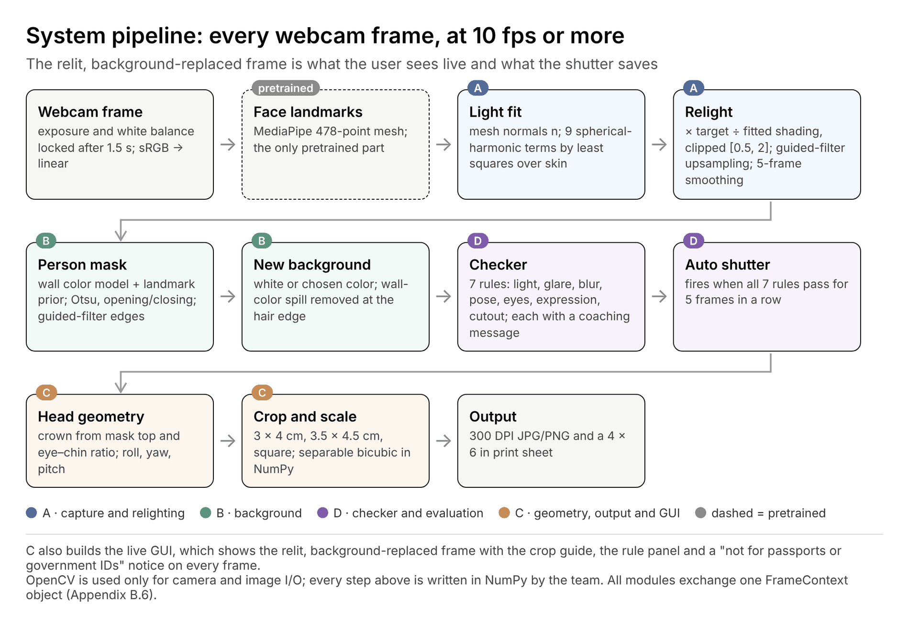

# ID Photo: webcam ID photos with live relighting

A Python desktop app that turns a webcam session into résumé (3 × 4 cm), student or employee ID (3.5 × 4.5 cm) and square profile photos, plus 6 × 4 in print sheets. Every frame is relit to an even light from the face mesh, the background is replaced, and seven checks run before the shutter. The plan, formulas and thresholds are in [docs/id-photo-survey-plan-v2.md](docs/id-photo-survey-plan-v2.md).

The photos are edited (relit, background replaced), so the app is **not for passports or other government IDs**. It says so on screen and in every saved file.

## Quick start

Requires [uv](https://docs.astral.sh/uv/). Python 3.12 is pinned in `.python-version`.

```bash
uv sync
```

```bash
uv run python tools/fetch_model.py
```

The second command downloads MediaPipe's face landmark model (3.6 MB) to `models/` if it isn't there yet. Then start the app:

```bash
uv run idphoto
```

Other ways to run it:

```bash
uv run idphoto --source demo
```

```bash
uv run idphoto --source photo.jpg --lang en
```

- `--source`: camera index (default `0`), `demo` (a synthetic sitter, no camera needed), or an image or video file.
- `--lang ko|en`: interface language (default: the system language). The panel's language button switches it live.
- `--camera-size 1920x1080`: request a larger camera frame for sharper saved photos.

In the app, hold **B** to see the frame before processing, and press **Space** to take a photo without waiting for the auto shutter.

On macOS, the first start asks for camera access on behalf of the app you launched it from (Terminal, iTerm and so on): click Allow and the live view starts. If no dialog appears, which can happen in an editor's built-in terminal, run it from Terminal, or turn that app on in System Settings → Privacy & Security → Camera and restart it.

## What happens to each frame



| Step | Module (owner) | File | Plan |
|---|---|---|---|
| Camera, exposure and white-balance lock, lock check | A | [capture.py](idphoto/capture.py) | B.2 |
| sRGB → linear, luminance | A | [color.py](idphoto/color.py) | B.2 |
| 478 face landmarks (the only pretrained part) | C | [landmarks.py](idphoto/landmarks.py) | A.3 |
| Mesh normals, 9-term SH light fit, ratio relighting, 5-frame average | A | [relight.py](idphoto/relight.py), [mesh.py](idphoto/mesh.py) | B.2 |
| Background and person color models, score, Otsu, opening/closing, guided filter, spill removal, compositing | B | [matting.py](idphoto/matting.py) | B.3 |
| Crown, pose, crop and scale, print sheet, 300 DPI files | C | [geometry.py](idphoto/geometry.py) | B.5 |
| Seven checks with coaching messages, auto shutter | D | [checker.py](idphoto/checker.py) | B.4 |
| Glue, settings, shutter render | all | [pipeline.py](idphoto/pipeline.py) | 2.2 |
| GUI (Korean/English) | C | [gui.py](idphoto/gui.py), [i18n.py](idphoto/i18n.py) | Fig. 4 |

All modules exchange one [`FrameContext`](idphoto/context.py) (B.6). Image processing is NumPy only ([npimg.py](idphoto/npimg.py): box filters from cumulative sums, guided filter, Laplacian, Otsu, morphology, separable bicubic resampling, polygon fill, triangle rasterizer). OpenCV is used only to open the camera and to read and write image files.

Every starting value from B.2–B.5 is in [config.py](idphoto/config.py), so tuning in weeks 2–5 happens in one file.

The live view runs on frames downscaled to 640 px wide. When the shutter fires, the same camera frame is processed again at full resolution with the live light average, and that is what gets saved.

## Saved files

**Save…** in the result window writes a folder `idphoto_YYYYmmdd_HHMMSS/` with:

- `resume_3x4cm.jpg` (354 × 472), `id_3.5x4.5cm.jpg` (413 × 531), `profile_800px.jpg` (800 × 800), all marked 300 DPI;
- `print_sheet_resume_3x4cm_6x4in.jpg` (10 photos) and `print_sheet_id_3.5x4.5cm_6x4in.jpg` (8 photos), 1800 × 1200 at 300 DPI;
- `report.json`: the seven check values, R_LR before and after, the fitted light, crown and crop boxes. This is data for the evaluation in C.1.

Everything stays on the computer. Nothing is uploaded.

## Tools

| Command | What it does |
|---|---|
| `uv run python tools/relight_demo.py` | Reproduces Figure 3 with the real code: prints R_LR and shadow share before and after, saves `out/relight_demo.png` |
| `uv run python tools/eval_synthetic.py` | Synthetic version of C.1: R_LR over a sweep of side lights, mask IoU against the true mask, staged faults and per-rule recall |
| `uv run python tools/bench_fps.py` | Frames per second of the full live pipeline on this machine (target ≥ 10) |
| `uv run python tools/process_image.py photo.jpg` | Runs the pipeline on still photos and saves the same files as the app |
| `uv run python tools/crown_inspector.py photo.jpg` | Crown and crop tuning window: both crown cues, the crop box and the saved photo, with sliders for k, the mask band and the head share. Click the top of the head to mark the true crown; it shows the head-length error in mm and the best-fit k. `--demo` uses synthetic faces |
| `uv run python tools/capture_frames.py` | Saves webcam frames, their landmarks and each matting step to `out/debug/` (debugging, test sets). On macOS run it from a terminal that has camera access |
| `uv run python tools/replay_frames.py out/debug/<folder>` | Re-runs the pipeline on saved frames, to compare a code change on real rooms |
| `uv run python tools/extract_canonical_mesh.py` | Rebuilds `idphoto/data/canonical_face_mesh.npz` from the model bundle |

Tests: `uv run pytest` (55 tests, about 10 s).

## Results so far

Measured on an Apple M4 Pro, mostly with the synthetic sitter (`idphoto/synthetic.py`), which renders MediaPipe's canonical face with a chosen light, so each module can be checked against known truth. These are not the plan's results; those need real people (C.1).

- **Relighting:** a side window that leaves R_LR = 0.41 is relit to 0.94, and the shadowed share of the face drops from 15% to 0%. R_LR lands in 0.90–1.10 for side lights down to R_LR ≈ 0.4; harsher lights stop at about 0.84–0.89 because of the [0.5, 2] clip, and rule 1 then asks the user to turn toward the light, as C.4 plans.
- **Matting:** IoU 1.000 against the true mask on four wall and top combinations. A top the color of the wall drops to 0.82, and rule 7 catches it (contrast below 0.12).
- **A real, busy room** (clothes rack, white doors, ceiling light, black T-shirt; six webcam frames): hair, face and the black top are kept and the room is replaced. The edge on the clothes-rack side is not exact, and rule 7 asks for a plain wall there, since only 65% of that background is one color.
- **Relighting on real frames** (nine webcam frames, overhead light, head turned up to about 6°): R_LR after relighting is 0.97–1.05 on all nine. With a camera-fixed target it was 0.89–1.12, four of nine outside 0.90–1.10.
- **Checker:** each staged fault (side shadow, glare, blur, tilt, turn, closed eyes, open mouth, top like the wall) fails its rule; the good frame passes all seven.
- **Speed:** 16–22 fps for the whole live pipeline including MediaPipe (45–62 ms per frame from a 1280 × 720 camera frame, varying between runs).
- **Landmarks:** MediaPipe finds the synthetic face with a mean landmark error of 1.6% of the face width, which confirms that the renderer and the landmark numbering agree.

## Where the code goes beyond or departs from the plan

These are choices made while implementing the drafts in Appendix B. Each is commented in the code.

1. **Mesh normals** are stored on the 128 × 128 face crop the light is fitted on (`FrameContext.normals` plus `face_box`), not as a full (H, W, 3) array.
2. **Guided filter (B.3 step 3):** the guide is the frame's color instead of its luminance (He et al.'s color-guide variant), since a lit neck and a wall of the same brightness differ only in color. The radius is 6 px at 640 px wide instead of the starting 15 px: in a real room, a 15-px window spread a gray halo wherever the mask edge was a few pixels off.
3. **Background and person color models (B.3 step 1):** the single wall color from the upper corners failed in a real room (corners holding a window, a patterned ceiling and a door frame), and dark hair was classified as a shadowed wall. The background is now k-means clusters (8) of the pixels the landmarks place well outside the person, and the person gets clusters (5) of the face, the head under the crown and a column straight below the chin. Each pixel weighs its distance to the nearest background color (allowing it 0.5–1.25 times as bright, so a wall shadow stays background) against its distance to the nearest person color; distances past 2.5 spreads count the same. In front of a plain wall this reduces to the plan's wall model.
4. **Head-and-shoulders prior:** besides the region where the person can be, a prior probability that is high in the skull and neck (0.88) and inside the shoulder line (0.7), so a black top in front of dark clutter is kept; after Otsu and morphology, only the region connected to the face is kept and holes are filled.
5. **Live speed:** in the live view, steps 1–3 and the guided-filter coefficients run at half resolution and the coefficients are upsampled (fast guided filter); connectivity runs on a grid 4 times coarser. The saved photo uses the exact full-resolution filter.
6. **Spill removal:** μ_B in F = (I − (1 − α) μ_B) / max(α, 0.1) is the background color around each edge pixel (the mean of nearby background pixels), not one wall color.
7. **Target light follows the head's yaw (B.2):** "frontal" means in front of the face, not the camera. The yaw comes from the mesh's mean normal, averaged over the same 5 frames as the light. With a camera-fixed target, a head turned a few degrees left one cheek brighter after relighting.
8. **Ratio outside the face** fades to the face mean weighted by brightness, so hair, neck and shoulders keep the exposure the face keeps.
9. **Cheek polygons** sit below the lower orbital rim so glasses frames stay outside them.
10. **Pitch ratio:** d(10, 1) / d(1, 152) is divided by its value on MediaPipe's canonical face (1.134), so 1.0 means a level head and the 0.85–1.15 band applies.
11. **Sharpness (rule 3)** is measured on the camera's full-resolution frame, so the 256 × 256 face crop is not an upsampled copy of the 640-px live frame. The bound of 120 is calibrated per camera as B.4 asks: after 15 frames it becomes 70% of the camera's sharp frames (the 80th percentile of the last 90), never above 120 and never below 15. A MacBook webcam scores 40–50 and could never pass 120.
12. **Rule 7:** the hair band is everything above the mouth within 1.1 face widths of the midline. Contrast compares the top with the background in the same rows, on each side of the neck, and the weaker side counts. When the cutout fails, the message asks for a top unlike the wall (low contrast), for a plain wall (less than 70% of the background is one color), or to move away from the wall.
13. **Crown:** the mask-top cue is used (averaged with the proportion rule) only when the two agree within 0.85–1.25 of the proportion's head length.
14. **Exposure lock:** OpenCV's macOS backend has no exposure control, so the lock is reported as unavailable there and the light is averaged over 10 frames instead of 5 (the C.4 fallback). The same fallback applies when face brightness drifts more than 3% while the head holds still.
15. **Rule 7 fallback (C.4):** if the cutout check fails when a photo is taken, the saved photo keeps the original wall and the result window says so.
16. **Print sheets** are made for the résumé and ID formats; the profile photo is for screens.

## Not done yet

- Not yet tested on the team's webcams and rooms. The Nov 8 gate (10 real frames, side and overhead light) is the next check.
- The C.1 baselines (ArcFace identity, rembg masks, blind rating, usability test) are separate studies and are not in this repository.
- Thresholds are the drafts from B.4 and are calibrated in week 5. EAR ≥ 0.23 is close to the canonical face's 0.234, so it may need a lower or per-user value.
- Stretch goals (lighting presets, more background colors, job-portal pixel sizes) are not started.

## Credits

Face landmarks: [MediaPipe Face Landmarker](https://developers.google.com/edge/mediapipe/solutions/vision/face_landmarker) (Apache 2.0). `idphoto/data/canonical_face_mesh.npz` is MediaPipe's canonical face mesh, extracted from the model bundle.
