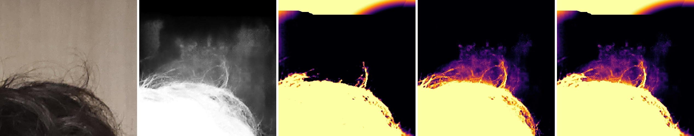
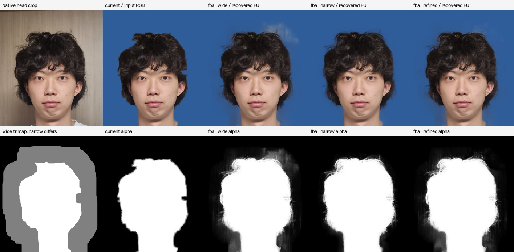

[English](README.md)

# 매팅 실험: 사람 prior 대안과 머리카락 후처리

기존 배경 분리 전체 과정을 아직 모르면 먼저 [배경 분리 알고리즘 설명(한국어)](https://github.com/hanbin5/relight/blob/module-b/matting/README_kr.md)을 읽어 주세요. 이 문서는 그 내용을 전제로, 기존 방식의 실패 사례에서 출발한 세 가지 실험에 집중합니다.

아래 용어는 간단히 짚고 넘어갑니다. **사람 prior**는 얼굴 랜드마크로 사람이 있을 만한 위치를 정하는 기존 가정이고, **기존 alpha**는 그 알고리즘이 계산한 대략적인 인물/배경 마스크이며, **트라이맵(trimap)**은 확실한 인물·확실한 배경·모델이 판단할 픽셀을 표시한 지도입니다. 자세한 내용은 위 설명의 prior, alpha, 경계 다듬기 단계를 참고하세요.

## 1. 사람 prior 대안 비교

### 실험 이유

기존 prior가 실제 머리카락이나 옷을 색 분류 전에 인물 영역 밖으로 제외할 수 있습니다. 기존 방식의 test5에서는 오른쪽 어깨 끝이 인물 허용 영역 밖에 있어 흰 티셔츠 픽셀 약 20개가 배경 표본에 포함되고 흰색 배경 군집을 만들었습니다. 어두운 방에서는 검은 머리가 배경과 비슷하고, 카키 재킷은 회색 블라인드와 비슷할 수 있습니다. 아래 값은 정답 마스크와 비교한 정확도가 아니라, 랜드마크로 지정한 영역의 중앙값입니다.

| 사진 | 문제 영역 | 관찰한 원인 | *d*<sub>bg</sub> | *d*<sub>fg</sub> | *p*<sub>color</sub> | 점수 | 임계값 *t* | 기존 마스크 포함 비율 |
|---|---|---|---:|---:|---:|---:|---:|---:|
| test1 | 옆머리 | 어두운 방에서 검은 머리가 배경 모델에 더 가까움 | 0.16 | 0.56 | 0.42 | 0.44 | 0.613 | 4% |
| test5 | 어깨 바깥, 흰 티셔츠 | 티셔츠 약 20개 픽셀이 흰 배경 군집(1%)을 만듦. 이 군집이 없으면 *d*<sub>bg</sub> 중앙값은 4.1이며 상한 2.5 적용 | 0.09 | 0.51 | 0.40 | 0.60 | 0.65* | 0% |
| shot2 | 어깨 바깥, 카키 재킷 | 재킷이 회색 블라인드 군집의 어두운 색처럼 보여 점수가 임계값에 걸침 | 0.70 | 1.35 | 0.35 | 0.54 | 0.508 | 59% |
| test3 | 옆머리 | 머리 군집이 약간 더 가깝지만 점수가 임계값 부근에 있음 | 0.52 | 0.15 | 0.59 | 0.61 | 0.598 | 57% |

*test5에서 Otsu는 0.711을 선택했지만 구현의 상한인 0.65로 제한했습니다. 옆머리는 눈높이 위, 핵심 prior 바깥, 중심선에서 얼굴 폭 0.35–0.8 범위의 어두운 픽셀입니다. 어깨 바깥은 턱 아래 눈–턱 거리 0.5부터 중심선에서 얼굴 폭 1.0–2.0 범위입니다. 정답 라벨이 없어 이 영역에 배경 픽셀이 포함될 수 있습니다.*

<table>
<tr><td valign="top" width="50%"><a href="docs/module-b/matting/test5_0_input.jpg"></a><br/>기존 방식 test5 입력: 베이지 벽 앞 흰 티셔츠</td><td valign="top" width="50%"><a href="docs/module-b/matting/test5_2_bg_palette.png"></a><br/>사람 prior 밖의 티셔츠에서 뽑힌 흰색이 배경 군집에 포함됨</td></tr>
<tr><td valign="top" width="50%"><a href="docs/module-b/matting/test5_3_score.jpg"></a><br/>기존 방식의 인물 점수</td><td valign="top" width="50%"><a href="docs/module-b/matting/test5_4_m_conn.jpg"></a><br/>기존 이진 마스크: 어깨 바깥 티셔츠가 빠짐</td></tr>
</table>

### 비교한 방법

`tools/compare_matting.py`는 기존 방법과 두 연구 방법의 공개 구현을 비교하는 **오프라인 도구**입니다. 앱의 `Matter`, GUI, 저장 경로는 변경하지 않았습니다. 연구 비교에만 OpenCV `grabCut`과 scikit-image `random_walker`를 사용하며, 논문 전체 재현이나 최종 매팅 구현은 아닙니다.

- **[GrabCut (Rother 등, SIGGRAPH 2004)](https://www.microsoft.com/en-us/research/publication/grabcut-interactive-foreground-extraction-using-iterated-graph-cuts/)**은 전경·배경 가우시안 혼합 모델과 색 경계 비용을 이용한 반복 graph cut입니다. seed 색을 각각 k-means 5개 군집으로 모델링하고, 밝기 배율을 허용하지 않은 군집 거리로 probable FG/BG를 초기화한 뒤 OpenCV에서 5회 반복합니다. 이때 probable 라벨은 바뀔 수 있습니다.
- **[Random Walker (Grady, TPAMI 2006)](https://doi.org/10.1109/TPAMI.2006.233)**는 같은 seed에서 색 경계에 따른 그래프 가중치로 인물 도달 확률을 계산합니다. 설정은 sqrt-linear RGB, beta 130, `cg_j`, 허용오차 `1e-6`, 전경 확률 > 0.5입니다.

두 방법 모두 기존 `gate`와 `likely`를 사용하지 않고 prior 바깥도 분할합니다. 하지만 **가정이 전혀 없는 것은 아닙니다.** 자동 전경 seed는 침식한 얼굴 안쪽과 작은 머리·가슴 패치이며, 배경 seed는 넉넉한 머리 박스 바깥의 위·옆 테두리입니다. 테두리 두께는 짧은 변의 4%입니다. 옷이 있을 수 있는 아래쪽 테두리는 배경으로 지정하지 않습니다. 이 seed 가정도 틀릴 수 있고, 두 방법은 같은 hard label을 사용합니다. 기존 방법은 원래의 표본과 prior를 그대로 씁니다.

사진마다 IMAGE 모드로 랜드마크를 독립 검출하고, 긴 변 최대 480 px로 줄인 전체 사진에서 비교합니다. 재조명은 끕니다. 비교 그림은 왼쪽부터 입력/seed, 기존 방법, GrabCut, Random Walker이며 위쪽은 합성, 아래쪽은 이진 마스크입니다. 기존 방법은 형태학·연결 영역 정리 뒤의 `coarse_mask`입니다. 대안 두 방법에는 그런 후처리나 실루엣 자르기를 추가하지 않았습니다. **가이드 필터, 번짐 제거, 규칙 7 fallback은 비교 합성에 적용하지 않습니다.** Random Walker 확률도 물리적인 alpha 매트는 아닙니다.

### 결과와 결론

실제 사진 결과는 정답 기반 순위가 아니라 정성적 관찰입니다.

| 사진 | GrabCut | Random Walker |
|---|---|---|
| test5 | 기존보다 머리·어깨 윤곽이 자연스러워졌지만 일부 누락은 남음 | 흰 티셔츠는 유지하나 머리·목 옆 벽도 포함 |
| test3 | 머리와 맨투맨 윤곽을 비교적 잘 유지 | 머리와 어깨 사이 배경까지 연결 |
| shot2 | 카키 재킷 일부를 배경으로 제거 | 인물 주변 롤스크린까지 포함 |
| test1 | 검은 옷이 많이 빠지고 어두운 배경이 섞임 | 검은 옷은 유지하나 머리 위·옆 배경도 섞임 |

렌더러가 정답 마스크를 제공하는 합성 장면 세 개의 결과입니다.

| 합성 장면 | 기존 IoU | GrabCut IoU | Random Walker IoU |
|---|---:|---:|---:|
| 밝은 벽·남색 상의 | 1.000 | 1.000 | 0.849 |
| 베이지 벽·빨간 상의 | 0.999 | 1.000 | 0.843 |
| 벽과 비슷한 상의 | 0.735 | 0.650 | 0.765 |

단순한 합성 장면 세 개로 실제 사진 성능을 예측할 수는 없습니다. GrabCut을 더 살펴볼 근거는 있지만, 기존 방식을 대체할 근거는 부족합니다. Seed 위치와 색 모델 초기화가 중요합니다. 미정 픽셀을 전부 probable foreground로 두면 배경 대부분이 남았고, 전부 probable background로 두면 작은 가슴 seed만 남아 옷 대부분이 사라졌습니다. 보고된 결과는 이 문제를 보완하기 위해 seed 색 기반으로 초기화한 설정입니다.

도구는 입력, seed, 마스크, 비교 그림, Random Walker 확률(16-bit PNG, 0–65535)을 저장하고 `report.json`에 해상도, 설정, 라이브러리 버전, 전경 면적 비율, 실행 시간, solver 경고를 기록합니다. 시간에는 검출과 입출력이 빠져 있으며, 기존 방식만 가이드 필터 같은 추가 연산을 포함하므로 엄밀한 속도 비교가 아닙니다. IoU·precision·recall은 합성 이미지에서만 계산하며, 정답이 없는 실제 사진에서는 `null`입니다. 전경 면적이 커졌다고 정확도가 높아진 것은 아닙니다.

### 재현 방법

```bash
uv sync --extra research
uv run python tools/fetch_model.py
uv run --extra research python tools/compare_matting.py \
  docs/evaluation/test/test5.jpg docs/evaluation/test/test3.jpg \
  docs/evaluation/test/shot2.jpg docs/evaluation/test/test1.jpg \
  --out out/matting-real
uv run --extra research python tools/compare_matting.py \
  --synthetic --out out/matting-synthetic
```

자동 seed를 고치려면 `seeds.png`를 복사해 같은 작업 해상도의 `<사진 이름>.png`로 편집합니다. 8-bit 회색조에서 **0=미정, 128=배경, 255=전경**만 사용하며 두 클래스에 각각 최소 5픽셀이 있어야 합니다.

```bash
uv run --extra research python tools/compare_matting.py \
  docs/evaluation/test/test5.jpg --seeds-dir out/edited-seeds \
  --out out/matting-edited
```

## 2. 원본 해상도 머리/얼굴 매팅

### 실험 이유

기존 마스크가 경계 다듬기 전에 가는 머리카락을 놓칠 수 있습니다. 기존 가이드 필터는 대략적인 실루엣 주변 띠 안에서만 경계를 다듬기 때문에 그 띠 밖으로 빠진 잔머리는 복구할 수 없습니다. 잔머리를 모델이 판단하도록 두는 트라이맵으로 머리 crop을 원본 해상도에서 매팅하면 더 잘 남길 수 있는지 실험했습니다.

이 오프라인 실험은 crop에서 연속적인 alpha와 전경색을 추정합니다. 결과는 **얼굴을 포함한 head matte**이지 머리카락만 의미적으로 분할한 결과나 동영상 추적이 아닙니다. 앱의 `idphoto/` 경로는 바꾸지 않았고 추가 학습도 하지 않았습니다.

### 처리 흐름과 시각 자료

초기 alpha와 랜드마크는 기존 `Matter.process`/얼굴 랜드마크 경로에서 가져옵니다. 원본 사진의 랜드마크로 넉넉한 머리 영역을 정하고, crop 픽셀을 축소하지 않습니다. 초기 alpha를 crop에 보간하고 0.5에서 이진화한 뒤 트라이맵을 만듭니다. 얼굴 폭의 0.06만큼 침식한 곳은 확정 인물, 선택한 폭만큼 팽창한 경계 바깥은 확정 배경, 그 사이가 미정 영역입니다. 얼굴 내부도 확정 인물로 고정합니다. 따라서 이전 person prior의 영향은 남습니다.


*왼쪽부터 초기 alpha를 이진화한 마스크, 넓은 트라이맵, 좁은 트라이맵입니다. 흰색 = 확정 인물, 검정 = 확정 배경, 회색 = 미정 영역.*

FBA(**Foreground, Background, Alpha**)는 crop과 트라이맵으로부터 전경색·배경색·alpha를 함께 추정하는 학습 모델입니다. Alpha는 두 색을 섞는 양으로, 0은 배경, 1은 인물, 그 사잇값은 가는 잔머리처럼 픽셀 일부만 덮인 부분을 나타냅니다. 비교에는 [Closed-Form Matting](https://webee.technion.ac.il/people/anat.levin/)과 [KNN Matting](https://dingzeyu.li/projects/knn/)을 [PyMatting](https://pymatting.github.io/)으로 사용했습니다. FBA는 [저자 공개 구현과 가중치](https://github.com/MarcoForte/FBA_Matting)를 사용했습니다. Deep Image Matting은 실행하지 않았습니다.


*위: 원본 crop과 넓은 FBA, 좁은 FBA, 후처리의 복원 전경색입니다. 아래: 같은 순서의 alpha 매트입니다.*

넓은 트라이맵은 더 많은 픽셀을 미정으로 남겨 잔머리를 살릴 수 있지만, 벽의 넓은 잔상도 허용할 수 있습니다. 이 사례에서 좁은 트라이맵은 잔상을 줄였지만 멀리 뻗은 잔머리를 확정 배경으로 지정할 위험이 있습니다.

### 결과와 한계

기본 자동 트라이맵, CPU 4스레드에서 관찰한 결과입니다.

| 사진 | 원본 crop | 관찰 |
|---|---|---|
| test3 | 673×732 | FBA와 CF가 기존 마스크에서 빠진 곱슬머리를 상당 부분 복원. CF는 주변 배경 조각, KNN은 더 넓은 잔상을 남김 |
| test1 | 692×654 | FBA/CF 외곽은 개선되지만 어두운 배경과의 모호함이 남음. KNN 전경은 crop 위쪽까지 닿음 |
| shot2 | 439×501 | FBA/CF가 머리 외곽을 복원하지만 블라인드·끈 같은 배경 구조가 남을 수 있음 |
| test5 | 2152×2431 | FBA 16타일, 약 11–12초. 가는 잔머리를 복원하지만 머리 위·옆에 벽의 나뭇결과 옅은 잔상이 남음 |

작은 crop에서 FBA는 약 0.3–1.2초, CF는 0.5–1.8초, KNN은 0.8–2.4초 걸렸습니다. 첫 추론 초기화와 반복 실행 간 편차도 포함합니다. test5는 100만 픽셀을 넘어 CF/KNN을 실행하지 않았습니다. 그림자 사진 test9도 사용하지 않았습니다. 시간은 매팅 단계만 측정한 값이며 실시간 성능을 뜻하지 않습니다.

test5에서 `--band`를 0.25에서 0.12로 줄이면 미정 영역 비율이 약 41%에서 24%로 감소하고 나뭇결 잔상도 눈에 띄게 줄었습니다. 하지만 멀리 뻗은 잔머리를 잃을 위험이 커집니다. 0.12가 보편적으로 최적이라는 근거가 없어 기본값은 바꾸지 않았습니다. 원본 해상도 매팅을 적용할 가치는 있지만 모델 교체만으로 해결되지는 않으며, crop과 trimap에서 확정한 영역도 검증해야 합니다.

Crop에 긴 머리가 포함되지 않을 수 있고, 확정 배경으로 잘못 지정된 머리카락은 FBA가 복구할 수 없습니다. 타일별 문맥 차이와 경계 오차도 남으므로 논문의 전체 영상 추론을 재현했다고 주장하지 않습니다. 실제 alpha 정답이 없어 정확도 지표는 `null`이며, 미정 영역이나 반투명 alpha 비율은 정확도 점수가 아닙니다. 어댑터는 CPU 추론만 지원합니다. Apple MPS의 adaptive pooling 제약을 우회하려고 입력 크기를 임의로 바꾸거나 장치를 조용히 바꾸지 않습니다. 모델 입력과 합성은 참고 구현의 sRGB 관례를 따르며 앱의 선형광 합성과 다릅니다.

### 재현 방법과 기술 세부

FBA 저자 코드는 MIT이지만 **공개 가중치는 비상업적 용도로만 사용할 수 있습니다.** 제품 사용이 허용된다는 뜻이 아닙니다. 이 제한을 확인한 뒤 아래 명령은 외부 코드와 약 139 MB 가중치를 내려받습니다. 사진은 업로드하지 않고 로컬에서 추론합니다. 모델과 출력은 무시된 `models/`, `out/`에 저장합니다.

```bash
uv sync --extra hair-matting
uv run --extra hair-matting python tools/fba_reference.py --accept-noncommercial

# FBA: 원본 머리 crop이 크면 겹치는 타일로 처리
uv run --extra hair-matting python tools/matte_hair.py \
  docs/evaluation/test/test5.jpg --out out/hair-native-large

# 같은 원본 crop / trimap으로 FBA와 비학습형 매팅 비교
uv run --extra hair-matting python tools/matte_hair.py \
  docs/evaluation/test/test3.jpg docs/evaluation/test/test1.jpg \
  docs/evaluation/test/shot2.jpg --methods fba cf knn \
  --out out/hair-native-small
```

고정한 저자 소스 커밋은 `8dd100d760186150710510ee8d78ed916cdb17a4`, 가중치 SHA-256은 `f3f8a2b6cefd7200368b6008a712468ed1debc6658693db31b0f719f658a2967`입니다. 실행 전에 소스 버전·수정 여부와 가중치 해시를 확인하고, 가중치는 `torch.load(..., weights_only=True)`로 읽습니다. 자산이 없을 때 자동으로 다운로드하거나 다른 모델로 대체하지 않습니다.

얼굴 검출과 초기 마스크 생성만 긴 변 최대 640 px 이미지에서 합니다. 랜드마크를 원본 좌표로 옮겨 얼굴 폭과 눈–턱 거리로 머리 ROI를 정합니다. 기본 crop은 양옆으로 얼굴 폭 1.05배, 눈높이 기준 위쪽으로 눈–턱 거리 1.7배, 턱 아래로 0.2배 범위이며 RGB와 매팅 입력은 축소하지 않습니다. 한 장은 `--box x0 y0 x1 y1`로 원본 좌표 crop을 직접 정할 수 있습니다. 기본 crop은 턱 조금 아래에서 끝나 긴 머리가 잘릴 수 있으며, crop 가장자리에 닿아도 자동 확장하지 않고 경고만 합니다.

기본 바깥 트라이맵 폭은 `--band 0.25`이고 좁은 비교는 `--band 0.12`입니다. 확정 인물은 얼굴 폭의 0.06만큼 침식한 곳이며 얼굴 내부도 확정 인물입니다. 나머지가 미정 영역입니다. 즉, 이전 prior를 제거한 실험은 아닙니다. 원본 해상도 트라이맵은 crop과 같은 크기의 8-bit 회색조 PNG로 **0=확정 배경, 128=미정, 255=확정 인물**을 사용합니다. 전경·배경 seed가 모두 있어야 하며, 크기·값이 잘못되면 자동 수정하지 않고 오류를 냅니다. Experiment 1의 seed-map 값과 다릅니다.

추론 없이 원본 해상도 트라이맵을 준비해 편집하려면:

```bash
uv run python tools/matte_hair.py docs/evaluation/test/test3.jpg \
  --prepare-only --out out/hair-prepare
mkdir -p out/hair-edited
cp out/hair-prepare/test3/trimap.png out/hair-edited/test3.png

# out/hair-edited/test3.png를 편집한 뒤 동일 crop으로 재실행
uv run --extra hair-matting python tools/matte_hair.py \
  docs/evaluation/test/test3.jpg --trimap-dir out/hair-edited \
  --out out/hair-replay
```

FBA는 기본 `--tile-size 768 --overlap 96`으로 미정 영역이 있는 타일만 추론하고, 겹친 예측을 가중 평균합니다. 각 타일은 8의 배수 크기로 패딩할 뿐 리사이즈하지 않습니다. CF/KNN은 메모리 안전을 위해 100만 픽셀 이하만 허용하며, 더 큰 crop에는 `--methods fba`를 사용해야 합니다.

사진별 출력 파일:

| 파일 | 의미 |
|---|---|
| `crop.png`, `trimap.png` | 원본 RGB crop과 실제 사용한 트라이맵 |
| `comparison.jpg` | 축소한 전체 비교. 위쪽은 합성, 아래쪽은 alpha |
| `detail_1to1.png` | 기존 마스크 위쪽 중앙 경계에서 고른 최대 256×256 원본 픽셀 crop. 크기 변경 없음 |
| `*_alpha.png`, `*_rgba.png` | 원본 크기의 16-bit alpha와 8-bit straight RGBA |
| `*_blue.png`, `*_white.png` | 추정한 전경색을 이용한 합성 |
| `*_naive.png` | 같은 alpha에 원본 RGB를 사용한 합성. 전경색 복원 효과를 분리해 확인 |

`current`는 640픽셀 작업 영상에서 계산한 기존 alpha를 보간하고 원본 RGB로 합성한 기준선이며, 앱의 번짐 제거 합성을 정확히 재현하지는 않습니다. FBA/CF/KNN은 원본 crop에서 alpha와 전경색을 추정하므로 합성 차이가 모두 alpha 개선 때문이라고 볼 수 없습니다. `report.json`에는 crop 좌표·크기, 입력/trimap 해시, 라이브러리·모델 버전, 설정, 타일 수, 추론 시간, crop 끝 접촉 여부, solver 경고를 기록합니다. CF의 불완전 Cholesky 전처리기는 shift로 재시도할 때 성능 경고를 출력할 수 있습니다.

## 3. 넓은 FBA 알파 잔상 억제

### 실험 이유와 방법

넓은 트라이맵을 쓴 FBA는 test5의 가는 잔머리를 복원했지만 머리 위·옆에 벽의 나뭇결과 넓은 잔상도 남겼습니다. 트라이맵을 좁히면 잔상은 줄었지만 멀리 뻗은 잔머리가 잘릴 수 있습니다. 그래서 **넓은 트라이맵은 그대로 둔 채** 저장된 FBA alpha를 후처리했습니다. crop을 줄이거나 고정된 인물 실루엣으로 자르지 않고, FBA를 재학습·재추론하지도 않습니다. 앱에도 연결하지 않았습니다.

색 점수를 alpha 전체에 곱한 첫 시도는 실제 잔머리도 손상시켰습니다. 최종 방법은 다음과 같습니다.

1. 확정 인물과 연결된 alpha 0.98 이상 영역에서 얻은 국소 RGB 통계와 FBA가 복원한 전경색을 비교합니다. 원본 RGB는 배경과 섞여 보일 수 있으므로 그 값만으로 잔머리를 판정하지 않습니다.
2. 복원 전경색이 주변 인물색과 비슷하거나 alpha가 이미 높은 픽셀을 보호하고, 근거가 약한 곳에서 넓게 퍼진 국소 alpha 바닥 성분만 줄입니다. 그 바닥보다 높은 가는 선은 남을 수 있습니다.
3. 확정 인물과 연결되지 않은 alpha 영역을 제거합니다. 머리 안의 구멍을 채우거나 얼굴·실루엣 거리로 불투명도를 강제하지는 않습니다.



*왼쪽부터 crop, 입력 alpha, 색 유사도, 불투명도 보호, 두 근거를 합친 보호 정도입니다. 열지도는 어두울수록 보호가 약하고 노란색일수록 강합니다.*


*왼쪽부터 crop, 입력 alpha, 주변 최솟값, 실제로 뺀 양, 연결성 정리 직전 alpha입니다. 노란색일수록 더 많이 줄었으며 가는 잔머리 일부도 약해집니다.*


*왼쪽부터 정리 전 alpha, 제거된 픽셀(자홍색), 정리 후 alpha입니다. 후보 약 388만 픽셀 중 701개(0.02%)만 제거해 이 사례에서 영향은 작았습니다.*

### 결과와 한계

test5 비교 순서는 원본 / 기존 기준선 / 넓은 FBA / 좁은 FBA / 넓은 FBA 후처리입니다.



*위 행: 원본 해상도 머리 crop과 합성입니다. 아래 행: 넓은 트라이맵, 기준선 alpha, 넓은 FBA, 좁은 FBA, 넓은 FBA 후처리 alpha입니다.*

정수리 확대에서 벽 무늬 감소와 남은 잔머리를 볼 수 있습니다.


원본 crop 좌표 **(1200, 180)–(1650, 360)**에서 수동으로 선택한 벽 영역의 평균 alpha:

| 넓은 FBA | 좁은 FBA | 넓은 FBA 후처리 |
|---:|---:|---:|
| 0.11028 | 0.00002 | 0.01958 |

선택한 벽 영역에서 약 **82% 감소**했지만 전체 오검출률이나 정답 기반 정확도는 아닙니다. 왼쪽의 다른 배경 영역은 0.02165에서 0.02157로 거의 변하지 않았습니다. 복원 색이 머리와 비슷한 배경 잔상, 가는 배경 무늬, 원래 높은 alpha를 받은 오검출은 남을 수 있습니다. 실제 잔머리 일부도 약해지고 매우 옅게 끊긴 끝부분은 제거될 수 있습니다. test3·test1·shot2에서도 뚜렷한 머리 덩어리는 유지됐지만 배경 모호함이 모두 해결되지는 않았습니다. 이 방법은 머리카락을 의미적으로 인식하지 않습니다. 가르마·두피·얼굴은 여전히 인물 전경입니다.

alpha를 증가시키거나 전경색을 바꾸지는 않습니다. 확정 인물·배경을 유지하며 실제 사진 네 장에서는 alpha 0.8 이상도 그대로 두었습니다. 색 통계 반경은 crop 짧은 변의 약 1/64, 세부 반경은 약 1/800(최소 1 px)입니다. sRGB 색 표준편차 하한은 0.08이고, 정규화된 색 거리 감쇠는 2–4 사이에서 일어납니다. 검증된 최적값이나 논문 표준 설정이 아니라 탐색용 값입니다. 입력 alpha는 16-bit, 전경색은 8-bit PNG라서 FBA의 원래 float32 전경색과 저장 양자화 차이가 있습니다.

test5 후처리는 CPU에서 약 0.5–0.7초였습니다. `report.json`에서 참조 방법 시간이 0인 것은 저장된 결과를 읽었다는 뜻이지 FBA 추론 시간이 0이라는 뜻이 아닙니다. 보고서에는 설정, 반경, 입력 파일 해시, 코드 해시, 라이브러리 버전이 기록됩니다. FBA 공개 가중치의 비상업적 이용 제한은 그대로 적용됩니다.

### 재현 방법

Experiment 2에서 넓은/좁은 FBA 실행을 만든 뒤 다음 명령을 실행합니다.

```bash
# 넓은 결과와 좁은 참조 결과 비교
uv run python tools/refine_hair.py out/hair-native-large \
  --narrow out/hair-native-narrow --out out/hair-color-refined

# 같은 설정으로 다른 사진도 확인
uv run python tools/refine_hair.py out/hair-native-small \
  --out out/hair-color-refined-small
```

좁은 결과를 비교 열로 넣으려면 사진 해시, crop 좌표, 실제 crop 픽셀이 모두 일치해야 합니다. `--narrow`는 **비교용일 뿐** 후처리 결과 계산에는 사용하지 않습니다. 입력 폴더와 동일한 `--out`은 거부합니다. 단계별 중간 결과와 구현 세부는 [FBA alpha 후처리 문서(한국어)](docs/module-b/fba-alpha-refinement.md)에 있습니다.
