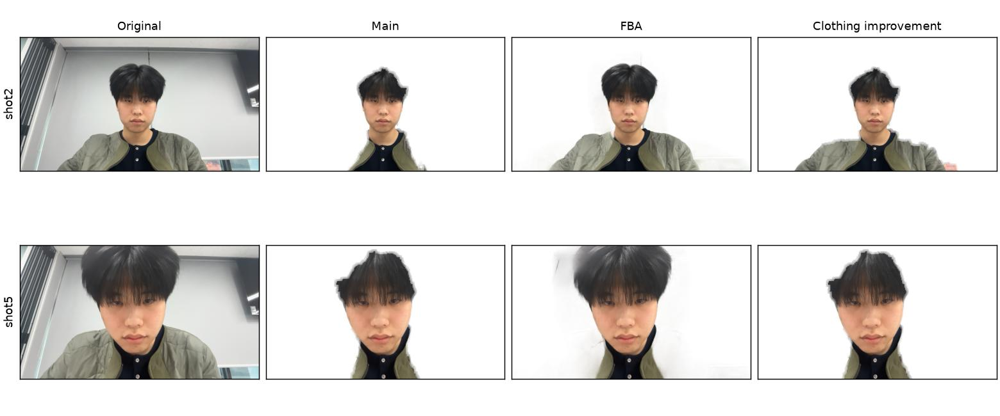
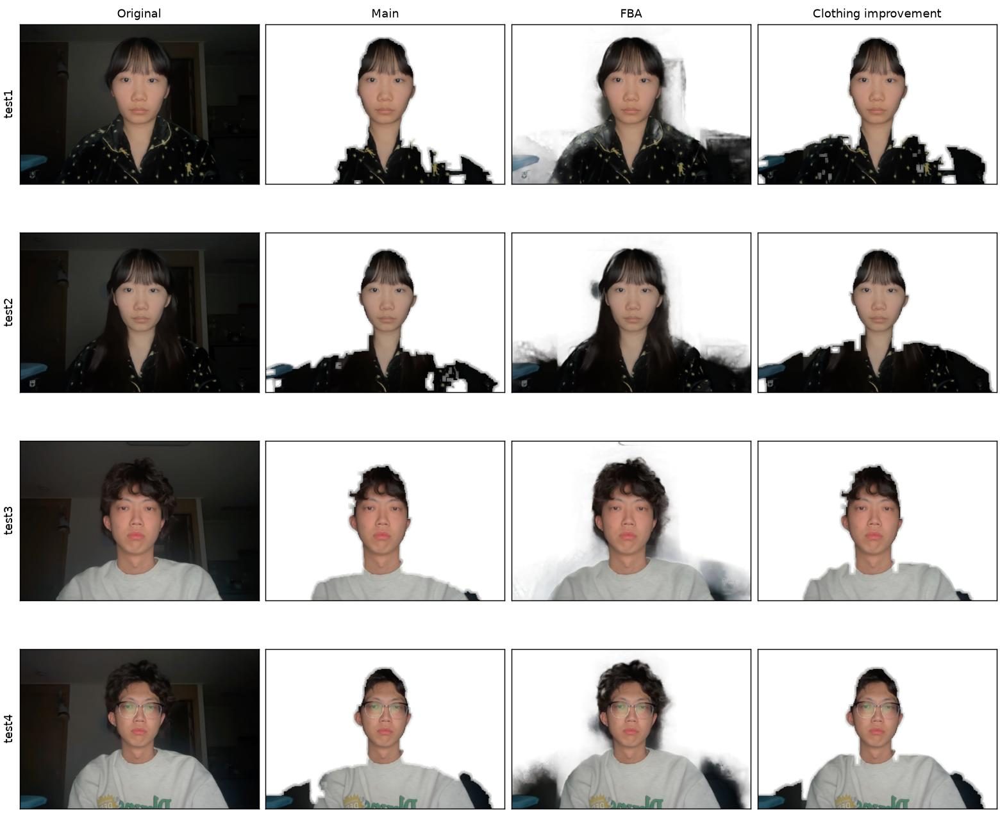
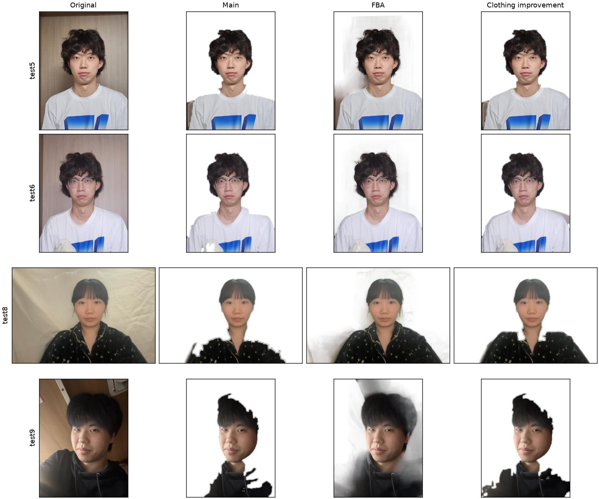
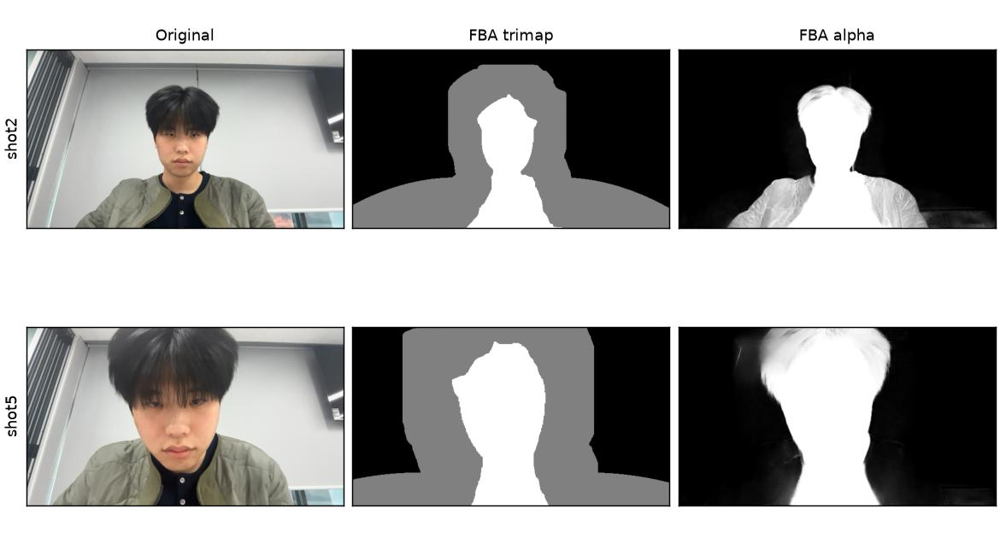

[English](README.md) | [한국어](README_kr.md)

# Module B 옷 영역 복원 실험



*위에서부터 shot2, shot5. 왼쪽부터 **Original**(원본), **Main**(기존 main 처리 결과), **FBA**(FBA 모델 결과), **Clothing improvement**(옷 복원 개선 결과)입니다. FBA에는 Main의 alpha 마스크와 얼굴 랜드마크로 자동 생성한 트라이맵(인물·배경·미확정 영역 구분)을 입력했습니다. 결과 세 열의 합성 배경은 흰색입니다.*



*위에서부터 test1–test4. 열 순서는 같습니다.*



*위에서부터 test5, test6, test8, test9. 열 순서는 같습니다.*

기존 배경 분리 과정이 익숙하지 않다면 먼저 [Module B 배경 분리 설명](https://github.com/hanbin5/relight/blob/module-b/matting/README_kr.md)을 읽어 주세요. 이 문서는 기존 과정을 반복하지 않고, 빠진 옷을 복원하기 위해 시도한 방법과 그 결과를 설명합니다. 변경은 오프라인 실험에만 머물지 않고 앱의 `idphoto/matting.py`에 적용되어 있습니다.

여기서 **사람 prior**는 얼굴 랜드마크로 사람이 있을 만한 위치를 가정한 것이고, **gate**는 그 위치를 제한하는 영역입니다. **색 표본 후보**는 색 모델을 만들 때 뽑을 수 있는 픽셀이며, **alpha**는 0이면 배경, 1이면 인물, 그 사이면 두 색이 섞이는 정도입니다. 앱은 옷을 의미적으로 인식하는 분할 모델을 쓰지 않으며, FBA는 오프라인 학습 모델 기준선입니다.

## 전체 데이터셋 평가: 사진 파일 12개

`docs/evaluation/test`의 `shot2`–`shot5`, `test1`–`test6`, `test8`, `test9`를 비교했습니다. `docs/evaluation/crown-crop/originals/`의 네 사진은 `shot2`–`shot5`와 바이트 단위로 같아 다시 세지 않았습니다.

12개 파일이 서로 독립적인 12개 장면은 아닙니다. `shot2`–`shot4`는 같은 장면의 비슷한 사진이므로 비교 그림과 트라이맵 그림에는 대표인 `shot2`만 보여 주고, 구도가 다른 `shot5`는 유지했습니다. 표와 CSV에는 12장 모두 남아 있습니다.

기존 기준선은 main의 `e96bb08cb678634207ea3aa45f086152c4c96f11`, 개선된 코드는 `06ec619158d68d7c3417fd47ce8fd3703ae269ca`입니다. 추가한 FBA 기준선은 main 기준선과 랜드마크에서 만든 트라이맵을 사용해 옷을 포함한 **너비 640 px 전체 프레임**을 처리합니다. 앞선 머리 crop 전용 FBA 결과가 아닙니다. 같은 입력과 랜드마크를 사용하고 relighting strength는 0, 합성 배경은 흰색으로 맞췄습니다. 앱 결과는 각각 새 `Matter`에서 `update=False`로 실행해 이전 사진의 색 모델을 이어받지 않았습니다.

**실제 사진에는 정답 마스크가 없습니다.** 표의 숫자는 main alpha가 0.5 이하이고 개선 후 0.5를 넘은 픽셀 수이며 FBA와의 비교 수치가 아닙니다. 실제 옷 픽셀 수, 정확도, 재현율이 아니며 추가된 배경도 포함합니다. 사진 크기가 달라 서로 다른 사진의 숫자를 품질 점수처럼 비교할 수도 없습니다. 관찰은 라이브 결과 기준이고, 좌우는 사진을 보는 방향입니다.

| 사진 | 개선 후 추가: 라이브 | 개선 후 추가: 전체 격자 | 개선 후 라이브 결과와 남은 문제 | FBA 라이브 관찰 |
|---|---:|---:|---|---|
| shot2 | 15,927 | 5,355 | 카키 재킷이 많이 돌아왔지만 바깥 소매와 작은 밝은 구멍이 남습니다. | 재킷과 머리가 더 넓게 남지만 재킷 일부가 반투명합니다. |
| shot3 | 7,916 | 14,472 | 양쪽 재킷이 더 남지만 왼쪽 소매는 상당 부분 빠집니다. | 재킷이 더 남지만 왼쪽은 일부 투명하고 배경도 조금 남습니다. |
| shot4 | 6,699 | 6,157 | 재킷 바깥이 늘지만 오른쪽 방 물체도 남습니다. | 재킷 대부분이 남지만 오른쪽 배경도 일부 남습니다. |
| shot5 | 0 | 0 | 근접 촬영으로 옷 표본이 없어 추가 복원을 건너뜁니다. | 머리는 더 넓게 남지만 재킷 상당 부분은 여전히 사라집니다. |
| test1 | 26,880 | 10,719 | 검은 무늬 상의가 늘지만 어깨 구멍과 어두운 배경 누출이 남습니다. | 머리와 옷이 더 남지만 방 물체와 배경 안개가 뚜렷합니다. |
| test2 | 15,067 | 16,128 | 무늬 상의가 늘지만 옆의 어두운 물체도 계속 연결됩니다. | 머리와 옷이 남지만 양옆에 어두운 방 물체와 안개가 남습니다. |
| test3 | 7,138 | 7,011 | 목·어깨 주변 회색 상의가 늘지만 목 옆 패임이 남습니다. | 머리와 어깨가 더 온전하지만 오른쪽 배경 안개가 남습니다. |
| test4 | 7,185 | 7,109 | 어깨 주변 상의가 늘지만 파란 물체와 옆의 어두운 배경이 남습니다. | 머리와 어깨가 더 온전하지만 양옆의 어두운 물체도 남습니다. |
| test5 | 12,618 | 12,714 | 오른쪽 흰 어깨가 돌아오지만 왼쪽 벽 조각은 그대로 남습니다. | 상의가 남지만 벽 질감과 왼쪽의 어두운 벽 조각도 남습니다. |
| test6 | 11,753 | 12,569 | 흰 상의 바깥이 늘지만 어깨 뒤 벽도 새로 포함되는 퇴행이 있습니다. | 상의가 남지만 머리 뒤에 희미한 벽 질감이 남습니다. |
| test8 | 15,664 | 14,794 | 검은 소매 바깥이 돌아오지만 칼라 패임과 각진 경계가 남습니다. | 상의가 더 온전하지만 천 배경의 안개가 남습니다. |
| test9 | 34,428 | 15,183 | 어두운 후드가 늘지만 그림자 쪽 누락, 배경 연결과 잘린 머리 경계가 남습니다. | 머리와 후드가 더 넓게 남지만 넓은 배경 안개가 남습니다. |

### 재킷: shot2–shot5

shot2에서는 기존에 거의 사라졌던 카키 재킷이 더 남지만, 모든 소매가 복원되거나 배경이 완전히 제거된 것은 아닙니다. shot5에서는 얼굴이 화면을 크게 차지해 표본 후보가 0개이므로 기존 결과가 그대로 남습니다.

### 어두운 방: test1–test4

test1과 test2에서는 더 넓은 검은 상의와 함께 방의 어두운 물체도 남습니다. 단순히 마스크가 커졌다는 사실만으로 옷을 정확히 분리했다고 판단할 수 없는 사례입니다.

### 밝은 벽과 다른 자세: test5, test6, test8, test9

test5의 오른쪽 흰 어깨는 전보다 넓어졌지만, test6에서는 어깨 뒤의 밝은 벽까지 새로 따라 들어옵니다. 비슷한 색의 옷과 벽을 구분하는 문제는 해결되지 않았습니다.

### FBA 기준선과 트라이맵

FBA는 사진만이 아니라 확정 전경·확정 배경·미확정 영역을 구분한 **트라이맵**을 함께 받아 전경, 배경과 alpha를 추정합니다. 여기서는 main alpha를 0.5로 이진화한 뒤 얼굴 너비의 0.06배만큼 침식한 안쪽과 얼굴 마스크를 확정 전경으로 지정합니다. 이진 마스크를 얼굴 너비의 0.5배만큼 팽창한 바깥은 확정 배경으로 지정하되, 턱 아래 랜드마크로 잡은 넉넉한 몸통 영역 안은 확정 전경을 제외하고 미확정으로 둡니다. 몸통 영역의 반폭은 턱부터 눈–턱 거리만큼 내려가면서 얼굴 너비의 1배에서 3.5배까지 정규화 거리의 제곱근에 따라 넓어집니다. 침식과 팽창에는 정사각형 창을 쓰며 반경은 픽셀 단위로 반올림하고 최소 1 px로 둡니다.



*왼쪽부터 Original / FBA trimap / FBA alpha입니다. 트라이맵의 흰색은 확정 전경, 검정은 확정 배경, 회색은 미확정입니다. 넓은 회색 몸통 영역에는 옷뿐 아니라 배경도 포함됩니다. 나머지 사진은 [어두운 방 트라이맵](docs/evaluation/clothing/fba/trimap-2.jpg), [그 외 트라이맵](docs/evaluation/clothing/fba/trimap-3.jpg)에서 볼 수 있습니다.*

이는 **main 마스크와 랜드마크에 조건화된 FBA**이며 독립적인 자동 분할 기준선이나 사람이 수정한 트라이맵이 아닙니다. 배경을 확정 전경으로 잘못 지정하면 지울 수 없고, 옷을 확정 배경으로 지정하면 복원할 수 없습니다. 넓은 몸통 미확정 영역은 기존 마스크 바깥 소매를 FBA가 판단할 기회를 주지만 벽 누출도 허용합니다. 라이브 트라이맵의 미확정 비율은 31.1–59.7%, 중앙값 42.5%로, 입력의 특성이지 품질 점수가 아닙니다. 예를 들어 shot2–shot4에서는 FBA가 재킷을 더 남기지만 shot5의 재킷은 여전히 사라지고 test1/test9에는 넓은 배경 안개가 남습니다.

FBA도 앱 비교와 같은 640 px 입력을 쓰며 CPU 스레드 4개, 타일 크기 1024 px로 처리했습니다. 12장 모두 타일 하나에 들어가며, 8의 배수가 되도록 패딩해 입력 픽셀 격자를 유지합니다. 확정 트라이맵을 강제하고 FBA가 추정한 전경과 alpha를 sRGB에서 흰 배경에 합성했으며 추가 후처리는 하지 않았습니다. 앱은 선형광 합성과 자체 spill 제거를 사용하므로 합성 색상까지 완전히 같은 조건은 아닙니다. 라이브 FBA 처리 시간은 중앙값 277 ms, 범위 226–1,326 ms의 단일 실행값이며 모델 로딩, 트라이맵 생성, 랜드마크 검출과 트라이맵에 필요한 main 마스크 생성은 제외합니다. 전체 파이프라인 시간이나 실시간 성능을 뜻하지 않습니다.

라이브는 640 px 입력에서 색 판정과 필터 계수를 **절반 격자 `s=2`**로 계산합니다. 전체 격자는 **같은 640 px 입력**에 촬영 알고리즘의 `s=1`을 적용하고 해당 main alpha에서 FBA 트라이맵을 다시 만든 비교입니다. [전체 격자 재킷](docs/evaluation/clothing/full-grid-fba/comparison-1.jpg), [어두운 방](docs/evaluation/clothing/full-grid-fba/comparison-2.jpg), [나머지 사진](docs/evaluation/clothing/full-grid-fba/comparison-3.jpg)을 볼 수 있습니다. shot2와 shot4의 어깨는 이 경로에서 여전히 조각나고, shot3은 라이브보다 많이 추가됩니다. **원본 해상도 저장 결과를 평가한 것이 아니며**, 두 경로의 경계가 같다는 뜻도 아닙니다.

전체 격자 FBA 트라이맵과 alpha도 [재킷](docs/evaluation/clothing/full-grid-fba/trimap-1.jpg), [어두운 방](docs/evaluation/clothing/full-grid-fba/trimap-2.jpg), [나머지 사진](docs/evaluation/clothing/full-grid-fba/trimap-3.jpg)에서 볼 수 있습니다. 기존 main과 개선 후의 라이브 alpha 비교도 [재킷](docs/evaluation/clothing/comparison-1.jpg), [어두운 방](docs/evaluation/clothing/comparison-2.jpg), [나머지 사진](docs/evaluation/clothing/comparison-3.jpg)에 남겨 두었습니다. 이 그림의 열은 Original / Main / Clothing improvement / Main alpha / Clothing improvement alpha 순입니다.

[라이브 CSV](docs/evaluation/clothing/measurements.csv)와 [전체 격자 CSV](docs/evaluation/clothing/full-grid/measurements.csv)에는 12장 각각의 임계값, 표본 후보 수, 적용 여부와 단일 실행 시간이 있습니다. 전체 합계는 라이브에서 추가 161,275개·제거 9개, 전체 격자에서 추가 122,211개·제거 6개입니다. 제거는 기존 alpha가 0.5를 넘고 개선 후 0.5 이하가 된 픽셀입니다. 이진 마스크에는 정리 **전** 추가만 하지만, 이후 정리와 guided filter를 다시 계산하면 기존 경계도 달라질 수 있습니다.

[FBA 라이브 CSV](docs/evaluation/clothing/fba/measurements.csv)와 [FBA 전체 격자 CSV](docs/evaluation/clothing/full-grid-fba/measurements.csv)에는 트라이맵 각 영역 크기, alpha 0.5 기준 main 대비 FBA의 추가·제거 픽셀, 타일 수와 처리 시간도 있습니다. 이 차이는 정답 오류 수나 옷 정확도가 아닙니다.

비교 그림은 rule 7 판정과 관계없이 흰 배경 합성을 보여 줍니다. 실제 앱은 촬영 시 rule 7이 실패하면 원래 벽을 유지할 수 있으므로 그림이 곧 저장 결과라는 뜻은 아닙니다.

## 1. 왜 옷이 빠졌나

기존 gate는 두 역할을 함께 합니다. 점수 단계에서 gate 밖은 사람이 있을 수 없다고 판정하면서 동시에 배경 색 표본 후보로 씁니다. 어깨가 가정보다 넓으면 옷이 잘리는 데 그치지 않고, 그 옷이 배경 모델에도 들어갈 수 있습니다.

앞선 [배경 분리 실패 분석](https://github.com/hanbin5/relight/blob/module-b/matting/README_kr.md)에서는 test5의 오른쪽 흰 어깨 끝에서 배경 표본 약 20개가 뽑혀 흰색 군집이 생겼습니다. shot2에서는 카키 재킷이 회색 롤스크린 군집의 어두운 색과 비슷했고, 랜드마크로 잡은 어깨 바깥 영역의 마스크 포함 비율이 59%였습니다. 이 수치는 **이전 원본 해상도 분석의 영역 관찰**이며 정답 옷 마스크의 재현율이 아닙니다. 위 640 px 비교와 직접 전후 수치로 연결하지 않습니다.

기존 사람 색 표본은 얼굴, 머리, 목과 좁은 가슴을 함께 표현합니다. 가슴 가운데 검은 이너가 많으면 바깥 재킷 색은 충분히 대표되지 않을 수 있습니다. 어두운 방에서는 검은 상의와 방 물체의 색이 겹칩니다. 몸통 prior가 0.7이어도 확정 인물은 아니므로 배경 색 증거와 임계값에 의해 옷이 빠질 수 있습니다.

## 2. 옷 전용 색 모델과 배경 표본 보호

### 실험 이유와 선택

처음에는 전역 어깨 gate를 위로 넓히고 가슴 표본을 확장했습니다. 옷은 더 남았지만 전역 배경·사람 모델과 Otsu 임계값이 함께 달라져 shot3과 test9의 머리 경계에도 변화가 보였습니다. 그래서 머리 색 모델을 다시 정의하는 대신 옷 점수만 따로 계산하는 방법을 선택했습니다. 이 첫 시도의 중간 코드와 그림은 보관하지 않아 독립적인 정량 비교나 재현 가능한 ablation 결과는 아닙니다.

흰 옷의 음영 허용폭도 줄이고 실제 옷 표본에 가까운 색만 추가하도록 제한했습니다. 그래도 test6의 벽 누출은 남았습니다. 기존 몸통 마스크를 새 판정으로 대체하는 대신 **근거가 있는 픽셀만 기존 마스크에 추가**해 새 구멍을 줄였지만, 기존에 잘못 포함된 배경도 그대로 남을 수 있습니다.

### 처리 흐름

1. 얼굴 랜드마크의 얼굴 너비 `fw`, 눈–턱 거리 `ec`, 중심선으로 기존보다 이른 높이에서 넓어지는 옷 탐색 영역을 만듭니다. 턱 아래 넓은 보호 구역의 픽셀은 **옷용 배경 표본 후보에서만** 제외합니다. 보호 구역 전체를 인물로 강제하지는 않습니다.
2. 턱 아래 가슴 쪽에서 옷 색 표본 후보를, 보호 구역 바깥의 기존 배경 후보에서 옷용 배경 표본 후보를 만듭니다. 예를 들어 test5 라이브 실행의 후보는 각각 20,243개와 44,745개였고, 각 모델은 그중 최대 2,000개를 사용합니다. 후보 영역에는 실제 옷이나 배경이 아닌 픽셀이 섞일 수 있습니다.
3. 옷용 전경·배경 색 모델을 별도로 만들고, 옷 탐색 영역에서 색 거리와 몸통 prior를 결합합니다. 옷 점수가 기존 Otsu 임계값을 넘고 옷 모델과의 거리가 2.5 미만인 픽셀만 추가합니다.
4. 추가 판정을 기존 이진 마스크에 합친 뒤 기존 opening/closing, 얼굴 연결, 구멍 채우기와 guided filter를 실행합니다. 기존 머리 색 모델과 원래 점수의 정의는 바꾸지 않았지만, 뒤의 연결·경계 처리 결과까지 픽셀 단위로 같다는 보장은 없습니다.


*위는 shot2, 아래는 test5입니다. 왼쪽부터 원본, 기존 배경 후보(주황), 보호 후 배경 후보(주황)와 제외된 기존 후보(파랑), 옷 표본 후보(초록)입니다. 라이브 처리 격자의 후보 전체를 입력 크기로 키워 표시한 것으로 실제 뽑힌 표본이나 최종 마스크는 아닙니다.*

test5에서 기존 배경 후보 49,352개 중 4,607개가 보호 구역 때문에 옷용 배경 후보에서 빠져 44,745개가 남습니다. 파란 영역에는 벽도 포함되며, 모두 오염된 표본이거나 모두 옷이라는 뜻은 아닙니다. 초록 영역도 옷이라고 보장된 영역은 아닙니다.

앱의 영상 처리는 NumPy로 구현했습니다. 별도의 분할·깊이 모델, 보정 프레임, 사진별 수동 영역이나 사진 이름별 임계값은 사용하지 않습니다. 얼굴 랜드마크 검출에는 기존 MediaPipe 모델을 사용합니다.

### 설정과 표본이 부족할 때

| 항목 | 설정 |
|---|---|
| 옷 탐색 영역 | 턱 + 0.2 `ec`부터 시작. 0.8 `ec`에 걸쳐 반폭이 0.6 `fw`에서 2.8 `fw`로 제곱근 형태로 증가하고 바깥 0.25 `fw`에서 감쇠 |
| 배경 표본 보호 | 턱 아래에서 위 반폭 + 0.6 `fw` 안의 기존 배경 후보를 옷용 배경 후보에서 제외 |
| 옷 표본 후보 | 턱 + 0.65 `ec`부터 + 2.5 `ec`까지. 반폭은 1 `ec`에 걸쳐 0.35 `fw`에서 1.0 `fw`로 제곱근 형태로 증가 |
| 목 보호 | 턱 + 0.65 `ec`보다 아래이거나 중심선에서 0.45 `fw` 이상 떨어진 곳만 추가 판정 |
| 옷 prior | 가장자리 0.5, 몸통 안쪽에서 최대 기존 `PRIOR_TORSO=0.7` |
| 색 모델 | 배경 8군집·옷 5군집, 각각 최대 2,000개 표본. 표본 RNG seed는 배경 3·옷 4 |
| k-means | 초기 8회, 이전 모델이 있는 업데이트 프레임은 3회 |
| 음영과 색 근거 | 옷 색의 선형 밝기 배율 0.8–1.2; 색 거리 계산에는 제곱근을 적용. 옷 모델까지의 거리는 기존 상한 2.5 미만이어야 함 |
| 임계값 | 기존 점수의 Otsu 값, 0.35–0.65로 제한 |

옷 표본 후보 또는 보호 후 배경 후보가 처리 격자에서 50개 미만이면 이 추가 판정을 건너뜁니다. 업데이트 프레임이면 이전 옷 모델도 비우며, `Matter.reset()`은 기존 모델과 옷 모델을 모두 초기화합니다. 적용 여부와 후보 수는 `ctx.stats["matting"]`에 기록합니다.

**프레임 테두리 fallback의 범위에 주의해야 합니다.** 기존 배경 또는 기존 전경 후보가 50개 미만이면 원래 코드가 배경 후보를 프레임 테두리로 바꿉니다. 이 경우 옷용 배경 후보도 그 테두리에서 보호 구역을 뺀 것이므로, 50개 이상 남으면 테두리 픽셀로 옷용 배경 모델을 학습할 수 있습니다. 표본이 반드시 깨끗한 벽이라는 보장은 없습니다.

보호된 배경 모델은 옷 점수에만 쓰입니다. 기존 머리·배경 모델, 벽 통계, 단색 벽 판정, 국소 spill 추정은 기존 정의를 유지합니다. 따라서 모든 배경 추정이 정화되었다는 뜻은 아닙니다.

## 3. 정답이 있는 합성 회귀 실험

실제 사진과 달리, 320 × 280 합성 장면의 사람 영역은 생성할 때 알고 있습니다. 더 넓고 위에서 시작하는 어깨를 만든 뒤 같은 기준선과 개선 코드를 비교했습니다. 아래 유지율은 **해당 합성 평가 영역** 중 alpha가 0.5를 넘은 비율이며 전체 사진 IoU가 아닙니다.

| 합성 평가 영역 | 평가 픽셀 | 기존 유지율: 라이브 / 전체 격자 | 개선 후: 라이브 / 전체 격자 |
|---|---:|---:|---:|
| 검은 이너 바깥 카키 재킷 | 13,932 | 0% / 0% | 100% / 100% |
| 기존 gate가 0.05 미만인 흰 소매 | 658 | 0% / 0% | 100% / 100% |
| 분리된 어두운 방 물체가 있는 검은 상의 | 26,304 | 95.38% / 95.15% | 100% / 100% |

개선 후 잘못 포함된 전경은 세 장면에서 **전체 이미지**의 약 0.013–0.016%였습니다. 배경 픽셀만을 분모로 한 비율이 아닙니다. 테스트는 평가 영역 유지율 98% 초과와 전체 이미지 중 잘못 포함된 전경 0.5% 미만을 요구합니다. 표본 보호와 가슴이 잘린 프레임에서의 warm-state 초기화도 검사합니다.

이 단순한 장면들은 의도한 회귀를 확인할 뿐입니다. 실제 사진의 정확도, 같은 색의 옷과 벽, 다양한 자세나 머리 경계의 품질을 입증하지는 않습니다.

## 4. 재현 방법과 한계

Python 3.12와 [uv](https://docs.astral.sh/uv/)가 필요합니다. 아래 평가는 추적 중인 그림과 CSV를 덮어쓰지 않도록 `out/`에 출력합니다.

```bash
uv sync --group dev
uv run python tools/fetch_model.py

uv run python tools/eval_clothing.py --sample-figure --out out/clothing-report/live
uv run python tools/eval_clothing.py --full-grid --out out/clothing-report/full-grid

uv run pytest tests/test_matting_checker.py -q
uv run pytest -q
```

각 평가 명령은 비교 그림 3장과 `measurements.csv`를 만듭니다. 그림에는 10장을 보여 주고 CSV에는 12장 모두 남깁니다. `--sample-figure`는 위의 `sample-regions.jpg`도 생성합니다. 기본 기준선은 위의 고정 main 커밋이며 `--baseline SHA`로 바꿀 수 있습니다. 도구는 Git에서 해당 버전의 `matting.py`를 읽고 현재 공통 설정을 사용하므로, 기준선 커밋이 로컬 Git에 있어야 합니다. 고정 기준선과 이 브랜치의 공통 설정 차이는 새 옷 음영 상수뿐이며 기준선 코드는 이를 사용하지 않습니다.

FBA 비교를 재현하기 전 [저자의 라이선스와 모델 안내](https://github.com/MarcoForte/FBA_Matting)를 확인하세요. 소스는 MIT 라이선스지만 공개 가중치는 **비상업적 용도로만** 사용할 수 있으며, 이 비교가 상업적 사용이나 제품 탑재를 허용하는 것은 아닙니다. 이 제한을 확인한 뒤:

```bash
uv sync --extra fba --group dev
uv run --extra fba python tools/fba_reference.py --accept-noncommercial
uv run --extra fba python tools/eval_clothing.py --fba --out out/clothing-report/live-fba
uv run --extra fba python tools/eval_clothing.py --fba --full-grid --out out/clothing-report/full-grid-fba
uv run --extra fba pytest tests/test_matting_checker.py -q
uv run --extra fba pytest -q
```

명령은 저자의 소스와 약 139 MB 가중치를 Git에서 제외된 `models/fba/`에 내려받으며 사진은 로컬에 남습니다. 어댑터는 소스 리비전 `8dd100d760186150710510ee8d78ed916cdb17a4`와 가중치 SHA-256 `f3f8a2b6cefd7200368b6008a712468ed1debc6658693db31b0f719f658a2967`을 검증하고 `weights_only=True`로 가중치를 읽습니다. FBA 실행은 4열 비교 그림 3장, 트라이맵·alpha 그림 3장과 CSV를 출력합니다. 자료나 트라이맵이 없거나 잘못되면 다른 방법으로 조용히 대체하지 않고 오류를 냅니다.

랜드마크는 이미지 모드로 검출해 기본적으로 `out/clothing-landmarks/`에 캐시하고, 각 사진의 전후 비교에 같은 값을 씁니다. 캐시는 Git에 포함되지 않습니다. 새 환경이나 새 `--cache` 디렉터리에서 다시 검출하면 랜드마크와 수치가 달라질 수 있습니다. 사진이나 얼굴을 찾지 못하면 조용히 제외하지 않고 오류로 종료합니다. `test9.jpg`는 `module-b/person-prior`의 `e8e798c8eee3118bebba4ba8f34c37808f84c250`에서 원본 그대로 가져왔습니다.

FBA 자료를 갖춘 검증에서 전체 206개, matting/checker 36개 테스트가 통과했습니다. main과 개선 후의 CSV 시간은 매팅 단계의 단일 초기 실행값으로, 이미지 로딩·랜드마크·relighting을 포함하지 않는 진단값입니다. 지연시간 보장이나 10 fps 달성을 뜻하지 않습니다.

이 변경은 **일반적인 인물 분리 해결책이 아닌 제한적인 옷 복원**입니다. shot5처럼 표본이 없으면 복원하지 못하고, test1/test2/test9처럼 색이 비슷한 물체나 test6처럼 옷에 가까운 벽은 남을 수 있습니다. 팔을 꼬거나 가슴이 가려진 경우에는 표본과 어깨 위치 가정도 틀릴 수 있습니다. 원본 해상도 저장, 실제 연속 프레임의 warm start와 랜드마크 흔들림, 지속 웹캠 성능은 평가하지 않았습니다. 수동 정답 마스크와 시간축 평가 전에는 정확도나 실사용 준비 완료를 주장할 수 없습니다.

앱의 일반 사용법은 [main의 README](https://github.com/hanbin5/relight/blob/main/README.md)를 참고하세요. 이 앱은 편집된 사진을 만들므로 여권 등 정부 신분증에는 사용할 수 없습니다.
