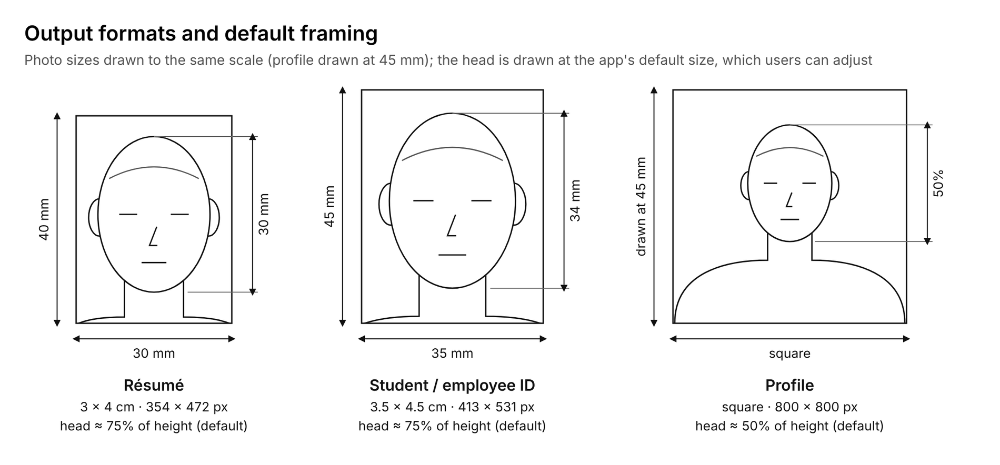
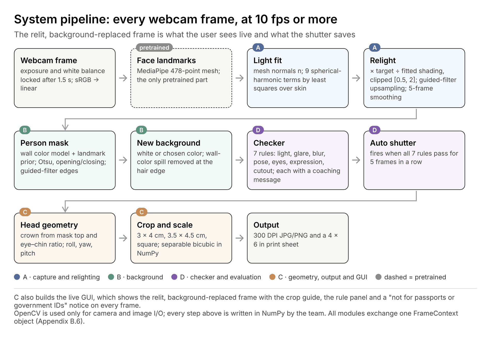
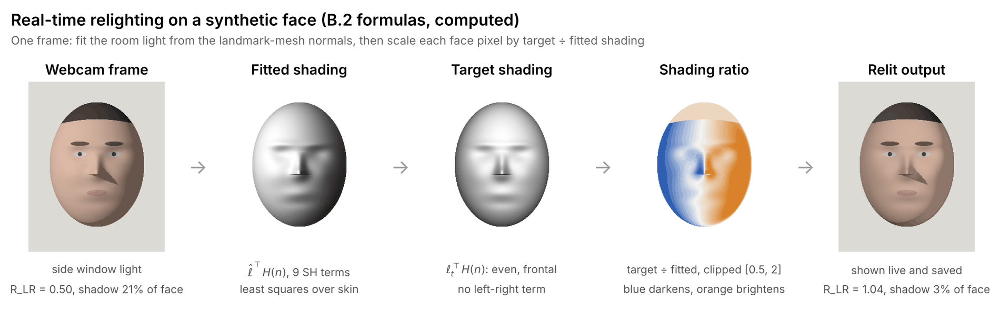
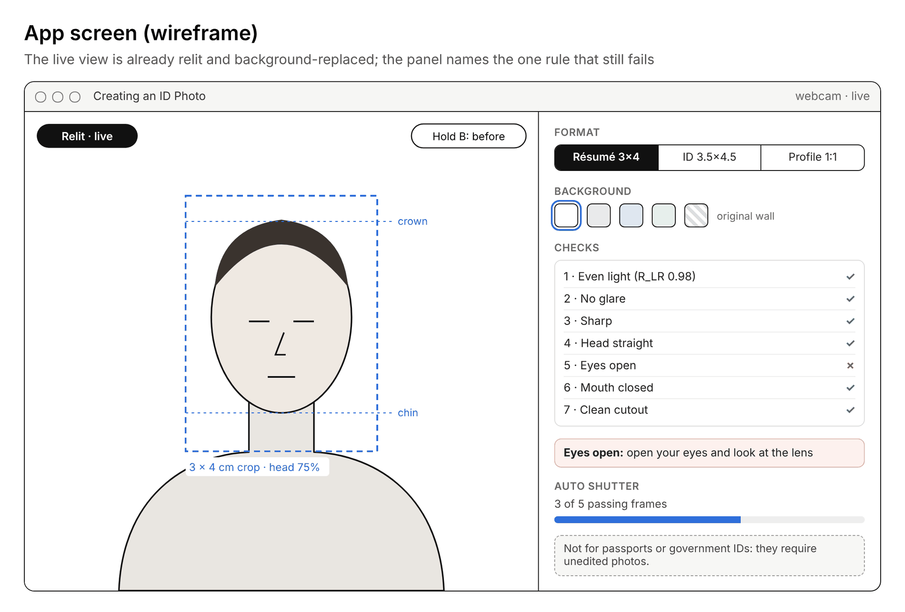
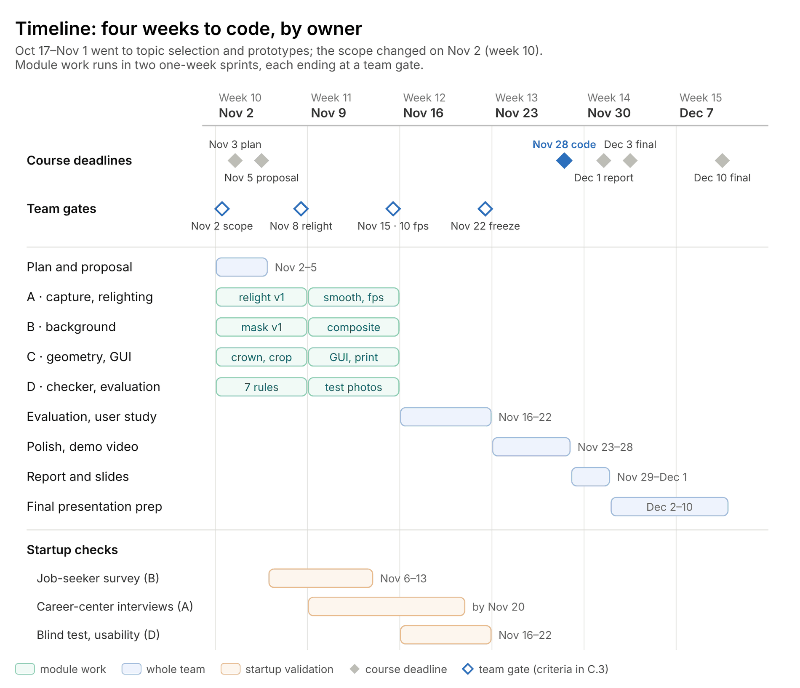

<!-- Converted from "Creating an ID Photo — Survey & Plan (v2).docx" on 2026-11-02. Figures are in images/. -->

# Creating an ID Photo — Survey & Plan

## Team

**Team <mark>[TBD: number]</mark> · <mark>[TBD: team name]</mark> · Global · Startup**

We are a global team of Korean and international students, and we add a startup plan (2.7). The team leader presents the proposal on Nov 5. Each member owns one module and one validation task (2.4).

| Member | Name (English) | Home country | Module | Validation task |
|:---|----|----|----|----|
| A (leader) | <mark>[TBD]</mark> | <mark>[TBD]</mark> | Capture and real-time relighting | Interviews with university career centers |
| B | <mark>[TBD]</mark> | <mark>[TBD]</mark> | Background separation and replacement | Survey of job seekers |
| C | <mark>[TBD]</mark> | <mark>[TBD]</mark> | Geometry, output, GUI (Korean/English) | Collecting photo formats from companies and schools |
| D | <mark>[TBD]</mark> | <mark>[TBD]</mark> | Checker and evaluation | Blind rating and usability test |

## Overview

We will build a webcam ID photo app for résumés, student and employee IDs and profile photos. It relights the live view to an even studio light in real time, replaces the background and checks pose and expression before the shutter, so the user sees the final photo live instead of retaking it.

We deliberately leave out passports and other government IDs. They reject edited photos, and a relit photo is an edited photo (A.1), so the app says on screen that its photos are not for those documents.

The core methods are implemented by the team: real-time relighting from the face landmark mesh, background separation and replacement from a single frame, and a rule-based photo checker. Only face landmark detection uses a pretrained model, as a supporting tool.

## 1. Survey

### 1.1 Background: which ID photos may be edited

Korean life runs on small ID-style photos, but they fall into two groups. Government documents (passport, residence card, resident registration card, driver’s license) and exam forms that follow passport rules reject edited photos, and several now compare the face against earlier photos. Résumés, student and employee IDs and profile photos have no such rule, and Korean employers may still ask for a résumé photo for identification ([Fair Hiring Procedure Act](https://mobile.newsis.com/view/NISX20190716_0000711988)). This project serves the second group only. Full comparison: Appendix A.1.

*Figure 1. The three output formats, drawn to scale, with the default head size*

Home photos fail mostly on light. Room lights sit overhead and windows light one side, which leaves shadows across the face. Studios fix this with lighting and retouching, and AI profile apps by regenerating the face; we fix the light itself and keep the face.

### 1.2 Existing services

Job seekers today choose between a studio shoot, freelance retouching of a phone photo, an AI profile generator or a phone app with beauty filters. Studios are costly and need a visit; AI profiles are cheap but may not look like the person; phone apps adjust tone and skin but cannot remove a shadow cast by a side window. Comparison table and sources: Appendix A.2.

### 1.3 Gap and our contribution

No existing tool relights the live view of a home webcam while keeping the face’s own pixels. That is our contribution; Appendix A.3 lists the prior work behind each building block.

1. **Real-time relighting without training.** Each frame, we fit the room light on the face from the landmark mesh with nine spherical-harmonic terms and scale every pixel by the ratio of an even target shading to the fitted one. The user sees the relit photo live, before the shutter. Prior ratio-image relighting is used offline or to train a network ([Zhou et al., ICCV 2019](https://openaccess.thecvf.com/content_ICCV_2019/html/Zhou_Deep_Single-Image_Portrait_Relighting_ICCV_2019_paper.html)); we run it per frame with no network and keep skin texture, because only a smooth shading ratio changes.

2. **Single-frame background separation and replacement.** We separate the person from one frame with a wall color model and a landmark prior, refine the hair edge with a guided filter, and composite a new background, without a pretrained segmentation model. rembg serves as the baseline.

3. **A capture-time checker with reasons.** Each frame gets seven interpretable measures and a pass or fail that names the failing rule (Appendix B.4); the shutter fires only when all pass.

We do not claim that our photos look better than AI-generated profiles. We claim photos that still look like the person, with even light from any room, and we will measure both identity and lighting.

## 2. Plan

### 2.1 Objectives and scope

By Nov 28 we will deliver a Python desktop app that turns a webcam session into ready-to-use photos in three formats: résumé (3 × 4 cm), student or employee ID (3.5 × 4.5 cm) and a square profile photo, plus a printable sheet. OpenCV is used only for camera and image I/O; all image processing is written with NumPy by the team.

Must-haves are real-time relighting, single-frame background separation and replacement, the seven-rule live checker, an auto shutter, and crop and print output for all three formats. Lighting style presets, more background colors and job-portal pixel sizes are stretch goals. Passports and other government IDs, and mobile or web versions, are out of scope (Appendix B.1).

### 2.2 System design

Every frame passes through the same pipeline, and the relit, background-replaced frame is both the live view and the saved photo. Course topics used: point operations (gamma, ratio images), least-squares fitting, spatial filtering (Laplacian, guided filter), color-based segmentation, Otsu thresholding, morphology and geometric transforms.

*Figure 2. System pipeline and module owners*

Figure 3 runs the relighting formulas of Appendix B.2 on a synthetic face lit by a side window. The cheek balance R_LR rises from 0.50 to 1.04 and the shadowed share of the face drops from 21% to 3%. The nose’s cast shadow stays, because nine spherical-harmonic terms only model smooth shading; the checker catches such cases (C.4). Real webcam results follow at the Nov 8 gate.

*Figure 3. Relighting one frame, computed on a synthetic face*

*Figure 4. App screen (wireframe)*

Formulas, checker rules, crop geometry, starting values and the shared data format are in Appendix B.2–B.6.

### 2.3 Evaluation plan

Every claim is tested against a baseline: cheek balance within ±10% after relighting versus the unrelit frame, face-embedding similarity to the unrelit frame above that of an AI-generated profile, at least 32 of 50 blind raters preferring the relit photo, mask IoU of at least 0.95 versus rembg, at least 90% recall per checker rule, fewer retakes than the current workflow, and at least 10 fps on a laptop CPU. Data, baselines and statistics: Appendix C.1.

### 2.4 Team roles

Each member owns one module with its own demo and metric, plus one validation task:

- **A:** capture and real-time relighting
- **B:** background separation and replacement
- **C:** geometry, output and GUI
- **D:** checker and evaluation

Our international members each own a module, not translation; the Korean/English interface is part of module C. Full role table: Appendix C.2. Shared data format: Appendix B.6.

### 2.5 Timeline

*Figure 5. Project timeline by owner, Nov 2 to Dec 10, 2026*

Oct 17 to Nov 1 went to topic selection and prototypes. On Nov 2 we narrowed the scope to photos that may be edited, after confirming that passports and other government IDs reject edited photos (A.1). Module work then runs in two one-week sprints: first versions by the Nov 8 gate, when relighting must even out real webcam frames without changing how the face looks, and integration at 10 fps by the Nov 15 gate. Nov 3, Nov 5, Nov 28, Dec 1, Dec 3 and Dec 10 are course dates; the other dates are ours. Pass criteria for each gate: Appendix C.3.

### 2.6 Risks and mitigation

The main technical risk is that relighting leaves hard shadows or looks flat: nine spherical-harmonic terms cannot remove a cast shadow such as the nose’s (Figure 3). The checker flags any remaining shadow and asks the user to turn toward the light, and a strength setting keeps the result natural. The main product risk is misuse for official documents, which we address with an on-screen notice and by offering no passport or ID-card templates. Other risks (exposure lock, flicker, mask failures, privacy) and their fallbacks: Appendix C.4.

### 2.7 Startup plan

Our first customers are job seekers who need résumé photos. We sell studio-like even light at home, in a photo that still looks like the user, with résumé, ID and profile formats from one sitting.

About 600,000 young people outside the labor force were preparing for employment exams in May 2026, and job-seeking young adults report spending about 580,000 KRW a month on job preparation. Our revenue hypotheses, a per-bundle fee and a license for university career centers, are tested by a survey, interviews and a blind test with pass criteria fixed in advance. Market data, pricing and the validation table: Appendix D.

## References

**Photo rules and scope**

1. Ministry of Foreign Affairs (Korea). [Passport photo guide, Jan 2018 revision (PDF copy)](https://art.mokpo.go.kr/contents/13435/passport_photo_2020.pdf).
2. Korea Immigration Service. [Photo specification for foreigner registration](https://www.moj.go.kr/sites/immigration/file/photo-size.html).
3. Ministry of the Interior and Safety, via Korea.kr. [AI profile photos cannot be used for resident registration cards](https://www.korea.kr/news/policyNewsView.do?newsId=148918984).
4. Korean National Police Agency and KoROAD, via Korea.kr (reposted). [Online photo change for driver’s licenses](https://dazabi.com/insurance_magazine/article.php?id=30624).
5. Naeil Education. [CSAT photos follow passport photo rules](https://file.naeiledu.co.kr/uploadfile/20250909/115153_008큐엔에이_ok_m.pdf).
6. U.S. Department of State. [Passport photo requirements](https://www.travel.state.gov/en/passports/apply/help/photos.html).
7. Newsis, 16 Jul 2019. [Revised Fair Hiring Procedure Act takes effect](https://mobile.newsis.com/view/NISX20190716_0000711988).

**Existing services and prices**

8. Metro Seoul, 28 Oct 2014. [Job seekers’ test and résumé photo costs (Saramin survey)](https://www.metroseoul.co.kr/article/2014102800300).
9. Insight. [“Pay only 5,000 won”: a studio supporting job seekers](https://www.insight.co.kr/news/91362).
10. Bizhankook. [Studios charging job seekers 200,000 won](https://bizhankook.com/articles/11119.html).
11. Kmong. [Example freelance ID photo retouching listing](https://kmong.com/gig/764979).
12. Vogue Korea, Jun 2023. [Can AI profile photos be used on ID cards?](https://www.vogue.co.kr/?p=378614)
13. Kukinews, 28 Jun 2023. [AI profile photos cannot be used on resident registration cards](https://www.kukinews.com/article/view/kuk202306280046).

**Papers, tools and blogs**

14. R. Ramamoorthi, P. Hanrahan. [An Efficient Representation for Irradiance Environment Maps](https://graphics.stanford.edu/papers/envmap/). SIGGRAPH 2001.
15. H. Zhou, S. Hadap, K. Sunkavalli, D. W. Jacobs. [Deep Single-Image Portrait Relighting](https://openaccess.thecvf.com/content_ICCV_2019/html/Zhou_Deep_Single-Image_Portrait_Relighting_ICCV_2019_paper.html). ICCV 2019, pp. 7194–7202.
16. L. Zhang, A. Rao, M. Agrawala. [Scaling In-the-Wild Training for Diffusion-based Illumination Harmonization and Editing by Imposing Consistent Light Transport (IC-Light)](https://proceedings.iclr.cc/paper_files/paper/2025/file/1cce374fec7829c24a97ae0e91cd0999-Paper-Conference.pdf). ICLR 2025.
17. S. Sengupta, B. Curless, I. Kemelmacher-Shlizerman, S. M. Seitz. [A Light Stage on Every Desk](https://openaccess.thecvf.com/content/ICCV2021/html/Sengupta_A_Light_Stage_on_Every_Desk_ICCV_2021_paper.html). ICCV 2021, pp. 2420–2429.
18. K. He, J. Sun, X. Tang. [Guided Image Filtering](https://mlanthology.org/eccv/2010/he2010eccv-guided/). ECCV 2010.
19. D. Gatis. [rembg](https://github.com/danielgatis/rembg). MIT license, GitHub.
20. Y. Kartynnik, A. Ablavatski, I. Grishchenko, M. Grundmann. [Real-time Facial Surface Geometry from Monocular Video on Mobile GPUs](https://research.google/pubs/pub48502). CVPR Workshops 2019.
21. Google. [MediaPipe Face Landmarker guide](https://developers.google.com/edge/mediapipe/solutions/vision/face_landmarker).
22. T. Soukupová, J. Čech. [Real-Time Eye Blink Detection using Facial Landmarks](https://vision.fe.uni-lj.si/cvww2016/proceedings/papers/05.pdf). CVWW 2016.
23. A. Rosebrock. [Blur detection with OpenCV](https://pyimagesearch.com/2015/09/07/blur-detection-with-opencv/). PyImageSearch, 2015 (method credited to Pech-Pacheco et al., ICPR 2000).
24. Federal Office for Information Security (BSI). [OFIQ – Open Source Face Image Quality](https://bsi.bund.de/dok/OFIQ-e).
25. J. Deng, J. Guo, N. Xue, S. Zafeiriou. [ArcFace: Additive Angular Margin Loss for Deep Face Recognition](https://openaccess.thecvf.com/content_CVPR_2019/html/Deng_ArcFace_Additive_Angular_Margin_Loss_for_Deep_Face_Recognition_CVPR_2019_paper.html). CVPR 2019.

**Market data**

26. Nocut News, Jul 2026. [2026 youth supplement to the Economically Active Population Survey](https://nocutnews.co.kr/news/6552236).
27. Kyongbuk Maeil, 19 Oct 2026. [Job-seeking youths spend 580,000 won a month (FKI survey)](https://kbmaeil.com/article/20261019500007).

## Appendix A. Survey details

### A.1 Which ID photos may be edited

Government documents reject edited photos and increasingly match faces by software; private uses do not regulate editing. We serve only the second group.

| Photo | Issuer | Rule on editing | In scope |
|:---|----|----|----|
| Korean passport | Ministry of Foreign Affairs | Photos changed with Photoshop or similar are rejected; the photo must show the holder as they are [1] | No |
| Residence card (foreigners) | Korea Immigration Service | Photos modified with photo-editing software are rejected [2] | No |
| Resident registration card | Ministry of the Interior and Safety | Photos that can be altered or make identification hard must be redone; AI profile photos are not allowed [3] | No |
| Driver’s license | National Police Agency, KoROAD | Issuance can be limited if heavy retouching prevents face matching; new photos are compared with earlier ones by software [4] | No |
| CSAT and civil-service exam forms | KICE, exam bodies | Follow passport photo rules [5] | No |
| US passport | U.S. Department of State | No changes with software, apps, filters or AI; original photo only [6] | No |
| Résumé | Private employers | No editing rule; employers may request an ID photo for identification [7] | **Yes** |
| Student and employee ID | Each school or company | Set locally; we check each institution’s rule before listing it | **Yes** |
| Profile photo | Platforms (messenger, LinkedIn) | None | **Yes** |

Two consequences shape the design. First, the app never offers passport or ID-card templates and shows a notice that its photos are not for government documents. Second, résumé, ID and profile photos have no official head size, so we frame with a default (head about 75% of photo height for ID formats, 50% for profiles) and let the user adjust it; the defaults are tuned in the user test.

| Format                 | Canvas       | Output at 300 DPI | Default head length |
|:-----------------------|--------------|-------------------|---------------------|
| Résumé                 | 3 × 4 cm     | 354 × 472 px      | 30 mm (75%)         |
| Student or employee ID | 3.5 × 4.5 cm | 413 × 531 px      | 34 mm (75%)         |
| Profile                | square       | 800 × 800 px      | 400 px (50%)        |

### A.2 Existing services

| Service | How it works | Price | Main limit |
|:---|----|----|----|
| Photo studio | Studio light, shoot and manual retouching | About 100,000 KRW for a typical job photo [9]; a survey found about 30,000 KRW per shoot, about three shoots per job seeker [8]; up to about 200,000 KRW at premium studios [10] | Cost, booking and a visit |
| Freelance retouching | Retouches a phone photo by hand: skin, background, suit | 11,000–33,000 KRW per package in one listing [11] | Starts from a poorly lit photo; takes days |
| AI profile generator | A generative model makes studio-style photos from 10–20 selfies [13] | SNOW: 3,300–6,600 KRW in 2023 [12] | May not look like the person; not allowed on resident registration cards [3] |
| Phone camera and ID photo apps | Global tone and skin filters, background removal, size fitting | Free or low cost | Cannot remove a shadow cast by a side window |
| This project | Relights the live view from the face mesh; replaces the background; checks every frame | Per-bundle fee (to be tested, Appendix D) | Needs a webcam session; not for government IDs |

Studios and retouchers fix light by hand after the fact, and AI generators replace the face entirely. Our approach fixes only the light, live, so the result stays the person’s own photo.

### A.3 Related research

| Topic | Work | Key idea | Use in our project |
|:---|----|----|----|
| Lighting model | Ramamoorthi & Hanrahan, SIGGRAPH 2001 [14] | Diffuse shading is captured by 9 spherical-harmonic coefficients | Our light model for every frame |
| Ratio-image relighting | Zhou et al., ICCV 2019 [15] | Relit image = source × target shading ÷ source shading, with SH lighting; used to build a training set for a CNN; SH cannot model cast shadows | Our relighting step, run live without a network |
| Generative relighting | Zhang et al., IC-Light, ICLR 2025 [16] | A diffusion model regenerates the image under new light | Contrast: we keep the face’s own pixels |
| Screen as light stage | Sengupta et al., ICCV 2021 [17] | Monitor light as structured illumination; a per-user network relights the face | Contrast: no per-user capture or training |
| Edge refinement | He et al., ECCV 2010 [18] | Edge-preserving filter from a local linear model | Hair edge of the mask; upsampling the shading ratio |
| Background removal | rembg [19] | Runs pretrained U²-Net, BiRefNet and similar models | Baseline only |
| Face landmarks | Kartynnik et al., 2019 [20]; MediaPipe [21] | Real-time 478-point 3D face mesh from one camera | Our only pretrained component: normals, eyes, chin, pose |
| Eye state | Soukupová & Čech, CVWW 2016 [22] | Eye aspect ratio from landmarks | Eyes-open check |
| Sharpness | Rosebrock 2015 [23] | Variance of the Laplacian as a blur score | Blur check |
| Face image quality | OFIQ, BSI [24] | Reference quality components such as lighting uniformity and head pose | Definitions for our checks |
| Identity | Deng et al., ArcFace, CVPR 2019 [25] | Face embeddings whose cosine similarity measures identity | Evaluation only: does relighting keep the face? |

## Appendix B. Design details

### B.1 Scope

| Feature | Priority |
|:---|----|
| Real-time relighting from the face mesh, shown live and saved | Must (core contribution) |
| Single-frame background separation with guided-filter edges, and background replacement | Must |
| Live checker, 7 rules: even light, glare, sharpness, head pose, eyes open, expression, clean cutout | Must |
| Auto shutter when all 7 rules pass for 5 frames in a row | Must |
| Crop and scale for 3 formats, plus a 4 × 6 in print sheet | Must |
| On-screen and export notice: not for passports or government IDs | Must |
| Lighting style presets (for example, soft side light for profiles) | Stretch |
| Extra background colors and job-portal pixel sizes | Stretch |
| Passport and government ID templates; mobile or web version | Out of scope |

### B.2 Camera lock and real-time relighting (draft)

All values in B.2–B.5 are starting points to tune in weeks 2–4, not measured results.

Auto exposure and white balance would shift brightness and color between frames and make the relit output flicker, so module A lets the camera settle for about 1.5 s, then locks both. It checks the lock by confirming that face brightness stays steady while the user holds still. OpenCV’s exposure flag differs by backend (commonly reported: V4L2 uses 1 for manual and 3 for auto; DirectShow uses 0.25 and 0.75), so we test it on every team laptop.

Light is measured on linear pixels. After undoing the sRGB gamma, luminance and the cheek balance are:

$$
Y = 0.2126\, R_{\text{lin}} + 0.7152\, G_{\text{lin}} + 0.0722\, B_{\text{lin}}
$$

$$
R_{LR} = \frac{\mu_{L}}{\mu_{R} + \epsilon}
$$

μ_L and μ_R are the mean Y over the subject’s left and right cheek polygons from the landmarks; in an unmirrored camera image the subject’s left cheek appears on the right. A balanced face has R_LR between 0.90 and 1.10.

The landmark mesh gives a surface normal n at each face pixel. Treating skin as matte (Lambertian), module A fits the current light with nine spherical-harmonic terms H(n) by least squares over skin pixels, leaving out eyes, brows, lips and clipped pixels, and scales each frame by the ratio of an even target shading to the fitted one:

$$
\widehat{\ell} = \arg\min_{\ell}\sum_{i \in \text{skin}}\left( Y_{i} - \ell^{\top}H\left( n_{i} \right) \right)^{2}
$$

$$
I_{\text{relit}}(x,y) = I(x,y) \cdot \operatorname{clip}_{\lbrack 0.5,\, 2\rbrack}\left( \frac{\ell_{t}^{\top}H\left( n(x,y) \right)}{{\widehat{\ell}}^{\top}H\left( n(x,y) \right) + \epsilon} \right)
$$

The target light ℓ_t is even, frontal and slightly from above, with no left-right term, and is scaled to keep the mean face brightness, so a good fit brings R_LR close to 1; the clip to [0.5, 2] keeps deep shadows from turning into noise. We fit on a 128 × 128 face crop, upsample the ratio with the guided filter (B.3) and average the fitted light over the last 5 frames so the output does not flicker. Outside the face mesh the ratio fades to its face mean over a head-and-shoulders region, so hair, neck and shoulders follow the face; the background is replaced in B.3. A strength setting s ∈ [0, 1] blends the ratio toward 1 if a result looks flat.

### B.3 Single-frame matting, guided filter and background replacement (draft)

Without a light we control, the person is separated from a single frame. A plain wall is easy to model, so module B fits a color model to the upper corners of the frame, which the landmarks place outside the head, and measures each pixel’s distance from it:

$$
D(x,y) = \sqrt{\sum_{k \in \{ R,G,B\}}\left( \frac{c_{k}(x,y) - \mu_{B,k}}{\sigma_{B,k}} \right)^{2}}
$$

c_k is a pixel’s linear color in channel k, and μ_B,k and σ_B,k are the mean and spread of the corner samples in that channel. Skin, hair and a darker top lie far from a white wall; a top the same color as the wall is the hard case that rule 7 flags.

Module B then runs four steps:

1. Score each pixel by its distance D, its chromaticity shift from the wall (a wall shadow is darker but keeps the wall’s chromaticity, so it stays background) and a head-and-shoulders prior from the landmarks, with module A’s face mask as sure foreground.

2. Threshold the score with Otsu’s method, then clean it with opening and closing built from NumPy sliding windows.

3. Refine the edge with a guided filter, using the frame luminance as the guide I and the coarse mask as p:

$$
a_{k} = \frac{\frac{1}{|\omega|}\sum_{i \in \omega_{k}}I_{i}\, p_{i} - \mu_{k}{\bar{p}}_{k}}{\sigma_{k}^{2} + \varepsilon},\qquad b_{k} = {\bar{p}}_{k} - a_{k}\mu_{k},\qquad\alpha_{i} = {\bar{a}}_{i}I_{i} + {\bar{b}}_{i}
$$

4. Remove the wall color that bleeds into hair edges and composite the new background B_new:

$$
F = \frac{I_{\text{relit}} - (1 - \alpha)\,\mu_{B}}{\max(\alpha,\, 0.1)},\qquad I_{\text{out}} = \alpha F + (1 - \alpha)\, B_{\text{new}}
$$

Window means come from cumulative sums along each axis, so the cost stays O(N) for any window radius; we start with r = 15 px and ε = 10⁻³.

### B.4 Checker rules (draft thresholds)

Seven rules run on every output frame, and each returns a value, a pass or fail, and a coaching message. Landmark numbers refer to the MediaPipe 478-point mesh; thresholds are calibrated on our test set in week 5.

| Rule | Measure | Initial pass threshold | Coaching message |
|:---|----|----|----|
| 1. Even light | R_LR over the cheek polygons of the relit frame; share of face pixels darker than 0.45 × the face mean | R_LR 0.90–1.10; shadow share < 5% | “Turn a little toward the light” |
| 2. Glare | Pixels with Y > 0.94 and HSV saturation < 0.12 on the skin and around the eyes | No glare on lenses; < 1% of the face | “Glare on your glasses: tilt them or lower your chin” |
| 3. Sharpness | Variance of the 3 × 3 Laplacian on a 256 × 256 face crop | ≥ 120, calibrated per camera | “Hold still and clean the lens” |
| 4. Head pose | Roll from iris centers 468 and 473; yaw from nose tip 1 to face edges 234 and 454; pitch from points 10, 1 and 152 | Roll ≤ 2.5°; yaw ratio ≤ 0.06; pitch ratio 0.85–1.15 | “Straighten your head” or “Face the camera” |
| 5. Eyes open | Eye aspect ratio on points 33, 160, 158, 133, 153, 144 and 362, 385, 387, 263, 373, 380 | EAR ≥ 0.23 for both eyes | “Open your eyes and look at the lens” |
| 6. Expression | Inner-lip gap (13 to 14) over mouth width (61 to 291) | Lip-gap ratio < 0.03; a closed-mouth smile is allowed | “Close your mouth” |
| 7. Clean cutout | Share of uncertain mask pixels (0.1 < α < 0.9) outside the hair band; person–wall contrast at the shoulder line | < 2%; contrast ≥ 0.12 | “Move about 1 m from the wall” or “Wear a top that differs from the wall” |

The eye aspect ratio follows Soukupová and Čech, with p1 and p4 the eye corners:

$$
\mathrm{EAR} = \frac{\lVert p_{2} - p_{6} \rVert + \lVert p_{3} - p_{5} \rVert}{2\, \lVert p_{1} - p_{4} \rVert}
$$

The shutter fires once all seven rules pass for 5 frames in a row.

### B.5 Crop geometry and output sizes (draft)

Landmark 10 sits on the upper forehead, not the top of the head, so cropping from point 10 to the chin (point 152) would make heads too small. Module C estimates the crown from two cues: the top of the foreground mask on the face midline, and the proportion rule that the eyes sit about halfway between crown and chin (crown ≈ chin − k × (chin − eye line), k ≈ 2, calibrated on hand-measured photos).

$$
H_{\text{crop}} = \frac{H_{\text{head}}}{f_{\text{head}}},\qquad W_{\text{crop}} = H_{\text{crop}} \cdot \frac{W_{\text{doc}}}{H_{\text{doc}}}
$$

f_head is the default head share from A.1 (0.75 for ID formats, 0.50 for profiles), adjustable by the user. Crops are resampled with separable bicubic interpolation in NumPy; scaling is always uniform, never stretched. The print sheet is 4 × 6 in (1200 × 1800 px at 300 DPI): in landscape, ten 3 × 4 cm photos fit (five across, two down) or eight 3.5 × 4.5 cm photos (four across, two down).

### B.6 Shared data format

The shared format is one FrameContext object passed along every frame:

| Field | Type and shape | Producer | Consumers | Meaning |
|:---|----|----|----|----|
| raw_frame | uint8 (H, W, 3) | A | B, C, D | Exposure-locked camera frame |
| linear_rgb, Y | float32 (H, W, 3) and (H, W) | A | A, B, D | Linear color and luminance in [0, 1] |
| landmarks | float32 (478, 3) | C | A, B, C, D | MediaPipe face and iris points in pixels |
| normals, face_mask | float32 (H, W, 3), bool (H, W) | A | A, B | Mesh normals; face pixels as sure foreground |
| light_coeffs | float32 (9,) | A | A, D | Fitted spherical-harmonic light, averaged over 5 frames |
| relit_frame | float32 (H, W, 3) | A | B, D | Linear frame relit to the target light |
| alpha | float32 (H, W) | B | C, D | Foreground mask in [0, 1] |
| output_frame | float32 (H, W, 3) | B | C, D | Relit frame on the new background: the live view and the saved photo |
| rule_verdicts | dict per rule | D | A, C | Pass or fail, measured value, bound and coaching text |
| geometry | dict | C | C, D | Crown, chin, eye center and pose angles |

## Appendix C. Execution details

### C.1 Evaluation plan

Every claim is tested against a baseline with numbers; targets below are planned pass criteria, not results. Test photos come from consenting team members and volunteers and are deleted after the semester.

| Question | Metric | Data | Baseline | Target |
|:---|----|----|----|----|
| Does relighting even out the light? | R_LR; shadow share of the face | 10 people × 3 rooms (dim, side window, overhead light) | Unrelit frame | R_LR within 0.90–1.10 for at least 8 of 10 people in every room |
| Does it keep the face? | Cosine similarity of ArcFace embeddings to the unrelit frame (evaluation only) | Same 10 people | AI profile photo of the same person (consenting team members only) | Ours higher for at least 9 of 10 people |
| Do people prefer it? | Blind paired choice: relit vs unrelit; “which looks more like this person”: ours vs AI profile | 50 raters | Unrelit frame; AI profile | At least 32 of 50 prefer relit (sign test, one-sided p < 0.05) |
| Is the mask accurate? | IoU and boundary F-score against hand-drawn masks | 30 frames, varied hair and clothing | rembg (U²-Net human and BiRefNet portrait models) | IoU ≥ 0.95 |
| Does the checker catch faults? | Per-rule precision and recall | About 20 people × 1 good + 7 staged faults (side shadow, glare, blur, tilt, closed eyes, open mouth, top matching the wall) | OFIQ scores where a component exists | ≥ 90% recall per rule |
| Is the crop right? | Head-length error against the default; head tilt | All outputs | None | Within ±1 mm of the default |
| Does it save retakes? | Time to a usable photo; number of retakes | 10 users | Phone camera plus an existing app | Fewer retakes for at least 6 of 10 users |
| Is it fast enough? | Frames per second with relighting, matting and the checker on a laptop CPU | Team laptops | None | ≥ 10 fps |

With 10–20 people we report paired comparisons (Wilcoxon signed-rank test, bootstrap 95% intervals), not broad claims. With 50 raters, 32 preferences give a one-sided sign-test p of about 0.03, while 30 would give about 0.10. Failures are reported as they come.

### C.2 Team roles

Each member owns one module with its own demo and metric, so peer evaluation and the random presenter draw are both covered. Names are filled in under Team.

| Member | Module | Stand-alone demo | Own metric | Validation task |
|:---|----|----|----|----|
| A | Capture and relighting: webcam control, light fit, ratio relighting, smoothing | Raw and relit views side by side, live | R_LR before and after | Interviews with university career centers |
| B | Background: single-frame separation, guided filter, spill removal, compositing | Live background swap | IoU against hand masks and rembg | Survey of job seekers |
| C | Geometry and output: pose, head size, crop and scale, print sheet, Korean/English GUI | One sitting to three formats | Head-length error | Collecting photo formats from companies and schools |
| D | Checker and evaluation: rule set, test set, identity metric, user study | Pass/fail panel with reasons | Per-rule precision and recall | Blind rating and usability test |

Modules exchange data in one shared format (B.6). In rehearsals each member presents someone else’s module.

### C.3 Milestone gates

1. **Oct 25:** exposure lock works on every team laptop; FrameContext fixed; first relighting test in a dim and a bright room.

2. **Nov 2, scope decision:** keep only photos that may be edited (A.1); passports and other government IDs are dropped, and the notice is added to the must-haves.

3. **Nov 8, relighting gate:** on 10 webcam frames from a side-lit and an overhead-lit room, R_LR lands within 0.90–1.10 and the embedding similarity beats the AI-profile baseline. If not, we lower the strength, narrow the clip and coach the user toward the light.

4. **Nov 15:** relighting, matting and all seven rules run end to end at 10 fps or more; test photos collected.

5. **Nov 22, feature freeze:** at least 90% recall per rule and mask IoU of at least 0.95, or the gap documented.

6. **Nov 28 and Dec 1:** code, then report, slides and demo video submitted; final presentations on Dec 3 and Dec 10; test photos deleted after the semester.

### C.4 Risks

Every risk below has a measured check and a fallback that keeps a working app.

| Risk | Mitigation | Fallback |
|:---|----|----|
| Hard shadows (nose, glasses frames) remain, since nine SH terms model smooth shading only (Figure 3) | Rule 1 flags remaining shadow and coaches the user toward the light | Ask the user to face a window; report how often this happens |
| Relit face looks flat or unnatural | Target keeps mean brightness and a slight top light; ratio clipped; blind test | Strength setting; narrower clip |
| Relighting changes how the face looks | Only a smooth shading ratio changes; ArcFace check at every gate | Lower strength |
| Mask fails with a top matching the wall, a busy background or flyaway hair | Coaching to sit about 1 m from a plain wall; guided filter; spill removal | Keep the original wall when rule 7 fails |
| Webcam auto exposure shifts the light fit between frames | Pick webcams with manual exposure; warm up, lock, then run the hold-still test (B.2) | Average the fit over more frames |
| Relit view flickers or lags behind head motion | Fit on a 128 × 128 face crop; average over 5 frames | Keep the last good fit while the head moves |
| Users submit our photos for passports or government IDs | On-screen and export notice; no government templates | — |
| Face data privacy | Written consent; local processing and storage only; AI-profile comparison only with consenting team members; deletion after the semester | — |

## Appendix D. Startup plan details

Demand is large and persistent. In the May 2026 youth supplement to the Economically Active Population Survey, about 600,000 young people outside the labor force had prepared for employment exams in the past week, and private companies were the most common target at 34.0% [26]. In an October 2026 survey of 1,000 job seekers aged 19–34, monthly job-preparation spending averaged about 580,000 KRW and 69.3% called the cost a burden [27].

Résumé photos are a visible part of that cost. A job photo at a studio is reported at about 100,000 KRW [9], and an earlier Saramin survey found job seekers shooting about three times at about 30,000 KRW each [8]. AI profile apps are far cheaper, 3,300–6,600 KRW at SNOW in 2023 [12], but their results are reported as not looking like the person [13].

- **Value proposition:** studio-like even light at home, in a photo that still looks like you, with résumé, ID and profile formats from one sitting.
- **Revenue (assumptions to test):** a per-bundle fee, for example 2,900–4,900 KRW for all three formats and a print sheet; a license for university career centers, for example for photo corners at job fairs.
- **Competition:** studios and freelance retouchers (better finish, higher cost and slower), AI profile generators (cheaper, but the face is regenerated) and phone apps (cannot fix side light); our edge is relighting the live view while keeping the face.
- **Global:** our international members build the Korean/English interface; international graduates looking for jobs in Korea are a later segment.

| Validation activity | Owner | When | Pass criterion | If it fails |
|:---|----|----|----|----|
| Survey of job seekers on photo cost, “looks like me” versus “looks better”, and willingness to pay | B | Nov 6–13 | ≥ 50 responses; ≥ 40% would pay 2,900 KRW or more for a home résumé photo | Report the real share; test a free tier with paid print sheets |
| Interviews with university career centers | A | By Nov 20 | ≥ 2 of 3 centers open to a pilot | Record the objections; narrow the B2B claim |
| Blind rating (C.1) | D | Nov 16–22 | ≥ 32 of 50 prefer relit; ours judged more like the person than the AI profile | Report the result; reposition on identity only |
| Usability test, our app vs current workflow | D | Nov 16–22 | Fewer retakes for at least 6 of 10 users | Report the full retake data and the bottlenecks |

If a criterion fails, we report it and narrow the claim instead of hiding it.
