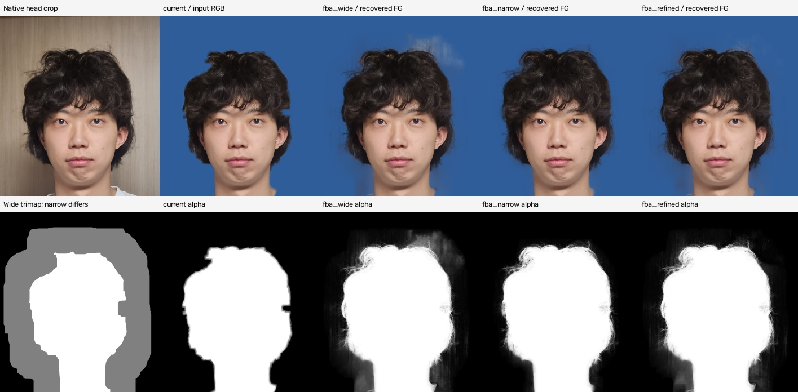
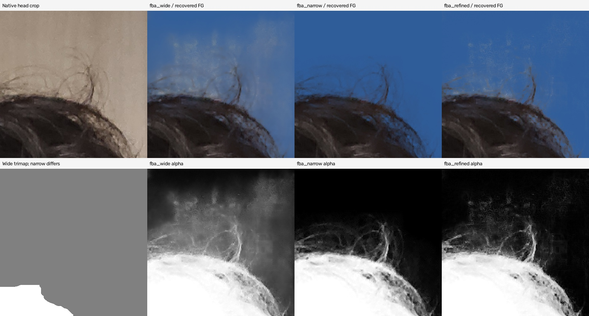

# 잔머리는 남기고 배경 잔상 줄이기

**왼쪽에서 세 번째(보정 전)와 맨 오른쪽(보정 후)을 비교하면, 정수리 위로 번진 나뭇결이 옅어지고 가는 잔머리는 일부 남는다.** 머리 위 벽 한 구역에서 배경이 인물로 남는 정도는 평균 **0.110 → 0.020(약 82% 감소)**했다. 왼쪽 벽의 잔상은 거의 그대로였고, 일부 잔머리도 약해졌다. 82%는 선택한 벽 구역의 수치이지 전체 정확도는 아니다.

## 어떻게 했나

먼저 사진 속 픽셀을 **확실한 인물 / 확실한 배경 / 판단을 맡길 곳**으로 나눈다. 이 안내 그림이 **트라이맵(trimap)**이다. **FBA**는 이 안내와 원본 사진을 받아, 판단을 맡긴 곳에서 배경을 걷어냈을 때의 인물 색과 그 픽셀을 얼마나 남길지 추정하는 모델이다. 남기는 정도가 **알파(alpha)**다. `0`이면 배경이라 지우고, `1`이면 인물이라 그대로 남긴다. 그 사이 값은 가는 잔머리처럼 새 배경이 일부 비치는 곳에 쓴다. 비교 그림 아래쪽의 흑백 결과에서는 검정이 `0`, 흰색이 `1`이다.

잔머리를 처음부터 배경으로 잘라내지 않도록 **판단을 맡기는 범위는 넓게 유지**했다. 대신 모델이 만든 결과를 [`refine_hair.py`](../../tools/refine_hair.py)에서 다음과 같이 보정했다.

1. **주변 인물 색과 비교한다.** 모델이 복원한 색이 근처의 확실한 인물 색과 비슷하거나, 이미 거의 불투명한 픽셀이면 덜 깎는다.
2. **넓게 깔린 잔상만 줄인다.** 색이 다르고 반투명한 곳에서는 주변 픽셀 중 가장 낮은 알파를 기준으로 공통으로 깔린 잔상을 뺀다. 넓은 나뭇결 잔상은 같이 내려가지만, 그보다 알파가 높은 가는 선은 남을 수 있다.
3. **따로 떨어진 잔상을 걷어낸다.** 인물과 이어지지 않는 부분을 지운다. 확실한 인물과 배경은 그대로 두며, 머리 안쪽의 빈틈을 새로 채우지는 않는다.

[재현 명령과 실험 설정](../../README.md#13-넓은-영역의-fba-알파-누출-억제-실험)
