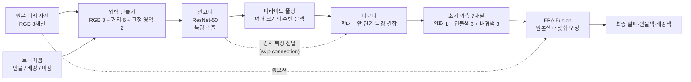

# 잔머리는 남기고 배경 잔상 줄이기

**test5 · 왼쪽에서 세 번째가 보정 전, 맨 오른쪽이 보정 후입니다.** 정수리 오른쪽 위 파란 배경의 희끗한 벽 무늬를 비교해 보세요. 보정 전 흑백 그림에서는 머리 윤곽 위에 회색 띠로 보입니다. 보정 후에는 이 잔상이 옅어지고 가는 잔머리는 일부 남습니다.

흑백 그림의 밝기는 **알파**, 즉 사진의 점(픽셀)마다 인물색을 얼마나 남길지를 나타냅니다. 검정(`0`)은 새 배경만, 흰색(`1`)은 인물색만 보인다는 뜻입니다. 잔머리 경계에서 `0.5`라면 머리카락 색과 새 배경색을 반씩 섞습니다. 인물일 확률이 50%라는 뜻은 아닙니다.

머리 위 벽의 한 구역에서 평균 알파가 **0.110 → 0.020(약 82% 감소)**했습니다. 왼쪽 벽의 잔상은 거의 그대로였고, 일부 잔머리도 약해졌습니다. 82%는 선택한 벽 구역의 수치이지 전체 정확도가 아닙니다.

## 실험에 쓴 모델 — FBA

**FBA(Foreground, Background, Alpha)**는 사진에서 인물색, 배경색, 알파를 함께 추정하는 학습 모델입니다. 인물과 배경이 한 픽셀에 섞이는 잔머리 경계를 다듬기 위해 썼습니다. 모델에는 원본 사진과 함께 **인물로 고정할 곳 / 배경으로 고정할 곳 / 모델이 판단할 곳**을 표시한 안내 지도인 **트라이맵(trimap)**을 줍니다.

## 1. 입력 — 기존 인물 마스크에서 트라이맵 만들기

먼저 **기존 배경 분리 알고리즘**([`Matter.process`](../../idphoto/matting.py))으로 첫 알파를 계산합니다. 얼굴 위치와 인물·배경의 색으로 대략적인 인물 영역을 찾고, 가이드 필터로 사진의 색 경계를 따라 윤곽을 다듬습니다.

이 **기존 알파**를 머리 영역의 원본 크기에 맞춘 뒤, `0.5`를 넘는 픽셀을 임시로 인물로 잡습니다. 이 윤곽의 안쪽과 바깥쪽에 여유를 둬 트라이맵의 세 구역을 정합니다.

*왼쪽부터 기존 이진 마스크 → 넓은 트라이맵 → 좁은 트라이맵. 트라이맵의 흰색은 고정 인물, 검정은 고정 배경, 회색은 모델이 판단할 영역입니다.*

| 구역 | 실제 기준 |
|---|---|
| 인물로 고정 | 윤곽을 얼굴 폭의 **6%**만큼 안쪽으로 줄여도 남는 곳과 얼굴 랜드마크로 잡은 얼굴 안쪽 |
| 배경으로 고정 | 윤곽을 얼굴 폭의 **25%**만큼 바깥으로 넓혀도 그 밖에 있는 곳. 좁은 비교에서는 **12%** |
| 판단을 맡길 곳 | 두 고정 영역 사이 |

## 2. 경계 추정 — FBA의 구조

FBA는 **사진과 트라이맵을 함께 보고, 인물색·배경색·알파를 한 번에 추정**하는 신경망입니다. 아래는 이번 실험에서 사용한 [저자 공개 구현](https://github.com/MarcoForte/FBA_Matting/blob/8dd100d760186150710510ee8d78ed916cdb17a4/networks/models.py)의 흐름입니다.

### 2-1. 입력 — 모델에 무엇을 알려 주나

| 입력 | 역할 |
|---|---|
| 사진 RGB 3채널 | 각 픽셀의 빨강·초록·파랑. 인코더에는 학습 시 사용한 평균과 표준편차로 정규화해 넣습니다. |
| 트라이맵 2채널 | 한 장에는 인물로 고정한 곳, 다른 한 장에는 배경으로 고정한 곳을 표시합니다. 미정 픽셀은 두 장 모두 `0`입니다. |
| 거리 정보 6채널 | 인물·배경 고정 영역까지의 거리를 각각 세 가지 범위로 바꾼 지도입니다. 고정 영역에 가까울수록 값이 크고 멀어질수록 작아져, 모델이 미정 픽셀 주변의 단서를 이용할 수 있습니다. |

저자 **공개 코드의 인코더 입력은 총 11채널**입니다. 논문 본문에서 설명한 9채널과 달리, 공개 코드는 거리 지도 6장에 고정 영역 지도 2장을 추가로 연결합니다. 거리 지도는 최근접 고정 영역까지의 거리를 구한 뒤 가까운 곳에 높은 값을 주는 곡선으로 변환합니다.

### 2-2. 인코더와 디코더 — 경계를 어떻게 찾나

1. **인코더:** 이미지 특징을 추출하는 ResNet-50이 색, 질감, 주변 형태를 여러 단계로 요약합니다. 뒤쪽 두 단계에서는 이미지를 더 작게 줄이는 대신 **팽창 합성곱**을 써서, 특징 지도의 크기를 유지하면서 넓은 주변을 봅니다. 최종 특징 지도는 입력의 가로·세로 각각 약 `1/8` 크기입니다.
2. **피라미드 풀링:** 최종 특징 지도를 `1×1`, `2×2`, `3×3`, `6×6` 크기로 각각 요약한 뒤 다시 늘려 합칩니다. 머리카락 주변의 작은 변화와 더 넓은 문맥을 함께 참고하기 위한 단계입니다.
3. **디코더:** 요약된 특징을 단계적으로 확대합니다. 확대할 때 인코더의 앞 단계 특징도 이어 붙이는 **스킵 연결(skip connection)**을 사용해, 축소 과정에서 희미해진 위치·경계 정보를 다시 참고합니다. 마지막에는 원본 사진과 트라이맵의 고정 영역 정보도 결합합니다.
4. **출력:** 픽셀마다 7개 값이 나옵니다. **알파 1개**, 인물색 RGB **3개**, 배경색 RGB **3개**입니다. 알파는 `0~1`로 제한하고, 색에도 `0~1` 범위를 적용합니다. 이는 알파만 추정하고 인물색 복원을 별도로 맡기는 방식과 다른 점입니다.

인코더와 디코더의 많은 합성곱에는 그룹 정규화와 가중치 표준화를 사용합니다. 저자 논문은 작은 학습 배치에서도 안정적으로 학습하기 위한 선택으로 설명합니다. **우리 실험에서는 공개 가중치를 사용했으며 추가 학습하지 않았습니다.**

### 2-3. FBA Fusion — 세 예측을 원본색에 맞춰 보정

한 픽셀에서 관찰한 원본색은 대략 **`알파 × 인물색 + (1 - 알파) × 배경색`**으로 표현합니다. 예를 들어 알파가 `0.5`면 추정한 인물색과 배경색을 절반씩 섞은 색이 원본에 가까워야 합니다.

네트워크가 처음 낸 세 값은 이 관계에 정확히 맞지 않을 수 있습니다. 저자 구현의 **FBA Fusion**은 원본색과 세 초기 예측을 함께 사용해 인물색 → 배경색 → 알파 순으로 한 번 보정합니다. 이는 관계를 고려하는 장치이지, 실제 머리카락이나 벽 색을 반드시 정확히 복원한다는 보장은 아닙니다.

### 2-4. 이번 실험에서의 실행

큰 머리 이미지를 **원본 픽셀 크기 그대로** 겹치는 타일로 나눠 FBA에 넣고, 겹친 예측을 부드럽게 평균합니다. 기본 타일은 `768×768`, 가장자리 여유 설정은 `96`픽셀이고 보통 `576`픽셀 간격으로 이동하므로 인접 타일이 `192`픽셀 겹칩니다. 크기가 8의 배수가 아니면 테두리를 패딩한 뒤 출력에서 걷어냅니다. test5는 16개 타일을 사용했습니다. 타일별로 보는 주변 문맥이 전체 이미지를 한 번에 처리할 때와 달라 결과도 달라질 수 있습니다.

FBA는 사진 전체를 예측하지만, 우리 실험 도구는 합친 결과에서 **트라이맵의 고정 인물은 알파 1, 고정 배경은 알파 0으로 다시 적용**합니다. 미정 구역만 모델 결과에 맡깁니다. 따라서 미정 구역이 넓으면 기존 윤곽에서 빠진 잔머리까지 살릴 가능성이 있지만, 벽 무늬도 인물처럼 남을 수 있습니다. 반대로 잔머리를 배경으로 고정하면 FBA도 되살릴 수 없습니다.

참고: [FBA 논문](https://arxiv.org/abs/2003.07711) · [저자 코드와 공개 가중치 이용 조건](https://github.com/MarcoForte/FBA_Matting/tree/8dd100d760186150710510ee8d78ed916cdb17a4). **공개 가중치는 비상업적 용도로 제한**됩니다.

## 3. 후처리 — 넓은 잔상만 줄이기

[`refine_hair.py`](../../tools/refine_hair.py)는 알파를 새로 예측하지 않습니다. **넓은 트라이맵으로 FBA가 계산한 알파**에서 배경 잔상으로 보이는 부분을 줄입니다. 좁은 결과는 비교에만 씁니다.

1. **색과 불투명도로 보호 정도를 정합니다.** FBA가 복원한 인물색을 가까운 불투명 인물 영역의 실제 색과 비교합니다. 색이 충분히 비슷하거나 **FBA가 추정한 알파가 0.8 이상**이면 이 단계에서 감쇠하지 않습니다.
2. **가까운 픽셀들의 알파 최솟값을 기준으로 깎습니다.** 보호가 약하고 주변에도 알파가 넓게 깔려 있으면 많이 줄입니다. 가는 선 옆에 알파가 낮은 픽셀이 있으면 최솟값이 작아, 선 자체를 통째로 지우지 않습니다.
3. **인물과 연결되지 않은 부분을 지웁니다.** 고정 인물·배경과 복원한 인물색은 그대로 둡니다. 머리 안의 빈틈을 채우지는 않습니다.

[재현 명령과 실험 설정](../../README.md#13-넓은-영역의-fba-알파-누출-억제-실험)
